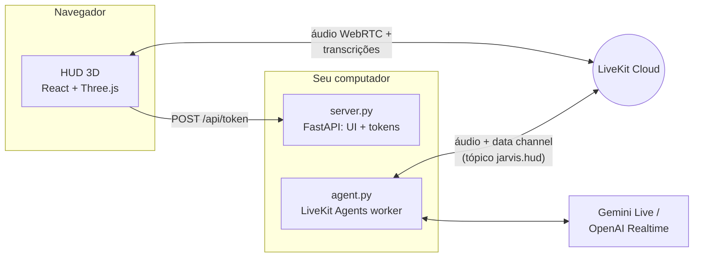

# J.A.R.V.I.S. v2

Assistente de voz em Python com persona inspirada no Jarvis do Homem de Ferro, agora com um **HUD holográfico 3D** no navegador: núcleo de energia que reage à voz, anéis rotativos, espectro de áudio, globo holográfico e painéis que se projetam quando o Jarvis usa uma ferramenta.

Short English summary: real-time voice assistant built on LiveKit Agents (Gemini Live or OpenAI Realtime) with a React Three Fiber holographic HUD. Tools push structured results to the HUD over the LiveKit data channel.

## O que tem de novo na v2

- **HUD 3D estilo Homem de Ferro** (React + Three.js): núcleo de plasma com shader, anéis com marcações, órbitas giroscópicas, disco de partículas, grade holográfica e bloom. Tudo reage em tempo real ao áudio do Jarvis e do seu microfone e muda de cor conforme o estado (ouvindo, processando, respondendo).
- **Painéis holográficos**: clima com previsão de 5 dias e globo que gira até a cidade, resultados de pesquisa, notícias, relógio mundial, diagnóstico do PC, timers com contagem regressiva, notas e rascunhos de email.
- **Novas ferramentas**: notícias, horário em qualquer cidade, diagnóstico do computador, timers que o Jarvis anuncia em voz alta e um painel livre (`show_on_hud`) para listas e resumos.
- **Transcrição ao vivo e comandos por texto** direto no HUD.
- **Modo simulação** para explorar a interface sem credenciais.
- **Controle do computador** (opcional): abrir e fechar apps, sites, YouTube e streamings, abas do navegador, mídia, volume, pastas, captura e bloqueio de tela.
- **Globo 3D com conexões**: enquanto pensa ou busca algo, o núcleo vira um globo holográfico que desenha arcos da sua cidade até os serviços consultados.
- **Seletor de microfone** e diagnóstico de captação no HUD.
- **Visão pela webcam** (opcional): o Jarvis olha pela câmera quando você pede e o HUD mostra o feed ao vivo num painel holográfico, com o aviso CÂMERA ATIVA sempre visível.
- **Assistente de tela para dev** (TEL-31): "explica esse erro", "o que tem de errado aqui?", "o que esse código faz?", "resume essa página", "traduz isso" e "copia a correção", com painel de explicação e blocos de código com destaque e botão de copiar.
- **Palavra de ativação** (opcional): diga "Jarvis" e o link abre sozinho; o silêncio o encerra para poupar a cota do Gemini. Detecção local, sem enviar áudio antes da ativação.
- **Voz e jeito do filme (VOZ-30)**: voz grave e calma configurável (`JARVIS_VOICE`, troca por comando de voz), persona de mordomo britânico com humor seco, sons de interface gerados no navegador e animações de "pensando" e "executando" no núcleo 3D.
- **Rotinas** (ROT-24): "Bom dia, Jarvis" cumprimenta, diz o clima, as manchetes e os lembretes, arruma as janelas e toca uma playlist; "modo foco", "modo jogo", "boa noite" e as rotinas que você criar por voz. Também rodam sozinhas no horário ("todo dia útil às 8h").
- **Um comando para subir tudo**: `python jarvis.py`.
- Ferramentas de rede agora rodam fora do event loop (`asyncio.to_thread`), então o áudio não engasga durante uma pesquisa.

## Arquitetura



1. O navegador pede um token em `/api/token` (com despacho do agente `jarvis`).
2. O worker (`agent.py`) entra na mesma sala do LiveKit e conversa por voz.
3. Quando uma ferramenta roda, `hud.py` publica eventos JSON no tópico `jarvis.hud`; o HUD transforma cada evento em um painel holográfico.

## Protocolos (ferramentas)

| Código | Ferramenta | Exemplo de pedido |
| --- | --- | --- |
| WX-01 | `get_weather` — clima atual + previsão de 5 dias | "Como está o tempo em Lisboa?" |
| NET-02 | `search_web` — pesquisa DuckDuckGo | "Pesquise sobre fusão nuclear." |
| NWS-03 | `search_news` — manchetes recentes | "Últimas notícias de tecnologia." |
| CHR-04 | `get_current_time` — hora local ou de qualquer cidade | "Que horas são em Tóquio?" |
| SYS-05 | `run_diagnostics` — CPU, RAM, disco, bateria, uptime | "Rode um diagnóstico do sistema." |
| TMR-06 | `set_timer` — contagem regressiva com aviso falado | "Timer de 10 minutos pro café." |
| TMR-06 | `get_timers` — quanto falta em cada timer da conversa | "Quanto tempo falta pro timer acabar?" |
| HUD-07 | `show_on_hud` — painel com listas, passos, resumos | "Mostre os passos no painel." |
| HUD-07 | `manage_hud_panels` — lista (tipo + título exibido), fecha e amplia painéis do HUD pelo tipo, pelo título ou "o último"; diz "NADA foi fechado" quando nada mudou | "Feche a aba." · "Fecha a aba de reprodução." · "Maximiza o rascunho da lista de compras." · "Fecha essas abinhas da esquerda." |
| MED-08 | `play_youtube` / `open_streaming` / `media_control` | "Toque lo-fi no YouTube." · "Abre a live do Gaules." · "Toca Guns N' Roses no Spotify." · "Pausa." |
| PC-09 | `open_app` / `close_app` / `open_folder` / `lock_computer` / `take_screenshot` | "Abra o Spotify." · "Bloqueie a tela." |
| WEB-10 | `open_website` / `browser_tab` / `save_shortcut` — com `monitor`, abre numa janela própria nessa tela | "Abre o Google Maps." · "Abre o YouTube no monitor 1." · "Feche a aba do YouTube." · "Salva esse site como portal SATC." |
| AUD-11 | `set_volume` | "Volume em 30%." |
| JAN-13 | `manage_window` / `manage_screens` — mover entre monitores pelo número do "Identificar" das Configurações ou pelo nome da tela (notebook, vertical, de cima, da esquerda, apelidos), voltar à posição anterior, maximizar, minimizar, encaixar, fechar janela; listar, apelidar e corrigir a numeração das telas | "Joga o Chrome na tela 1." · "Manda o Chrome pro monitor de cima." · "Volta pra onde estava." · "Salva a tela vertical como tela de código." · "A tela 1 é o notebook." |
| VIS-14 | `look_at_screen` — print de um monitor ou janela, mostrado no HUD e analisado | "O que tem aberto no PhpStorm?" |
| COM-12 | `check_email_address` / `draft_email` / `confirm_email_send` / `cancel_pending_email` | "Escreva um email para gabriel arroba gmail ponto com…" |
| APP-15 | `search_apps` / `prepare_app_install` / `confirm_app_install` / `cancel_app_install` — instala apps pelo winget, com código de confirmação | "Instala o VLC pra mim." |
| MIC-16 | `check_microphone` — microfone escolhido no painel Sistema, se está mudo e quando chegou som; padrões do Windows (só nomes) | "Qual microfone está conectado contigo?" |
| PWR-17 | `end_session` — despede-se e encerra o link, como o botão "Encerrar link" (não desliga o PC) | "Tchau, Jarvis." · "Jarvis, desligar." |
| CAM-19 | `look_at_camera` — foto da webcam, mostrada no painel Câmera e analisada · `camera_view` — mostra/esconde o feed ao vivo ou desliga a câmera | "O que você está vendo?" · "Que livro é esse aqui?" · "Mostra a câmera." · "Desliga a câmera." |
| LAY-21 | `manage_layouts` / `arrange_windows` — salva e aplica layouts de janelas (abre os apps que faltam e põe cada janela na tela e posição salvas), junta tudo numa tela, leva as janelas de uma tela para outra, mostra a área de trabalho e desfaz tudo de uma vez | "Salva esse layout como modo trabalho." · "Modo trabalho." · "Organiza tudo pro notebook." · "Manda tudo do notebook pro monitor de cima." · "Mostra a área de trabalho." · "Desfaz." |

Os protocolos MED, PC, WEB, AUD, JAN, VIS e LAY só existem com `JARVIS_ENABLE_PC_CONTROL=true`; COM só com `JARVIS_ENABLE_EMAIL_TOOL=true`; APP só com `JARVIS_ENABLE_APP_INSTALL=true`; CAM só com `JARVIS_ENABLE_CAMERA=true`.
| GST-18 | `gesture_control` / `gesture_shortcuts` — liga/desliga o controle de janelas por gestos das mãos (webcam), o mouse no ar e o painel de gestos (câmera + mapa das telas); lista, explica e muda o que cada gesto personalizável faz | "Liga os gestos." · "Liga o mouse no ar." · "Mostra o painel de gestos." · "Os gestos estão ligados?" · "Lista meus gestos." · "O que faz o rock?" · "Quando eu fizer joinha, pausa a música." |

Os protocolos MED, PC, WEB, AUD, JAN e VIS só existem com `JARVIS_ENABLE_PC_CONTROL=true`; COM só com `JARVIS_ENABLE_EMAIL_TOOL=true`; APP só com `JARVIS_ENABLE_APP_INSTALL=true`; GST só com `JARVIS_ENABLE_GESTURES=true` (ou `python jarvis.py --gestures`).
| MOU-20 | `click_on_screen` / `move_mouse` / `type_text` / `press_keys` / `scroll` / `do_on_screen` / `confirm_screen_action` / `cancel_screen_action` — mouse e teclado de verdade: acha o elemento num print com o Gemini, desliza o cursor até ele e clica; digita, usa atalhos liberados e rola; tarefas curtas de até 8 passos. Cliques que enviam, compram, pagam, publicam, apagam ou confirmam pedem código | "Clica no botão de play." · "Digita olá no bloco de notas." · "Rola a página." · "Abre o menu de configurações do Discord." |
| DIT-29 | `start_dictation` / `write_here` — modo ditado: tudo o que você fala vira texto no campo em foco até "fim do ditado", com vírgula, ponto, nova linha, apagar e desfazer por voz; ou uma frase só ("escreve aqui: ...") | "Jarvis, modo ditado." · "Escreve aqui: chego em 10 minutos." |

Os protocolos MED, PC, WEB, AUD, JAN e VIS só existem com `JARVIS_ENABLE_PC_CONTROL=true`; COM só com `JARVIS_ENABLE_EMAIL_TOOL=true`; APP só com `JARVIS_ENABLE_APP_INSTALL=true`; MOU e DIT só com `JARVIS_ENABLE_COMPUTER_USE=true`.
| MEM-23 | `remember` / `recall` / `forget` — memória entre conversas em `memoria.json`; o painel Memória lista e apaga | "Lembra que minha reunião de segunda é às 9." · "O que você sabe sobre mim?" · "Esquece isso." |
| TEL-31 | `explain_screen` — lê a seleção, o texto da janela em foco ou o trecho perto do cursor (print só sem texto) e explica no painel Assistente de tela · `copy_fix` — coloca o código sugerido na área de transferência | "Explica esse erro." · "O que tem de errado aqui?" · "O que esse código faz?" · "Resume essa página." · "Traduz isso pro inglês." · "Copia a correção." |
| VOZ-30 | `change_voice` — troca a voz do Jarvis (vozes do Gemini Live), lista as vozes no HUD e volta à padrão | "Troca sua voz para Orus." · "Quais vozes você tem?" · "Volta pra sua voz normal." |
| ROT-24 | `run_routine` / `list_routines` / `save_routine` / `delete_routine` / `schedule_routine` / `confirm_routine_step` — várias ferramentas em sequência, com cada passo no painel Rotina; agendamento por horário | "Bom dia, Jarvis." · "Modo foco." · "Cria uma rotina estudo que abre o Notion e põe lo-fi." · "Todo dia útil às 8h roda o bom dia." |
| PRO-28 | `set_reminder` / `list_reminders` / `cancel_reminder` / `configure_alerts` — lembretes com hora em `lembretes.json` e avisos sozinhos de bateria, CPU/RAM, downloads e disco | "Me lembra amanhã às 10h de ligar pro contador." · "Quais lembretes eu tenho?" · "Para de me avisar sobre bateria." |
| PRS-25 | `presence_control` — liga/desliga a presença pela webcam e escolhe se o PC bloqueia quando você sai | "Liga a presença." · "Não bloqueia quando eu sair." · "Pode bloquear quando eu sair." |

PRS só existe com `JARVIS_PRESENCE=true` (e precisa de `JARVIS_ENABLE_CAMERA=true`).

Os protocolos MED, PC, WEB, AUD, JAN, VIS e TEL só existem com `JARVIS_ENABLE_PC_CONTROL=true`; COM só com `JARVIS_ENABLE_EMAIL_TOOL=true`; APP só com `JARVIS_ENABLE_APP_INSTALL=true`. MEM vem ligado e some com `JARVIS_ENABLE_MEMORY=false`; ROT também vem ligado e some com `JARVIS_ENABLE_ROUTINES=false` (os passos que mexem no PC só funcionam com `JARVIS_ENABLE_PC_CONTROL=true`).
| AGD-27 | `get_agenda` / `next_meeting` — lê o Google Agenda · `prepare_calendar_event` / `prepare_calendar_update` / `prepare_calendar_delete` / `confirm_calendar_change` / `cancel_calendar_change` — cria, altera e apaga eventos com código de confirmação; painel Agenda e aviso antes das reuniões | "O que eu tenho hoje?" · "E amanhã?" · "Qual minha próxima reunião?" · "Marca dentista sexta às 15h." · "Desmarca a reunião das 10." |

AGD só existe com `JARVIS_ENABLE_CALENDAR=true` (veja [Google Agenda](#google-agenda-agd-27)).

### Memória entre conversas

Peça "lembra que eu prefiro lo-fi pra programar", "anota que minha reunião de segunda é às 9" ou "não esquece que eu moro em Criciúma". Cada fato vai para `memoria.json` (na pasta do projeto, fora do git) com categoria (perfil, preferência, pessoas, trabalho, agenda, outros) e data de criação. No começo de cada conversa, um resumo curto entra nas instruções do Jarvis, então ele já sabe seu nome, sua cidade e suas preferências.

- "O que você sabe sobre mim?" / "qual é a minha reunião?" → `recall`, com a lista no painel **Memória (MEM-23)**.
- "Esquece isso" (logo depois de guardar), "apaga o que eu falei do lo-fi" → `forget`. Se várias memórias combinarem, o Jarvis pergunta qual. "Esquece tudo que você sabe sobre mim" apaga tudo.
- "A reunião agora é às 10" → o Jarvis guarda a nova e remove a antiga (`replaces`).
- No painel Memória, o ícone de lixeira de cada item vira "Apagar?" e o segundo clique apaga (pelo agente, via RPC `jarvis.memory`).
- Dá para editar `memoria.json` à mão (`{"memories": [{"fact": "...", "category": "perfil"}]}`). Se o arquivo ficar ilegível, ele é preservado como `memoria.corrompido-<data>.json` antes de qualquer gravação.

O Jarvis entende "aba"/"abinha" na tela ou na esquerda como os painéis do HUD; só mexe em abas do navegador quando você cita o site ("feche a aba do YouTube"). Rascunhos de email aguardando confirmação e timers em andamento não somem da coluna quando chegam painéis novos.

Depois de atualizar o código, recompile o HUD com `python jarvis.py --rebuild`: sem isso o navegador continua com a versão antiga e não entende os títulos, o microfone nem o "desligar".

Serviços conhecidos (Google Maps, Gmail, Drive, Claude, ChatGPT, GitHub…) abrem direto pelo nome. Para sites seus, peça "salva esse site como …" ou edite `atalhos.json` (`{"portal SATC": "https://…"}`); esse arquivo fica fora do git.

### Rotinas (ROT-24)

Uma rotina é uma lista de passos que o Jarvis roda em sequência com as ferramentas que já existem. Diga o nome dela como comando:

| Rotina | O que faz |
| --- | --- |
| **Bom dia** ("Bom dia, Jarvis") | Cumprimenta pelo horário, diz o clima de `JARVIS_HOME_CITY`, as manchetes do dia e os lembretes de agenda da memória, aplica o layout de janelas **trabalho** e toca uma playlist lo-fi no YouTube |
| **Modo foco** | Minimiza as janelas (distrações fora da vista), volume em 15%, timer Pomodoro de 25 minutos e uma nota no HUD |
| **Modo jogo** | Abre a Steam e o Discord e põe o volume em 60% |
| **Boa noite** | Cumprimenta, salva as janelas como layout **noite**, pausa a mídia e **pergunta** antes de bloquear o PC |

- Cada passo aparece no painel **Rotina (ROT-24)** do HUD (✓ feito, ✕ falhou, ? esperando seu sim). Um passo que falha (layout que não existe, app que não abre, rede fora) não derruba os outros, e o Jarvis diz o que falhou e por quê. Um passo travado desiste depois de 60 segundos.
- O layout **trabalho** do "bom dia" é o que você salvou com "salva esse layout como trabalho" (`manage_layouts`); sem ele, o passo falha e o resto segue.
- Crie e edite por voz: "cria uma rotina estudo que abre o Notion e põe lo-fi", "coloca o Spotify no modo jogo", "muda o modo foco para 50 minutos", "apaga a rotina estudo", "quais rotinas eu tenho?".
- Agende por voz: "todo dia útil às 8h roda o bom dia", "toda sexta às 19h roda o modo jogo", "para de rodar o bom dia sozinho". Na hora, com o `python jarvis.py` aberto, o HUD conecta o link sozinho pela mesma via da palavra de ativação (abre o navegador se não houver aba), roda a rotina e o Jarvis fala o resultado. Se a conversa já estiver aberta, ela roda ali mesmo. O PC ligado até 10 minutos depois do horário ainda roda a rotina daquele dia.
- As rotinas ficam em `rotinas.json` (fora do git). Sem o arquivo, valem as quatro de fábrica; a primeira edição grava todas nele. Dá para editar à mão — cada passo é uma linha `ação: argumento`:

```json
{
  "version": 1,
  "routines": {
    "estudo": {
      "name": "Estudo",
      "aliases": ["hora de estudar"],
      "steps": ["app: Notion", "youtube: lo-fi para estudar", "timer: 50 Estudo", "volume: 25"],
      "schedule": {"days": [0, 1, 2, 3, 4], "time": "19:00", "enabled": true}
    }
  }
}
```

Ações: `greet`, `weather` (ou `weather: cidade`), `news: tema`, `reminders`, `time`, `timer: minutos rótulo`, `note: título | texto`, `layout: nome`, `save_layout: nome`, `youtube: busca`, `spotify: busca`, `stream: serviço | busca`, `site: endereço`, `app: nome`, `folder: pasta`, `volume: 0-100 | mute | unmute`, `media: stop | play_pause | next | previous`, `minimize`, `close: app` e `lock`. Os dias vão de 0 (segunda) a 6 (domingo).

Roteiro de teste ao vivo (Windows, `JARVIS_ENABLE_PC_CONTROL=true` e `JARVIS_HOME_CITY` no `.env`, `python jarvis.py --rebuild` na primeira vez):

1. Arrume as janelas de trabalho nos 3 monitores e diga "salva esse layout como trabalho". Minimize tudo.
2. "Bom dia, Jarvis" → o painel Rotina mostra os 6 passos um a um; o Jarvis fala o clima, 2 ou 3 manchetes e os lembretes, as janelas voltam ao lugar e a playlist abre.
3. "Apaga o layout trabalho" e repita o "bom dia": o passo do layout fica com ✕, o resto roda e o Jarvis diz que o layout não existe.
4. "Modo foco" → janelas minimizadas, volume em 15% e o timer de 25 minutos no HUD.
5. "Boa noite" → layout **noite** salvo, mídia pausada e a pergunta do bloqueio; responda "não" (nada acontece) e depois rode de novo e responda "sim, pode" (a tela bloqueia).
6. "Cria uma rotina estudo que abre o Notion e põe lo-fi" e depois "roda a rotina estudo".
7. "Todo dia às <daqui a 2 minutos> roda o modo foco", feche a aba do HUD e espere: o navegador abre sozinho, o link conecta e o Jarvis fala o resultado. Repita com uma conversa aberta: a rotina roda nela em até 15 segundos. No fim, "para de rodar o modo foco sozinho".

### Telas e layouts de janelas

As telas têm os mesmos números que o botão **Identificar** das Configurações do Windows (Sistema > Tela), e não os de `\\.\DISPLAYn`, que o Windows numera de outro jeito. O Windows não documenta essa numeração: o Jarvis a estima pela ordem dos caminhos do `QueryDisplayConfig` (adaptador, depois tipo de conexão: tela interna, DisplayPort, HDMI; depois o conector), a mesma heurística do módulo DisplayConfig. No setup de referência isso dá tela 1 = notebook, tela 2 = monitor vertical (DisplayPort) e tela 3 = monitor de cima (HDMI), igual ao "Identificar". Se algum número não bater, diga "a tela 1 é o notebook" (ou "os números estão certos" para confirmar); a correção fica guardada.

Cada tela também tem nome, tirado do hardware e da posição: **notebook** (tela embutida), **vertical** (em retrato), **de cima**, **de baixo**, **da esquerda**, **da direita** e **horizontal**, só quando o nome identifica uma tela só. Dá para dar apelidos: "salva a tela vertical como tela de código". Toda ferramenta com `monitor` (abrir app, site, YouTube, mover janela, ler a tela, layouts) aceita o número ou qualquer nome, e as respostas dizem as duas coisas: "agora está no monitor de cima (tela 3)".

Layouts guardam, para cada janela visível, o app, o título, a tela (pelo hardware, então continuam certos se você trocar os monitores de lugar), a posição e se estava maximizada. Ao aplicar, o Jarvis abre pelo Menu Iniciar os apps que não estão abertos (com as mesmas travas do `open_app`), reposiciona cada janela e conta o que ficou faltando; sites, pastas e janelas extras de um app já aberto não são reabertos. Aplicar um layout, juntar tudo numa tela, mover as janelas de uma tela para outra e mostrar a área de trabalho podem ser desfeitos de uma vez ("desfaz"); a janela do navegador com o HUD nunca é movida nem minimizada por essas ações em lote.

A numeração confirmada e os apelidos ficam em `telas.json`; os layouts, em `layouts.json`. Os dois ficam fora do git e podem ser editados à mão.

### Mídia: YouTube, lives, Spotify e Twitch

A regra é honestidade: cada ferramenta diz ao modelo o que de fato aconteceu ("abri", "está tocando", "só abri a busca"), e o prompt proíbe dizer que algo está tocando sem confirmação.

- **YouTube** (`play_youtube`): lê os resultados da busca e abre o primeiro vídeo, relatando o título e o canal reais e se ele está ao vivo agora. Abrir a página não confirma o áudio, então o Jarvis diz "abri".
- **Lives** (`play_youtube` com `live=true`, ou pedidos como "a live do Gaules"): usa o filtro "Ao vivo" da busca do YouTube (`sp=EgJAAQ==`) e só aceita resultados com o selo AO VIVO, preferindo o canal com o nome pedido. Se ninguém estiver ao vivo, não abre nada e consulta a página pública do canal na Twitch para oferecer a alternativa (ao vivo, reprise ou offline).
- **Twitch** (`open_streaming("Twitch", "gaules")`): abre o canal e diz se está ao vivo, passando reprise (RERUN) ou offline. Se o canal não existir, abre a busca da Twitch.
- **Spotify** (`open_streaming("Spotify", "Guns N' Roses")`): sem conta de desenvolvedor nem chave. O Jarvis acha o link da faixa ou do álbum numa pesquisa web (`site:open.spotify.com`), abre `spotify:track:…`/`spotify:album:…` no app desktop e confere o título da janela do Spotify, que mostra "Artista - Música" enquanto toca. Se o app abriu pausado, manda play só para a janela do Spotify (`WM_APPCOMMAND`) e confere de novo; se começar a tocar outra coisa, pausa de volta e avisa. Sem o app instalado, abre o Spotify Web e avisa que é preciso apertar play.
- **Fechar não é pausar**: o Jarvis guarda o título do último conteúdo que abriu. "Fecha a aba de reprodução" fecha essa aba pelo título exato (`browser_tab`), mesmo com várias abas do YouTube abertas. Se o último conteúdo foi o app do Spotify, ele indica `close_app`. `media_control` só pausa, retoma ou pula.

### Gestos das mãos (GST-18)

Controle as janelas só com a mão na frente da webcam (MediaPipe Hands, tudo local). Ligue com `JARVIS_ENABLE_GESTURES=true` e diga "liga os gestos", ou suba já ligado com `python jarvis.py --gestures`. Um aviso pequeno no topo do monitor onde você está olhando mostra o estado; ele fica sempre por cima, não rouba o foco e não captura cliques.

| Gesto | O que faz |
| --- | --- |
| 🖐 Mão aberta parada ~1 s | **Arma** os gestos (nada acontece desarmado). Sem uso por ~12 s, ou sem a mão no quadro por ~5 s, desarma sozinho. |
| ✊ Fechar a mão | **Pega** a janela em foco. |
| ✊ → mover para um lado → 🖐 abrir | **Joga** a janela para o monitor que está fisicamente naquele lado do monitor atual dela (cima → monitor de cima, baixo → notebook, esquerda → vertical). Do vertical, "baixo" vai ao notebook e "direita" ao monitor da altura da janela. O aviso mostra "→ monitor de cima" antes de soltar; abrir a mão já solta, mesmo com o polegar ainda encostado. |
| ✊ → 🖐 abrir sem mover | **Estende** (maximiza); se já estava maximizada, restaura. |
| 🖐 Palma descendo rápido e parando no quadro | **Minimiza** a janela em foco (baixar a mão até sair do quadro não conta). |
| 🖐 "Apagar o quadro" (palma de um lado para o outro, 3 traços em até 2 s) | **Desfaz** o último movimento: a janela volta para onde estava, com a mesma memória de "volta pra onde estava" da voz. |
| 👎 Polegar para baixo segurado ~1,2 s (a mão pode ficar meio fechada) | **Fecha** a janela em foco, com contagem visível; soltar antes cancela. No navegador fecha só a **aba ativa** (nunca a do HUD). |
| ✌ Dois dedos para a direita / esquerda | **Próxima / anterior aba**, só com o navegador em foco. O movimento de volta é ignorado. |
| ✌ Dois dedos parados ~1 s | Abre/fecha o **painel de gestos** (câmera + mapa das telas, veja abaixo). Também por voz: "mostra/esconde o painel de gestos". |
| ☝ Indicador parado ~1 s | Entra no **mouse no ar**: a mão move o cursor por todos os monitores (inclusive o vertical, à esquerda). Pinça ou fechar a mão rápido = clique; segurado = arrastar; palma aberta parada ~1 s = sai. Também por voz: "liga/desliga o mouse no ar". |
| ✊ → ☝ / ✌ / 3 dedos parados ~0,5 s | Com a janela pega, **manda para a tela 1, 2 ou 3** (os números do "Identificar" do Windows). O aviso mostra "→ TELA 2" enquanto conta. |

#### Gestos personalizáveis

Estes gestos disparam uma ação configurável, guardada em `gestos.json` (ignorado pelo git; só guarda o que você mudou). Os que exigem segurar mostram no aviso **o nome da ação com uma contagem** antes de executar; soltar antes cancela. Os rápidos (pinça, duas mãos) mostram o nome da ação enquanto ela roda.

| Gesto | Padrão |
| --- | --- |
| 👌 OK parado ~0,8 s (polegar no indicador, os outros três dedos esticados) | Tocar/pausar a mídia |
| 🤏 Pinça subindo / descendo | Volume +5% / −5% por degrau (cada ~1/3 de palma de movimento) |
| 🤘 Rock parado ~0,7 s (indicador e mindinho) | Aplicar o layout **"trabalho"** (salve um antes: "salva esse layout como modo trabalho") |
| 👍 Joinha parado ~0,7 s | Nada (livre para você ligar) |
| ✋📷 Palma tapando a câmera ~1 s | Mutar/desmutar o **microfone do Jarvis** na conversa de voz. Funciona mesmo desarmado; tape de novo para ele voltar a ouvir (mudo, ele não escuta "desmuta"). |
| 🙌 Duas palmas abertas se afastando / aproximando | Estender / restaurar a janela em foco |

O 🤫 "indicador nos lábios" não entrou: o detector só vê mãos (não o rosto), e um indicador parado já liga o mouse no ar. Tapar a câmera faz o mesmo papel sem confusão.

Por voz ("lista meus gestos", "o que faz o rock?", "quando eu fizer joinha, pausa a música", "o rock abre o Spotify", "o OK aperta ctrl+shift+m", "volta o rock ao padrão") ou editando o arquivo:

```json
{
  "joinha": {"tipo": "acao", "acao": "play_pause"},
  "rock": {"tipo": "app", "nome": "spotify"},
  "ok": {"tipo": "atalho", "teclas": "ctrl+shift+m"},
  "maos_afastam": {"tipo": "site", "url": "youtube.com"},
  "tapar_camera": {"tipo": "nada"}
}
```

Gestos: `ok`, `pinca_sobe`, `pinca_desce`, `rock`, `joinha`, `tapar_camera`, `maos_afastam`, `maos_aproximam`. Tipos: `acao` (`play_pause`, `next`, `previous`, `volume_up`, `volume_down`, `mute`, `unmute`, `mic_toggle`, `maximize`, `restore`, `minimize`, `undo`, `show_desktop`, `next_tab`, `previous_tab`), `layout`, `app`, `site`, `atalho` e `nada`. **Fechar, apagar e digitar nunca ficam num gesto**: atalhos como Alt+F4, Ctrl+W e Shift+Delete, teclas soltas (que digitariam) e instaladores são recusados, por voz e no arquivo; para fechar continua o polegar para baixo, que pede confirmação segurando.

Para testar e calibrar sem o agente:

```bash
python gestures.py --preview             # webcam com os pontos da mão, a pose e o estado
python gestures.py --preview --dry-run   # reconhece tudo, mas não mexe em nenhuma janela
python gestures.py --calibrate           # mede a sua mão em cada pose (grava gestos_calibracao.json)
```

No preview: `q` sai, `a` arma, `d` desarma, `m` liga/desliga o mouse no ar, `p` abre/fecha o painel de gestos (`python gestures.py --panel` já abre com ele). Se a webcam errada abrir, use `JARVIS_CAMERA_INDEX=1`. Na primeira execução o modelo de mãos do MediaPipe (≈8 MB) é baixado para `.cache/models/` e conferido por SHA-256.

#### Painel de gestos: câmera e mapa das telas

"Mostra o painel de gestos" (ou ✌ dois dedos parados ~1 s, com os gestos armados) abre um painel pequeno no canto (padrão: inferior direito do notebook, ~360×260, escalado pelo DPI daquele monitor). Ele mostra:

1. **A webcam** com os pontos da mão e o estado do gesto (o mesmo texto do aviso do topo), com os quadros por segundo.
2. **O mapa dos monitores** na disposição real do Windows (as mesmas coordenadas das Configurações: o de cima, o notebook embaixo e o vertical à esquerda, com x negativo), numerados como no "Identificar", com as janelas abertas dentro de cada monitor e miniaturas delas.
3. **Um cursor da mão** sobre o mapa. Ponha a mão sobre uma janela (ela fica com borda azul), **feche a mão** para pegá-la, leve até outro monitor (ele fica verde e o aviso diz "→ monitor de cima") e **abra a mão** para soltar. A janela vai para aquele monitor na **mesma posição e tamanho relativos** que tinha no de origem (metade esquerda continua metade esquerda, inclusive entre monitores com DPI diferente); maximizada continua maximizada. Soltar no mesmo monitor não muda nada, e o gesto "apagar o quadro" desfaz como sempre.

Como o modo mapa convive com o resto:

- **Só com o painel aberto e os gestos armados.** O cursor da mão percorre o mapa inteiro com a mesma região da câmera do mouse no ar (o centro do quadro), então não é preciso esticar o braço.
- **Punho fora de qualquer janela do mapa** continua pegando a janela em foco, com o arremesso por direção de sempre. Os outros gestos (minimizar, desfazer, abas, fechar) não mudam.
- **Mouse no ar tem prioridade.** Com o mouse no ar ligado o modo mapa fica suspenso: o mapa só mostra onde o cursor real está (seta amarela) e o punho/pinça clica como sempre. Ao sair do mouse no ar (palma parada ~1 s), o cursor da mão volta ao mapa. O painel não captura cliques do mouse de verdade (é "transparente"); quem mexe nele é a mão.
- Esconder o painel no meio de um arrasto cancela o arrasto. Desligar os gestos fecha o painel.

Desempenho e privacidade: o motor dos gestos só entrega ao painel uma cópia pequena do quadro (~220 px) e o desenho acontece em outra thread, no máximo 15 vezes por segundo e só quando algo mudou, então o loop dos gestos não perde quadros. A lista de janelas é relida a cada 1 s e as miniaturas (PrintWindow) são tiradas uma por vez, cada janela no máximo a cada 1,5 s, numa thread de prioridade baixa; apps que o PrintWindow não consegue desenhar (alguns jogos/vídeos com GPU) aparecem como um retângulo colorido com a inicial. Quadros e miniaturas ficam só na memória: **nada é gravado nem enviado**. O painel, como o aviso, fica fora dos prints do `look_at_screen`.

Configuração no `.env`:

| Variável | Padrão | O que faz |
| --- | --- | --- |
| `JARVIS_GESTURE_PANEL_CORNER` | `inferior-direito` | Canto: `inferior-direito`, `inferior-esquerdo`, `superior-direito` ou `superior-esquerdo` |
| `JARVIS_GESTURE_PANEL_MONITOR` | `notebook` | Monitor do painel: número ou nome da tela ("2", "de cima", um apelido). Sem esse monitor, vai para a tela do notebook ou a principal |
| `JARVIS_GESTURE_PANEL_OPACITY` | `0.92` | Opacidade de 0,3 a 1 |
| `JARVIS_GESTURE_PANEL_SIZE` | `360x260` | Tamanho em pixels lógicos (multiplicado pela escala do monitor) |

Roteiro de teste ao vivo (Windows, 3 monitores):

1. `python gestures.py --preview --dry-run --panel`: o painel aparece no canto inferior direito do notebook, com a câmera e a mão desenhada. Confira se o mapa tem o vertical à esquerda, o de cima e o notebook embaixo, com os números do "Identificar".
2. Abra 3–4 janelas em monitores diferentes: elas aparecem no lugar certo do mapa em até ~1 s, com miniaturas em até ~2 s. Mova uma janela com o mouse e veja o mapa acompanhar.
3. Mão aberta parada para armar; passe a mão sobre uma janela do mapa (borda azul), feche a mão, leve até o monitor de cima (fica verde, aviso "→ monitor de cima") e abra a mão: no terminal sai "(simulação) ... na mesma posição relativa". Repita para o vertical.
4. Sem `--dry-run`: arraste uma janela que ocupa a metade esquerda do notebook para o de cima e confira que ela ocupa a metade esquerda dele; depois "apague o quadro" para desfazer. Teste uma janela maximizada e uma do vertical para o notebook (DPIs diferentes).
5. ☝ indicador parado para o mouse no ar: o mapa mostra a seta amarela seguindo o cursor real e o punho clica sem pegar janelas do mapa; palma parada sai.
6. ✌ dois dedos parados ~1 s fecham o painel; "Jarvis, mostra o painel de gestos" abre de novo. Com o painel aberto, o preview deve continuar perto de 30 fps.

#### Precisão e calibração

- **Sem tremor e sem atraso**: os 21 pontos da mão passam por um filtro One Euro antes de virar pose, e o centro da mão e o mouse no ar têm o seu. Parado, o filtro segura a tremedeira; num movimento rápido ele abre na hora, então arremessos e swipes não ficam para trás.
- **Pose estável com histerese**: uma pose nova só vale depois de 4 quadros seguidos; a atual é solta com 3. Um quadro errado no meio (o detector em dúvida) não muda nada.
- **Quadros ruins são descartados**: confiança baixa do MediaPipe, mão saindo pela borda do quadro ou palma que "pula" de tamanho de um quadro para o outro valem como "sem mão". Assim, levar a mão para fora do quadro segurando uma janela cancela em vez de jogá-la.
- **Perto ou longe da câmera**: as distâncias usam o tamanho da palma. O swipe de abas, o "apagar o quadro" e o "mão parada" se ajustam à distância.
- **Calibração guiada**: `python gestures.py --calibrate` abre a webcam e pede, uma de cada vez, mão aberta, punho, pinça, indicador, dois dedos e polegar para baixo (contagem de 2,5 s, depois 2 s medindo). Ele mede as curvas dos dedos, o alcance, o polegar e a pinça da **sua** mão, põe cada limiar no meio do vão entre as poses e grava em `gestos_calibracao.json` (fica fora do git). Se os limiares medidos acertarem menos que os padrão, nada muda. No fim mostra o acerto de cada pose antes e depois. Daí em diante gestos e preview usam o arquivo; para voltar ao padrão, apague-o. Faça na distância e na luz de uso.
- **Preview**: além do estado, mostra a confiança do detector, quanto da mão está no quadro, a pose do quadro e a pose estável, avisa quando um quadro foi descartado (e por quê) e se a calibração é pessoal ou a padrão. A barra à direita é a confiança (verde, amarela, vermelha).
- **Traces de regressão**: `python gestures.py --preview --dry-run --trace meu_gesto.jsonl` grava só números (pontos, confiança, pose, comandos), nunca imagens. Para virar teste, ponha o arquivo em `tests/traces/` com uma primeira linha `{"expect": ["armed", "grab", "aim", "throw"]}` (os comandos esperados); o teste reproduz o trace no `GestureMachine` e confere. Já há traces sintéticos de casos difíceis: punho frouxo que não pode virar pinça, mão saindo do quadro e tremor.

Roteiro rápido para testar em casa (Windows, webcam do notebook):

1. `python gestures.py --calibrate`: faça as 6 poses e confira que todas terminam com acerto alto (≥ 90%).
2. `python gestures.py --preview --dry-run`: com a mão parada, a confiança fica verde e a pose estável não pisca; feche a mão devagar e confira que o punho frouxo continua `fist` (não `pinch`).
3. Arme, segure uma janela com o punho e leve a mão para fora do quadro pela lateral: deve aparecer "Cancelado", sem mover nada.
4. Repita os gestos com a mão a ~30 cm e a ~1 m da câmera: abas com dois dedos e "apagar o quadro" devem funcionar nas duas distâncias.
5. Mouse no ar (`m` no preview, sem `--dry-run`): com o indicador parado o cursor não treme; um movimento rápido chega no outro monitor sem arrastar atrás.
6. Se algo falhar, grave com `--trace`, mande o arquivo e ele vira teste.

Roteiro de teste ao vivo dos gestos personalizáveis (primeiro com `--preview --dry-run`, depois de verdade):

1. Arme (mão aberta parada) e faça 👌 parado: o aviso mostra "TOCAR/PAUSAR A MÍDIA" com contagem; com um vídeo tocando, ele pausa e volta no segundo 👌.
2. Pinça (com os outros dedos meio dobrados) e suba/desça a mão devagar: o volume muda de 5 em 5%. Veja se um 👌 parado nunca mexe no volume.
3. Salve um layout ("salva esse layout como modo trabalho"), bagunce as janelas e faça 🤘 parado: as janelas voltam.
4. Pegue uma janela (punho) e mostre 1, 2 e 3 dedos parados: ela vai para a tela com aquele número do "Identificar". Confira que abrir a mão ainda estende e que mover + abrir ainda joga para o lado.
5. Com a conversa de voz ligada, tape a webcam com a palma por ~1 s: o Jarvis para de ouvir; tape de novo e ele volta. Apague a luz do quarto sem a mão na frente: nada deve acontecer.
6. Duas palmas abertas se afastando estendem a janela em foco; se aproximando, restauram.
7. Por voz: "quando eu fizer joinha, pausa a música", "o que faz o rock?", "lista meus gestos" e "o rock fecha a janela" (deve recusar). Confira o `gestos.json` criado ao lado do projeto.

## Pré-requisitos

- Python 3.10+
- Node.js 20+ (para compilar o HUD)
- Conta no [LiveKit Cloud](https://cloud.livekit.io) (gratuita para começar)
- Uma chave de modelo:
  - `GOOGLE_API_KEY` para `gemini-realtime` (padrão)
  - `OPENAI_API_KEY` para `openai-realtime` ou `openai-compatible-pipeline`
- PortAudio apenas se quiser usar o modo `console` no terminal

## Instalação

### Windows (PowerShell)

```powershell
git clone https://github.com/GabrielMacielZavarize/Jarvis-AI.git
cd Jarvis-AI
py -3.12 -m venv .venv
.venv\Scripts\Activate.ps1
python -m pip install -r requirements.txt
copy .env.example .env
```

### Linux / macOS

```bash
git clone https://github.com/GabrielMacielZavarize/Jarvis-AI.git
cd Jarvis-AI
python3 -m venv .venv
source .venv/bin/activate
python3 -m pip install -r requirements.txt
cp .env.example .env
```

Depois preencha o `.env` (veja abaixo) e baixe os modelos locais usados pelo LiveKit:

```bash
python agent.py download-files
```

## Configuração

### LiveKit (obrigatório para conversar por voz)

Crie um projeto no LiveKit Cloud e copie as credenciais em **Settings → Keys**:

```env
LIVEKIT_URL=wss://seu-projeto.livekit.cloud
LIVEKIT_API_KEY=sua-api-key
LIVEKIT_API_SECRET=seu-api-secret
```

### Opção 1: Gemini Live (padrão, gratuito)

O modelo padrão é o **`gemini-3.8-live`**, o modelo Live estável recomendado pelo Google para agentes de voz e disponível no plano gratuito da Gemini API.

Para gerar a chave gratuita:

1. Acesse o [Google AI Studio](https://aistudio.google.com/apikey) com sua conta Google.
2. Clique em **Create API key** e escolha (ou crie) um projeto. Não é preciso cadastrar cartão.
3. Copie a chave e cole em `GOOGLE_API_KEY` no `.env`.

```env
JARVIS_BACKEND=gemini-realtime
GOOGLE_API_KEY=sua-chave-google
GOOGLE_MODEL=gemini-3.8-live
JARVIS_VOICE=Charon
```

`JARVIS_VOICE` escolhe a voz (veja [Voz, persona e sons](#voz-persona-e-sons-voz-30)); o antigo `GOOGLE_VOICE` continua aceito.

Observações do plano gratuito:

- No plano gratuito o Google pode usar o conteúdo das conversas para melhorar os produtos dele.
- Os limites de uso aparecem em **AI Studio → Rate limits**. As sessões só de áudio duram até 15 minutos; o plugin do LiveKit retoma a sessão automaticamente.
- Outros modelos Live aceitos: `gemini-3.8-live-extended-thinking` (raciocina mais, responde mais devagar) e `gemini-2.5-flash-native-audio-preview-12-2025` (geração anterior).

### Opção 2: OpenAI Realtime

```env
JARVIS_BACKEND=openai-realtime
OPENAI_API_KEY=sua-chave-openai
OPENAI_REALTIME_MODEL=gpt-realtime
OPENAI_VOICE=marin
```

### Opção 3: Provider compatível com OpenAI

```env
JARVIS_BACKEND=openai-compatible-pipeline
OPENAI_API_KEY=sua-chave
OPENAI_BASE_URL=https://seu-endpoint/v1
OPENAI_LLM_MODEL=gpt-4.1
OPENAI_STT_MODEL=gpt-4o-mini-transcribe
OPENAI_TTS_MODEL=gpt-4o-mini-tts
OPENAI_TTS_VOICE=ash
```

### Controle do computador e globo 3D

```env
JARVIS_ENABLE_PC_CONTROL=true
JARVIS_HOME_CITY=Criciúma
```

`JARVIS_HOME_CITY` define de onde saem as conexões no globo e é a cidade padrão quando você pede clima ou horário sem dizer onde. Sem ela, o HUD usa uma cidade aproximada pelo fuso horário do navegador. Os destinos dos arcos são aproximados (sede ou região de datacenter conhecida, ou o país do domínio): é uma visualização, não um traceroute.

### Instalar aplicativos (winget)

```env
JARVIS_ENABLE_APP_INSTALL=true
```

Precisa do `winget` (vem com o Windows 11; senão, instale o "App Installer" pela Microsoft Store). Peça "instala o VLC pra mim": o Jarvis busca no winget e na Microsoft Store, mostra os candidatos no painel APP-15, prepara o pacote escolhido e fala um código de 6 dígitos. A instalação só começa quando você diz **"confirmar instalação"** e o código. Veja as regras em [Segurança](#instalação-de-aplicativos).

### Câmera (webcam)

```env
JARVIS_ENABLE_CAMERA=true
# opcional: parte do nome ou índice da webcam; vazio = a primeira que não seja infravermelha
JARVIS_CAMERA=
```

A webcam pertence ao servidor do HUD (`camera.py`, iniciado pelo `python jarvis.py`): ele é o único a abri-la e reparte os quadros entre o feed do HUD, as fotos que o Jarvis analisa e outros recursos. No Windows ela abre pelo Media Foundation (MSMF) em 1280x720 a 30 fps; câmeras infravermelhas (Windows Hello) nunca são usadas. O worker do agente é outro processo e pede a foto ao servidor por HTTP no endereço que o `jarvis.py` passa em `JARVIS_HUD_URL` (padrão `http://127.0.0.1:8000`); se o servidor não estiver de pé, o Jarvis diz isso em vez de inventar uma resposta.

Endpoints locais: `GET /api/camera/state`, `GET /api/camera/snapshot` (JPEG), `GET /api/camera/stream` (MJPEG), `POST /api/camera/on` (mantém ligada) e `POST /api/camera/off` (desliga na hora para tudo).

Por que não vídeo contínuo para o Gemini: sessões de áudio+vídeo do Gemini Live duram ~2 minutos sem compressão de contexto (contra 15 só com áudio) e cada quadro custa ~258 tokens, o que esgota rápido o plano gratuito. Por isso o Jarvis manda **uma foto por pedido**; o vídeo ao vivo fica só no seu HUD, sem sair do computador.
### Mouse e teclado (MOU-20)

```env
JARVIS_ENABLE_COMPUTER_USE=true
JARVIS_COMPUTER_USE_MODEL=gemini-3.8-flash
```

O Jarvis passa a clicar, digitar, rolar e usar atalhos por você ("clica no botão de play", "digita olá no bloco de notas", "rola a página", "abre o menu de configurações do Discord"). Precisa da `GOOGLE_API_KEY` mesmo com outro backend: para achar o elemento descrito, um print do monitor vai para o **gemini-3.8-flash** pela API normal (não a Live), que devolve a caixa `box_2d` normalizada de 0 a 1000. Esse modelo está no plano gratuito, é o usado na documentação de detecção do Google e o recomendado para computer use.

- A caixa vira coordenada física da área de trabalho: cada monitor tem seu deslocamento (o vertical à esquerda tem `x` negativo) e o DPI de cada tela é respeitado (`win_desktop.physical_pixels`). O clique sai por `SendInput`/`SetCursorPos` via ctypes, não pelo pyautogui, que se perde com vários monitores e coordenadas negativas.
- Achar o elemento leva alguns segundos (de 4 a 8 nos testes, variando com a carga do plano gratuito); a precisão medida foi de 1 a 2 pixels, inclusive no monitor vertical de x negativo. Enquanto isso, o HUD mostra a ação em andamento.
- A digitação sai tecla por tecla no layout do teclado ativo (com Shift e Caps Lock respeitados; acentos sem tecla própria vão como Unicode), porque apps como o Bloco de Notas do Windows 11 embaralham texto enviado em rajada. Depois de digitar, o Jarvis confere o campo por UI Automation e avisa se o texto não chegou certo.
- O cursor desliza até o alvo e para um instante antes do clique, para você ver o que vai acontecer. Mexer no mouse ou apertar **ESC** no meio do caminho cancela.
- `do_on_screen` faz tarefas curtas: print → decidir → agir → conferir, no máximo 8 passos. Para quando o objetivo aparece na tela, quando você diz "Jarvis, para", aperta ESC ou mexe no mouse.
- Cada ação abre o painel **MOU-20** no HUD com o print, o alvo desenhado (caixa ciano e mira laranja) e o registro das últimas ações; o terminal registra a mesma linha com `[MOU-20]`.

As travas estão em [Segurança](#mouse-e-teclado).

### Assistente de tela (TEL-31)

Vem junto com o controle do PC (`JARVIS_ENABLE_PC_CONTROL=true`) e usa a `GOOGLE_API_KEY` com o modelo de `JARVIS_COMPUTER_USE_MODEL` (padrão `gemini-3.8-flash`, pela API normal, como o MOU-20), mesmo que a voz seja outro backend.

- "Explica esse erro" / "o que esse código faz?" / "resume essa página" / "traduz isso": o Jarvis lê a **janela em foco**. "O que tem de errado **aqui**?" lê o trecho **perto do cursor do mouse** (umas 25 linhas acima e abaixo).
- Ordem de leitura: **texto selecionado** → **texto da janela** por UI Automation (terminal do Windows, navegador, VS Code, Bloco de Notas...) → **print** da janela ou de uma região de ~1100×650 px em volta do cursor, só quando não há texto (o PhpStorm expõe pouco texto ao UI Automation, então lá costuma ir o print; selecionar o trecho, ou copiar e dizer "explica o que eu copiei", dá a leitura mais precisa).
- Se o HUD estiver em foco, o Jarvis lê a janela embaixo do mouse.
- O painel **Assistente de tela (TEL-31)** mostra de onde leu (ex.: "texto da janela · janela 'PowerShell'"), causa, correção, a explicação e os blocos de código com destaque de sintaxe (PHP, JS/TS, Python, SQL, shell, JSON, HTML, CSS) e botão **Copiar**. Por voz, o Jarvis fala só o resumo; ele nunca lê código em voz alta.
- "Copia a correção" (ou "copia o segundo bloco") coloca o código na área de transferência do Windows. Ele **nunca digita nem cola sozinho**: você cola com Ctrl+V onde quiser.
- Sem `GOOGLE_API_KEY` (ou se o modelo falhar), o texto lido vai para a própria sessão de voz responder, e o print, quando é o caso, vai como imagem.

#### Roteiro de teste ao vivo (TEL-31)

1. `python jarvis.py --rebuild`, conecte e confira o protocolo TEL-31 no painel Protocolos.
2. No PowerShell, rode `python -c "import json; json.loads('{')"`. Com o terminal em foco: "Jarvis, explica esse erro". Esperado: painel com "texto da janela", causa (`JSONDecodeError`) e correção.
3. Com o mouse em cima da mensagem de erro e o HUD em foco: "o que tem de errado aqui?". Esperado: "texto perto do cursor" (ou "print perto do cursor") e a leitura da janela certa, inclusive no monitor vertical (x negativo).
4. No PhpStorm, selecione uma função PHP: "o que esse código faz?". Esperado: "texto selecionado"; sem seleção, "print da janela".
5. "Copia a correção" e cole com Ctrl+V num arquivo de rascunho: tem que vir exatamente o bloco 1 do painel, sem nada digitado pelo Jarvis. Teste também o botão **Copiar** do painel.
6. Numa página em inglês no navegador: "resume essa página" e depois "traduz isso" com um parágrafo selecionado.
7. Abra o `.env` no Bloco de Notas e peça "explica isso": o painel avisa que segredos foram ocultados e a chave não aparece em lugar nenhum.
8. Com o KeePass/Bitwarden em foco: o Jarvis recusa ler.

### Modo ditado (DIT-29)

Vem junto com o mouse e teclado (`JARVIS_ENABLE_COMPUTER_USE=true`). Clique no campo onde quer escrever (Bloco de Notas, WhatsApp Web, PhpStorm, Discord...) e diga **"Jarvis, modo ditado"**: um bipe duplo avisa que ligou e o indicador **DITADO** aparece no HUD com o texto saindo. A partir daí tudo o que você falar é digitado ali, frase a frase (cada pausa de ~1 s fecha uma frase, com um bipe curto), até **"fim do ditado"**. Enquanto isso o Jarvis não responde falando.

| Você fala | Vira |
|---|---|
| "vírgula", "ponto" / "ponto final", "ponto de interrogação", "ponto de exclamação", "dois pontos", "ponto e vírgula", "reticências" | `,` `.` `?` `!` `:` `;` `...` |
| "nova linha" / "pula linha", "novo parágrafo" | Enter / dois Enter (Shift+Enter em apps de conversa) |
| "apaga a última palavra", "apaga a última frase" | Backspace só sobre o que o ditado escreveu |
| "desfaz" | volta a última frase ditada (de novo: a anterior) |
| "tudo maiúsculo" … "fim do maiúsculo" / "tudo minúsculo" | CAIXA ALTA no meio |
| "fim do ditado", "encerra/para/sai do ditado" | desliga (ESC, mexer no mouse durante a digitação e 3 min de silêncio também) |

- **Pontuação automática**: a pontuação que a transcrição do Gemini já põe fica; se você dita pontuação numa frase, só vale a falada (nada de "Oi,,"). Frase que termina sem pontuação ganha ponto, ou interrogação se começa com quem/como/onde/quando/qual/quanto/o que/por que; se depois da pausa você disser "vírgula", ela troca esse ponto. Maiúscula no começo de cada frase; a maiúscula que a transcrição põe no começo de cada fala some no meio da frase (nomes como Gabriel, PhpStorm e WhatsApp ficam).
- **"ponto" e "vírgula" como palavras**: "no ponto", "ponto de ônibus" e "uma vírgula" ficam escritos.
- **Uma frase só**: "escreve aqui: chego em 10 minutos" ou "digita aí que já vou" (`write_here`) escrevem as **suas** palavras (tiradas da transcrição da sua fala, não do que o modelo repetiu), com os mesmos comandos e sem ponto automático.
- **Nada é enviado**: em WhatsApp, Discord, Telegram, Teams e afins a nova linha sai como Shift+Enter; apertar Enter para enviar fica com você.
- **Mudou de campo no meio?** O ditado segue no campo novo, e "apaga"/"desfaz" passam a valer só para o que foi escrito nele.

**Por que um hook nas transcrições, e não o modelo chamando uma ferramenta a cada frase:** o texto digitado é exatamente o que você disse, sem o modelo resumir, traduzir ou "corrigir", sem uma ida e volta de ferramenta por frase e sem depender de ele lembrar de chamar. O modelo só liga o modo (`start_dictation`). Depois, o `dictation.py` escuta o evento `user_input_transcribed` do LiveKit (alimentado pela transcrição de entrada do Gemini Live, que vem ligada por padrão; `JARVIS_TRANSCRIPTION_HINTS=true` ajuda com o vocabulário) e, a cada fala que o modelo começa (`speech_created`), interrompe a fala antes de tocar áudio ou rodar ferramenta. O Gemini só manda a transcrição *final* depois de terminar a própria resposta, então o ditado usa as transcrições parciais assim que elas param de chegar (a pausa) e a final apenas completa o que faltou. O áudio continua indo para o Gemini durante o ditado (ele ouve tudo, mas fica calado).

Limites conhecidos: frases longas sem pausa só saem quando você pausa; "apaga a última frase" dito como parte de um texto é entendido como comando; o modo ditado precisa do HUD ou do alto-falante do PC para os bipes (sem HUD conectado, sai um `winsound.Beep`).

#### Teste ao vivo (em casa, no Windows)

1. `.env` com `JARVIS_ENABLE_COMPUTER_USE=true` (e, de preferência, `JARVIS_TRANSCRIPTION_HINTS=true`); `python jarvis.py`; conecte o HUD.
2. Abra o **Bloco de Notas**, clique dentro e diga "Jarvis, modo ditado". Espere o bipe duplo e o indicador DITADO; o Jarvis não deve falar nada.
3. Dite "oi vírgula tudo bem ponto de interrogação", pausa, "chego em 10 minutos", pausa, "nova linha tudo maiúsculo urgente", pausa, "fim do maiúsculo apaga a última palavra", pausa, "desfaz". Confira no Bloco de Notas e no HUD: `Oi, tudo bem? Chego em 10 minutos.` / `URGENTE` → apagado → volta. Um bipe curto por frase.
4. Diga "fim do ditado": bipe descendente, indicador "Ditado encerrado"; fale algo e confira que nada mais é digitado e que o Jarvis volta a responder.
5. **WhatsApp Web**: clique na caixa de mensagem, "modo ditado", "oi nova linha já chego", "fim do ditado". A mensagem **não** pode ter sido enviada (duas linhas na caixa).
6. **Travas**: no meio de um ditado, mexa no mouse enquanto ele digita uma frase longa (para, bipe grave); ligue de novo e aperte ESC entre frases (desliga); clique num campo de senha e dite algo (recusa no HUD, nada digitado); dite "4111 1111 1111 1111" (recusado).
7. **PhpStorm** e **Discord**: um ditado curto em cada, conferindo acentos (ç, ã, é) e que o "nova linha" no Discord não envia.
8. Fora do ditado: "escreve aqui: chego em 10 minutos" no Bloco de Notas → `Chego em 10 minutos` sem ponto, e o terminal registra `[DIT-29]`.
### Google Agenda (AGD-27)

O Jarvis lê e mexe na sua agenda principal do Google. Ler não pede nada; criar, alterar e apagar seguem o padrão do email: a ferramenta prepara a mudança, mostra o código no painel **Agenda** e só grava quando você diz **"confirmar agenda"** e o código.

```env
JARVIS_ENABLE_CALENDAR=true
JARVIS_CALENDAR_REMINDER_MINUTES=10   # aviso antes de cada reunião; 0 = sem aviso
```

**Credenciais OAuth (uma vez só).** O acesso é de "app para computador": nenhuma senha vai para o `.env`, e o token fica só no seu PC.

1. Abra o [Google Cloud Console](https://console.cloud.google.com/) e crie um projeto (ex.: `Jarvis`).
2. **APIs e serviços → Biblioteca** → procure **Google Calendar API** → **Ativar**.
3. **APIs e serviços → Tela de consentimento OAuth** (ou "Google Auth Platform"): tipo **Externo**, preencha nome do app e seu email. Em **Público-alvo → Usuários de teste**, adicione o seu Gmail. O app pode ficar "Em teste" para sempre: só você usa.
4. **Credenciais → Criar credenciais → ID do cliente OAuth** → tipo **App para computador** → Criar.
5. **Baixar JSON** e salve como `google_credentials.json` na pasta do projeto (ao lado do `jarvis.py`).
6. Rode `python calendar_tools.py --login`: o navegador abre, você escolhe a conta, passa pelo aviso "o Google não verificou este app" (**Continuar**, ou **Avançado → Acessar Jarvis**) e autoriza a agenda. O token vai para `google_token.json` e se renova sozinho.

`google_credentials.json` e `google_token.json` estão no `.gitignore`. `python calendar_tools.py --hoje` testa a conexão; `--logout` apaga o token (revogue também em [myaccount.google.com/permissions](https://myaccount.google.com/permissions)). A permissão pedida é só `calendar.events` (eventos), sem acesso a outros dados da conta.

**Como falar.** As datas são entendidas em português, no fuso `America/Sao_Paulo`:

- "o que eu tenho hoje?", "e amanhã?", "e sexta?", "e essa semana?" → `get_agenda` (o resumo é falado, a lista completa fica no painel);
- "qual minha próxima reunião?" → `next_meeting` (diz quanto falta e oferece abrir o link do Meet);
- "marca dentista sexta às 15h", "marca reunião com o Pedro depois de amanhã às 9 por meia hora", "marca o aniversário da Ana dia 25 o dia inteiro" → `prepare_calendar_event` (avisa se conflita com outro evento);
- "passa o dentista para as 16h", "muda o almoço para amanhã" → `prepare_calendar_update` (um horário sozinho mantém o dia; a duração é mantida);
- "desmarca a reunião das 10", "cancela o dentista de sexta" → `prepare_calendar_delete`. Sem dia, ele procura de hoje até a próxima semana; se vários eventos combinarem, ele pergunta qual.

Formatos aceitos: hoje, amanhã, depois de amanhã, segunda… domingo (sozinho = a próxima ocorrência, hoje incluso; "próxima sexta" pula hoje; "sexta da semana que vem"), dia 25, 25/12, 3 de novembro, daqui a 2 horas, 15h, 15h30, 15:30, às 9 e meia, 3 da tarde, meio-dia. "Às 3" sem "da manhã" vira 15h (de 1 a 6 sem período, conta como tarde), e um horário que já passou hoje, sem dia dito, vai para amanhã. Na dúvida, confira o dia e a hora que o Jarvis repete antes de confirmar.

**Aviso antes das reuniões.** Com `JARVIS_CALENDAR_REMINDER_MINUTES` > 0, o servidor do HUD olha a agenda a cada minuto. N minutos antes de um evento com horário, ele guarda o aviso numa fila e acorda o HUD pelo mesmo caminho da palavra de ativação: se não houver link, a aba conecta sozinha (o servidor abre o navegador se nenhuma estiver aberta); com o link aberto, o agente busca a fila em até 15 s. O Jarvis então avisa em uma frase ("Senhor, a Daily começa em 10 minutos") e oferece abrir o link da chamada. Eventos de dia inteiro e convites recusados não geram aviso, e cada evento avisa uma vez só. Sem `JARVIS_WAKE_WORD`, o link aberto pelo aviso não fecha sozinho por silêncio.

**Para outros módulos.** `calendar_tools` expõe funções simples, sem voz: `eventos_de_hoje()`, `eventos_do_dia(data, dias=1)`, `proximo_evento()` (todas levantam `CalendarError` se não houver login) e `resumo_do_dia()`, que devolve uma frase pronta e nunca levanta erro (boa para o "bom dia" das rotinas). `ReminderWatcher(lead_minutes=10).check()` devolve os eventos que acabaram de entrar na janela de aviso, para quem quiser avisar de outro jeito.

**Teste ao vivo (roteiro).**

1. Com o `google_credentials.json` salvo, rode `python calendar_tools.py --login` e depois `python calendar_tools.py --hoje`: deve listar os eventos de hoje.
2. Ponha `JARVIS_ENABLE_CALENDAR=true` no `.env`, rode `python jarvis.py --rebuild` e confira `python doctor.py` ("Google Agenda (AGD-27): ativado, conectado").
3. "Jarvis, o que eu tenho hoje?" → resumo falado e painel **Agenda** com os horários certos (compare com o calendar.google.com). "E amanhã?" e "e sexta?" também.
4. "Qual minha próxima reunião?" → título, horário e quanto falta.
5. "Marca dentista sexta às 15h" → o Jarvis repete "sexta, dia X, 15:00–16:00" e fala o código. Diga "pode marcar": não pode gravar. Diga "confirmar agenda" e o código: o evento aparece no Google Agenda (celular também).
6. "Passa o dentista para as 16h" e confirme → o evento muda de horário no Google. "Desmarca o dentista" e confirme → some.
7. "Marca um teste daqui a 12 minutos", confirme, feche o link e espere: uns 10 minutos antes a aba conecta sozinha e o Jarvis avisa. Repita com o HUD fechado (o navegador deve abrir) e com o link aberto.
8. Rode `python calendar_tools.py --logout` e pergunte a agenda: o Jarvis deve explicar que falta o login.

### Palavra de ativação "Jarvis" (WAK-22)

```env
JARVIS_WAKE_WORD=true
JARVIS_WAKE_THRESHOLD=0.5        # 0.05–0.99: menor ativa mais fácil (e erra mais)
JARVIS_WAKE_SILENCE_SECONDS=30   # encerra o link após N s de silêncio; 0 = nunca
JARVIS_WAKE_MIC=                 # opcional: parte do nome de um microfone só para o detector
```

Com isso, `python jarvis.py` também sobe `wake_word.py`, um processo leve (cerca de 110 MB de RAM e 2 ms de CPU a cada 80 ms de áudio) que roda o [openWakeWord](https://github.com/dscripka/openWakeWord) com o modelo pré-treinado `hey_jarvis`. Na primeira execução ele baixa cerca de 5 MB de modelos do GitHub do openWakeWord.

1. Diga **"Jarvis"** ou **"hey Jarvis"**, espere o bipe e fale. O HUD toca o bipe e conecta o link sozinho. Se nenhuma aba do HUD estiver aberta, o servidor abre o navegador e a aba conecta assim que carrega.
2. Depois de `JARVIS_WAKE_SILENCE_SECONDS` sem conversa, o link fecha com um bipe descendente e o detector volta a ouvir só a palavra de ativação. O Jarvis falando ou pensando conta como conversa. Nos últimos 10 s o dock mostra a contagem ("Encerrando por silêncio em 8 s"), e basta falar para continuar. O link não fecha enquanto houver timer correndo, código esperando "confirmar" ou instalação em andamento. Com a ativação ligada, a regra vale também para links abertos pelo clique ou pelo Espaço, e para um link em que o agente nunca respondeu.
3. O painel Sistema mostra o estado do detector: "Aguardando “Jarvis”", "Pausada durante o link", "Detector offline" ou "Sem sinal no microfone", quando o microfone que ele abriu só entrega silêncio por 5 s (em geral, mudo no Windows).

**Privacidade.** O detector analisa o som no próprio PC e só manda ao servidor local (127.0.0.1) a pontuação da detecção. Nada é gravado, e nenhum áudio vai para o Gemini ou o LiveKit antes de o link abrir.

**Microfone.** O detector usa o microfone escolhido no painel Sistema (o HUD informa o nome do dispositivo ao servidor) ou, sem escolha, o padrão do Windows. Durante o link ele **libera o microfone**: quem capta é o navegador, então os dois nunca disputam o dispositivo, e a voz do Jarvis saindo da caixa de som não reativa a palavra. Ele volta a ouvir 1,5 s depois de o link fechar. Fone Bluetooth usado como microfone fica no modo "viva-voz" (áudio de ligação) enquanto o detector escuta; para manter a música com qualidade, use `JARVIS_WAKE_MIC=Microphone Array` (ou outra parte do nome do microfone do notebook) só para o detector.

**Calibração.** `python wake_word.py --test` mostra o pico de cada fala e se ela ativaria com o limiar atual. Diga "Jarvis" e "hey Jarvis" algumas vezes e fale frases comuns para ver os falsos positivos. `python wake_word.py --list-mics` lista os microfones que o detector enxerga.

Limitações:

- O modelo foi treinado com "hey jarvis" em inglês. "Hey Jarvis" e "Jarvis" com pronúncia inglesa (*djár-vis*) pontuam perto de 1; "Jarvis" com pronúncia portuguesa pontua bem menos. Se o seu "Jarvis" não ativar, calibre e baixe `JARVIS_WAKE_THRESHOLD`.
- O que você diz junto com a palavra ("Jarvis, que horas são?") não chega ao Jarvis, porque o link só abre depois dela. Espere o bipe.
- Numa aba que o navegador abriu sozinho, sem nenhum clique, o Chrome pode bloquear o som: aparece o botão "Clique para ouvir o Jarvis".
- Os modelos pré-treinados do openWakeWord são licenciados como CC BY-NC-SA 4.0 (uso pessoal, não comercial).
- No Linux o `openwakeword` depende do `tflite-runtime`, que não tem wheel para o Python 3.12; lá, instale-o com `pip install openwakeword --no-deps` mais `onnxruntime tqdm requests`.

### Voz, persona e sons (VOZ-30)

**Voz.** `JARVIS_VOICE` escolhe uma das 30 vozes do Gemini Live. A padrão é **Charon**, grave, calma e informativa, a mais próxima do Jarvis do filme. Outras que combinam: **Orus** (grave e firme), **Iapetus** (clara e serena), **Rasalgethi** (de narrador), **Algieba** (suave) e **Sadaltager** (culta). Um nome que não existe aparece como erro em `python doctor.py` e no painel Sistema.

```env
JARVIS_VOICE=Charon
```

Também dá para trocar falando:

- "Jarvis, quais vozes você tem?": ele diz a atual e as recomendadas, e a lista completa aparece num painel.
- "Troca sua voz para Orus": ele confirma com a voz antiga e já responde a próxima com a nova. O plugin do Gemini reabre a conexão em um instante, sem perder a conversa. A escolha fica salva em `voz.json` (fora do git) e vale sobre o `.env` nas próximas sessões.
- "Volta pra sua voz normal": apaga `voz.json` e volta para `JARVIS_VOICE`.

A troca por comando só existe com o Gemini Live. Na OpenAI, a voz é a de `OPENAI_VOICE`.

**Persona.** O prompt (`prompts.py`) dá ao Jarvis o tom do filme: mordomo britânico educado, que chama você de "senhor", fica calmo quando algo dá errado, tem humor seco e responde em no máximo duas frases. As regras das ferramentas não mudaram.

**Sons de interface.** O HUD gera os sons por código (Web Audio, sem arquivos de terceiros): link abrindo e fechando, ferramenta começando e terminando, confirmação por código aceita, erro e timer acabando. No painel **Sistema**, em "Sons da interface", dá para ligar ou desligar, ajustar o volume e tocar um teste. A escolha fica salva no navegador. O bipe da palavra de ativação segue a mesma configuração, e quando o silêncio encerra o link toca um som só.

**Núcleo 3D.** Quando o Gemini está pensando, três arcos de varredura giram em volta do plasma e quatro "bits" orbitam o núcleo. Enquanto uma ferramenta roda, aparecem um anel de marcações girando e um giroscópio duplo, e ao fim dela uma onda de choque se expande do núcleo (vermelha se a ferramenta falhou). O modo Simulação também mostra as animações e toca os sons.

**Roteiro de teste ao vivo** (com fone, para ouvir bem os sons):

1. `python jarvis.py`, abra o HUD e confira no painel Sistema a linha "Voz · VOZ-30" (Charon) e "Sons da interface" ligado. Clique em **Testar**: três notas subindo.
2. Inicialize o link: ao ficar online toca o som de abertura. A saudação deve ser no tom do mordomo ("Boa noite, senhor...").
3. "Como está o tempo em Lisboa?": bipe curto ao começar a ferramenta, anel girando e giroscópio no núcleo, bipe duplo e onda de choque ao terminar.
4. Faça uma pergunta que exija pensar ("explica em uma frase o que é fusão nuclear"): os arcos de varredura giram enquanto ele pensa.
5. "Quais vozes você tem?" (painel com a lista) e depois "troca sua voz para Orus": ele confirma e a resposta seguinte já sai na voz nova. Encerre e reabra o link: continua Orus. "Volta pra sua voz normal" devolve a Charon.
6. "Timer de 10 segundos": ao acabar, três bipes de alarme.
7. Desligue os sons no painel Sistema, recarregue a página (F5) e confira que continuam desligados. Religue, baixe o volume e repita o passo 3.
8. "Tchau, Jarvis": som de link fechando (um só, mesmo com a palavra de ativação ligada).

Se algo soar alto demais ou repetitivo, me diga qual som; os tons ficam em `web/src/lib/sounds.ts` (`SOUND_CUES`).

### Avisos proativos e lembretes (PRO-28)

```env
JARVIS_PROACTIVE=true
JARVIS_QUIET_HOURS=23:00-07:00   # horário de silêncio: só o crítico fala; "off" desliga
JARVIS_DOWNLOADS_DIR=            # opcional: outra pasta para vigiar (vazio = Downloads do Windows)
```

O Jarvis passa a avisar sozinho, na hora certa:

- **Lembretes com hora.** "Me lembra amanhã às 10h de ligar pro contador", "daqui a 2 horas me lembra de tirar a roupa da máquina", "segunda às 9", "dia 25 às 8", "hoje à noite". Ficam em `lembretes.json` (fora do git) e sobrevivem a reinícios. Se o PC estava desligado na hora, o aviso sai quando o Jarvis voltar, dizendo o horário original. "Quais lembretes eu tenho?" lista (também num painel do HUD); "cancela o lembrete do contador" ou "desmarca o próximo" cancelam. "É urgente" faz o lembrete falar mesmo no horário de silêncio. `set_timer` continua sendo a contagem curta da conversa atual.
- **Bateria:** carregador desconectado, bateria em 20% (alta) e em 10% fora da tomada (crítica). Volta a avisar depois de carregar.
- **CPU ou RAM acima de 90% por 5 minutos**, citando o processo culpado (somado pelo nome: as dezenas de processos do Chrome contam como um). No máximo um aviso a cada 30 minutos.
- **Download concluído** na pasta Downloads (a de verdade do Windows, mesmo se você a mudou de disco): espera o `.crdownload`/`.part` sumir e o tamanho parar de mudar. Vários juntos viram um aviso só.
- **Disco quase cheio:** menos de 10% livre (normal) ou de 3% (alta), em cada disco fixo, no máximo a cada 12 horas.

**Como ele avisa.** Quem vigia é o servidor do HUD (sobe com o `jarvis.py` e fica de pé o tempo todo). Cada aviso tem uma prioridade:

| Link | Baixa / normal (download, CPU, carregador, disco) | Alta (lembrete, bateria 20%) | Crítica (bateria 10%, lembrete urgente) |
| --- | --- | --- | --- |
| Aberto | o Jarvis fala | o Jarvis fala | o Jarvis fala |
| Fechado | aviso no HUD | abre o link pela mesma via do "Jarvis" e fala | abre o link e fala |
| Horário de silêncio | aviso no HUD | aviso no HUD | abre o link e fala |

Com o link aberto, o agente pergunta ao servidor a cada 2 s (`/api/proactive/next`) e espera você ou ele terminarem de falar antes de dar o aviso. Com o link fechado, o aviso importante faz o mesmo que a palavra de ativação: bipe, a aba conecta sozinha (ou o servidor abre o navegador) e a primeira fala do Jarvis é o aviso, no lugar da saudação. Depois de `JARVIS_WAKE_SILENCE_SECONDS` de silêncio o link fecha de novo, mesmo sem a palavra de ativação ligada. Os avisos "só no HUD" aparecem como painel "Aviso · …" e no registro de atividade; se nenhuma aba estiver aberta, os últimos 10 esperam a próxima.

**Por voz.** "Para de me avisar sobre bateria" silencia o assunto (ele continua aparecendo no HUD, sem voz); "por duas horas" põe prazo; "pode voltar a avisar da bateria" desfaz. "Horário de silêncio das 22h às 6h" ou "desliga o horário de silêncio" mudam o horário (a escolha falada vale mais que o `.env` e fica em `lembretes.json`). "O que você está vigiando?" resume tudo.

Limitações: sem o servidor do HUD (só `python agent.py console`) os lembretes não disparam; ficam guardados até o `jarvis.py` subir de novo. O horário entendido é sempre repetido na resposta: se o Jarvis entender errado, cancele e peça de novo com "amanhã às 10h".

### Presença (PRS-25)

```env
JARVIS_ENABLE_CAMERA=true
JARVIS_PRESENCE=true
JARVIS_PRESENCE_AWAY_MINUTES=5   # fora por mais que isso: pausa a mídia (e bloqueia, se ligado)
JARVIS_PRESENCE_LOCK=false       # true = bloqueia o PC quando você sai (muda por voz)
```

O servidor do HUD (`presence.py`, dentro do `python jarvis.py`) pede quadros ao hub da webcam, o mesmo que serve o feed do HUD e os gestos, e olha cerca de **2 vezes por segundo** se há um rosto (MediaPipe Face Detector, ~5 ms por quadro).

- **Chegou.** Rosto visto por 1,5 s seguidos (um vulto passando não conta). Se você ficou pelo menos 2 minutos fora, o link abre pela mesma via da palavra de ativação (bipe no HUD; sem aba aberta, o navegador abre) e o Jarvis diz **"Bem-vindo de volta, senhor"**, resumindo o que aconteceu: timers que acabaram (o fim é anotado quando o timer é criado, então entra no resumo mesmo se a conversa já tiver fechado), mídia pausada, PC bloqueado e alguém que ele não reconheceu na frente do PC. Com a tela bloqueada, ele espera você desbloquear para falar.
- **Saiu.** Nem rosto nem teclado/mouse por 20 s. Teclado e mouse contam como presença: olhar o monitor vertical de lado enquanto digita não vira "ausente".
- **Fora por mais de N minutos** (`JARVIS_PRESENCE_AWAY_MINUTES`): pausa a mídia **só se algo estiver tocando** (mede o nível de áudio dos apps no Windows antes de mandar a tecla play/pause, que alternaria) e, com o bloqueio ligado, bloqueia o PC (`lock_workstation` do `pc_control.py`).
- O painel **Sistema** mostra "Presente", "Ausente há 5 min", "Verificando…" ou o motivo de não estar observando.
- Por voz: "liga/desliga a presença", "pode bloquear quando eu sair", "não bloqueia quando eu sair", "a presença está ligada?". As mudanças por voz valem até reiniciar o Jarvis; o padrão fica no `.env`.
- "Desliga a câmera" desliga a presença também (ela não religa a webcam sozinha): diga "liga a presença" para voltar.

**Reconhecer só você (opcional).** Com o Jarvis fechado (ele é o dono da câmera), rode:

```bash
python presence.py --enroll   # ~30 amostras do seu rosto em uns 10 s; vire a cabeça devagar
python presence.py --test     # mostra rostos, "é você"/"não reconheci" e a semelhança, ao vivo
python presence.py --forget   # apaga o cadastro
```

O MediaPipe (Face Landmarker) acha olhos, nariz e boca, o rosto é alinhado e o **SFace** do OpenCV (já vem no `opencv-contrib-python`) gera um embedding de 128 números. O cadastro guarda só esses vetores em `presenca_rosto.json` (fora do git), nunca imagens. Com ele, outra pessoa sentada não ganha "bem-vindo de volta" nem conta como você presente (o PC bloqueia normalmente), e o resumo avisa que alguém desconhecido apareceu. Semelhança ≥ 0,363 (o limite recomendado do SFace) é você; o `--test` mostra o valor para você conferir com outras pessoas e luzes. Não é uma trava de segurança: quem protege o PC é o bloqueio do Windows.

Na primeira execução são baixados (para `.cache/models`, conferidos por hash) o detector de rosto (~230 KB) e, com cadastro, o Face Landmarker (~3,7 MB) e o SFace (~37 MB).

Limitações: o detector é de curta distância (até ~1,5 m da webcam); a webcam fica ligada o tempo todo com a presença ativa (a luz e o aviso CÂMERA ATIVA ficam acesos); os gestos rodam no processo do agente e hoje abrem a webcam por conta própria, então no Windows pode ser que a segunda abertura falhe com "câmera em uso" enquanto os dois estiverem ligados (veja o roteiro de teste abaixo).

**Roteiro de teste ao vivo (Windows):**

1. `.env` com `JARVIS_ENABLE_CAMERA=true`, `JARVIS_PRESENCE=true`, `JARVIS_PRESENCE_AWAY_MINUTES=1` e `JARVIS_WAKE_SILENCE_SECONDS=30`; `python jarvis.py`. O painel Sistema deve mostrar "Presença · PRS-25: Presente" em ~2 s e o aviso CÂMERA ATIVA.
2. Vire a cabeça para o monitor vertical por 30 s mexendo no mouse: continua "Presente". Pare de mexer e saia da frente: depois de ~20 s, "Ausente há menos de 1 min".
3. Deixe um vídeo do YouTube tocando, peça antes "timer de 2 minutos pro chá" e saia por 3 minutos: em ~1 min o vídeo pausa (e nada acontece se não houver som tocando).
4. Volte e sente: bipe, o link abre e o Jarvis diz "Bem-vindo de volta, senhor", citando o timer do chá e a mídia pausada. Saia por só 1 minuto e volte: sem boas-vindas.
5. "Pode bloquear quando eu sair", saia por 2 minutos: o PC bloqueia. Ao voltar, as boas-vindas só vêm depois de você desbloquear. Anote se a webcam continua mandando imagem com a tela bloqueada (o painel deve seguir "Ausente" e não mostrar erro).
6. "Não bloqueia quando eu sair" → o painel tira "bloqueia ao sair". "Desliga a câmera" → "Câmera desligada · diga “liga a presença”"; "liga a presença" volta a observar.
7. Gestos juntos: "liga os gestos" com a presença ligada. Se der "câmera em uso", anote; os quadros da presença saem do hub do servidor e os gestos, do processo do agente.
8. Opcional: feche o Jarvis, rode `python presence.py --enroll` e depois `--test`: você deve ver "é você" com semelhança alta (0,6+), e outra pessoa (ou uma foto de outra pessoa no celular) "não reconheci" com valor baixo.

### Celular na rede de casa (LAN-26)

Fale com o Jarvis pelo celular, no Wi-Fi de casa, com o link de voz, os painéis e o Jarvis controlando o PC como sempre.

```bash
python jarvis.py --lan           # ou JARVIS_LAN=true no .env
```

- O PC continua em `http://127.0.0.1:8000`, igual a hoje. O celular abre `https://<ip-do-pc>:8000`; o terminal mostra o endereço (`[LAN] Celular: https://192.168.0.12:8000`).
- Na primeira vez o Windows pergunta se o Python pode usar a rede: libere só em **Redes privadas**.
- O HTTPS é obrigatório, porque o navegador só libera o microfone em página segura. Na primeira execução o Jarvis cria uma autoridade certificadora local em `.jarvis-tls/` (fica só no seu PC, fora do git) e um certificado para os IPs do PC. Se o IP mudar, o certificado é refeito na próxima execução com a mesma autoridade, e o celular continua confiando.

**Parear o celular**

1. No HUD do PC, o painel **CELULAR** (coluna da esquerda, só aparece com `--lan`) mostra o endereço. Toque em **Parear celular**: aparecem um código de 6 dígitos e um QR, válidos por 5 minutos.
2. No celular, leia o QR com a câmera, ou abra o endereço e digite o código. Dê um nome ao aparelho ("Pixel do Gabriel") e toque em **Parear**.
3. Pronto: o celular abre o HUD completo. Toque no núcleo para falar.

Revogue um aparelho no mesmo painel (**Revogar**): ele perde o acesso na hora, inclusive o feed da câmera que estiver aberto, e volta para a tela de pareamento em até 15 s, o que também encerra o link de voz.

**Tirar o aviso de certificado (recomendado)**

Sem isso o navegador mostra "Sua conexão não é particular" a cada visita. Dá para tocar em *Avançado → Continuar* e o microfone funciona, mas o PWA não instala direito. O melhor é instalar a autoridade do Jarvis no celular uma vez. Ela só vale para IPs privados (`192.168.*`, `10.*`, `172.16–31.*`) e nomes `.local`: mesmo que alguém copiasse a chave, ela não serviria para imitar outros sites.

- **Android (Chrome):** abra `https://<ip-do-pc>:8000/api/lan/ca.crt` (aceite o aviso dessa vez) ou toque no link da tela de pareamento. Depois vá em *Configurações → Segurança e privacidade → Mais configurações de segurança → Criptografia e credenciais → Instalar um certificado → Certificado de CA*, confirme "Instalar mesmo assim" e escolha `jarvis-ca.crt` em Downloads. O caminho muda um pouco por fabricante; procure "certificado de CA" na busca das Configurações. Feche e abra o Chrome.
- **iPhone (Safari):** abra o mesmo endereço no Safari e toque em *Permitir* para baixar o perfil. Vá em *Ajustes → Geral → VPN e Gerenciamento de Dispositivos → Jarvis CA local → Instalar*. Depois ative em *Ajustes → Geral → Sobre → Ajustes de Confiança de Certificados → Jarvis CA local* (sem este passo o iPhone continua desconfiando).

Para remover depois: no Android, *Credenciais do usuário*; no iPhone, apague o perfil em *VPN e Gerenciamento de Dispositivos*. Apagar a pasta `.jarvis-tls/` gera uma autoridade nova, e aí é preciso instalar de novo.

**Instalar como app (PWA)**

- **Android:** no Chrome, menu ⋮ → *Instalar app* (ou *Adicionar à tela inicial*).
- **iPhone:** no Safari, Compartilhar → *Adicionar à Tela de Início*. O app instalado tem armazenamento próprio no iPhone, então pareie de novo **dentro do app** (gere outro código no PC).

**No celular**

- O núcleo vira o botão de falar, grande no centro; o dock com **Inicializar/Encerrar link** e o microfone fica preso embaixo; os painéis vêm empilhados abaixo, rolando.
- A cena 3D roda com menos pixels e só o brilho (sem aberração, ruído e vinheta), para não esquentar o celular.
- O áudio sai e entra pelo celular. O Jarvis continua agindo no PC: abrir apps, mover janelas, a webcam do notebook e o resto.
- Dizer "Jarvis" perto do PC conecta só uma aba do PC, nunca o celular, e o microfone escolhido no celular não muda o microfone do detector.

**Roteiro de teste ao vivo (celular)**

1. `python jarvis.py --lan`; libere o Python em *Redes privadas* no aviso do Windows. Anote o endereço `[LAN] Celular: ...`.
2. Com o celular no mesmo Wi-Fi, abra o endereço **sem** parear: deve aparecer só a tela "Parear este aparelho". Tente `https://<ip>:8000/api/status` e `.../api/camera/snapshot` no navegador do celular: os dois devem responder `401`.
3. No PC, painel CELULAR → **Parear celular**. Leia o QR com a câmera do celular: ele deve parear sozinho e abrir o HUD. O aparelho aparece na lista do PC.
4. Instale a CA (Android ou iPhone, acima) e reabra a página: o aviso de certificado some.
5. Toque no núcleo, permita o microfone e peça "Jarvis, abre o bloco de notas" e "que horas são?": o Jarvis responde pelo alto-falante do celular e o app abre no PC.
6. Peça "mostra a câmera": o feed da webcam do notebook aparece no celular, e o aviso CÂMERA ATIVA aparece nos dois.
7. Com o feed aberto, revogue o celular no PC: o feed congela na hora e, em até 15 s, o celular volta para a tela de pareamento e o link de voz cai.
8. Erre o código cinco vezes no celular: o código do PC deve sumir, pedindo um novo.
9. Instale o PWA (Chrome: *Instalar app*; iPhone: *Adicionar à Tela de Início*), abra pelo ícone e confira que abre em tela cheia. No iPhone, pareie de novo dentro do app.
10. Com o PWA aberto, feche o Jarvis no PC e recarregue: deve aparecer o aviso "O PC não respondeu" (Android, com a CA instalada).
11. Diga "Jarvis" perto do PC com o HUD aberto no celular e no PC: só a aba do PC conecta.

Confira tudo com:

```bash
python doctor.py
```

## Rodando

### Tudo de uma vez

```bash
python jarvis.py
```

Compila o HUD na primeira execução, sobe o worker do agente (`agent.py dev`) e o servidor em `http://127.0.0.1:8000`, e abre o navegador. Clique no núcleo (ou pressione **Espaço**) para iniciar o link e fale normalmente.

Opções úteis:

| Comando | O que faz |
| --- | --- |
| `python jarvis.py --no-agent` | Só o HUD (útil para o modo simulação) |
| `python jarvis.py --agent-mode start` | Worker sem hot reload |
| `python jarvis.py --port 8080 --no-browser` | Outra porta, sem abrir o navegador |
| `python jarvis.py --rebuild` | Recompila a interface |
| `python jarvis.py --lan` | Atende também o celular na rede de casa, com HTTPS e pareamento ([LAN-26](#celular-na-rede-de-casa-lan-26)) |
| `python jarvis.py --gestures` | Liga também os gestos das mãos (com a sessão de voz; sem agente, rodam no próprio launcher) |
| `python gestures.py --preview` | Só os gestos, com a imagem da webcam para testar |
| `python gestures.py --calibrate` | Calibração guiada dos gestos para a sua mão (grava `gestos_calibracao.json`) |

### Desenvolvimento do HUD (hot reload)

Em três terminais:

```bash
python server.py
```

```bash
python agent.py dev
```

```bash
cd web
npm install
npm run dev
```

Abra `http://localhost:5173` — o Vite encaminha `/api` para o `server.py`.

### Modo simulação

Sem LiveKit configurado, o botão **Simulação** roda uma conversa roteirizada com áudio sintético para você ver todos os estados e painéis. Os dados exibidos nesse modo são fictícios e o HUD mostra o selo "SIMULAÇÃO".

### Atalhos do HUD

| Tecla | Ação |
| --- | --- |
| `Espaço` | Inicializar o link (ou diga "Jarvis", com a [palavra de ativação](#palavra-de-ativação-jarvis-wak-22)) |
| `M` | Silenciar / ativar microfone |
| `/` | Focar a linha de comando de texto |
| `Esc` | Limpar os painéis holográficos |

### Outros modos do agente

```bash
python agent.py console          # voz direto no terminal (sem HUD)
python agent.py connect --room minha-sala
python generate_playground_token.py --room jarvis-demo --name Gabriel   # LiveKit Agents Playground
```

## Segurança

### Controle do computador

O Jarvis lê páginas, pesquisas e notícias, e um texto malicioso pode tentar dar ordens a ele (prompt injection). Por isso ele **não tem terminal nem execução de comandos livres**. Em vez disso, existe um conjunto fechado de ações visíveis e reversíveis:

- Abre apps pelo Menu Iniciar e **ignora instaladores e desinstaladores**.
- Fecha apps como o botão X (`taskkill` sem `/F`). Processos do sistema, o terminal e o Python que rodam o Jarvis, e o navegador onde o HUD está aberto são protegidos.
- Só abre endereços `http`/`https`.
- Nunca lê arquivos, senhas, área de transferência ou configurações de rede.
- O prompt instrui a ignorar ordens vindas de conteúdo da internet; ações só acontecem a pedido seu.
- Toda ação aparece no registro do HUD e no terminal.

### Instalação de aplicativos

Desligada por padrão (`JARVIS_ENABLE_APP_INSTALL=false`). Quando ligada, continua sem terminal livre:

- A busca roda `winget search --query <nome> --source winget|msstore` com o nome validado (letras, números e espaços, até 60 caracteres), sem shell.
- Só é possível instalar um pacote que apareceu na **última busca**. O ID passa por regex (`Publicador.Programa` no winget, 12–14 caracteres na Microsoft Store) e a fonte precisa ser `winget` ou `msstore`.
- O comando é sempre o mesmo, montado como lista de argumentos: `winget install --id <ID> --exact --source <fonte> --accept-package-agreements --accept-source-agreements`.
- Nada roda antes de a sua **última fala** ser `confirmar instalação <código>`. O código de 6 dígitos aparece no HUD e o Jarvis o fala dígito por dígito.
- Não existe desinstalação, `upgrade --all` nem qualquer outro subcomando do winget.
- Instaladores que pedem administrador mostram a janela de permissão do Windows (UAC): você aprova ou recusa ali.
- A instalação roda em segundo plano; o painel mostra o progresso e o Jarvis anuncia o resultado real informado pelo winget.

### Confirmação por voz

Enviar email, instalar app e cliques arriscados do mouse usam o mesmo código de 6 dígitos. A fala é normalizada antes da comparação, então tudo isto vale para o código 482913:

- "Confirmar 482 913." · "Jarvis, confirma 4-8-2-9-1-3"
- "Confirmar quatro oito dois nove um três" · "confirmar quatrocentos e oitenta e dois, novecentos e treze"

O que **não** vale: "pode ir", "manda", "sim", "não confirmar 482913", "confirmar 482913 e …" (qualquer palavra fora da frase) e frases que não sejam a sua última fala. Para instalar, a palavra "instalação" é obrigatória; para o mouse, a palavra "clique" ("confirmar clique 482913"); para a agenda, "agenda" ou "evento" ("confirmar agenda 482913"). Uma frase não serve para a outra. Se a transcrição da sua fala chegar um instante atrasada, o Jarvis espera até 3 segundos por ela.

### Mouse e teclado

Desligado por padrão (`JARVIS_ENABLE_COMPUTER_USE=false`). **O trade-off**: até aqui o Jarvis só tinha um conjunto fechado de ações (abrir app, mover janela, abrir site). Mouse e teclado alcançam qualquer coisa que você alcança, e o Jarvis lê páginas, emails e a própria tela, onde um texto malicioso pode tentar dar ordens a ele. Ligar isso troca parte da garantia "só ações fechadas" por conveniência. Para compensar, o conjunto continua fechado, visível e registrado, com estas travas:

- **Só a pedido da sua última fala.** Antes de cada ação o Jarvis confere se a sua última fala pede algo na tela ("clica", "digita", "rola", "aperta"...). Um pedido de leitura ("o que tem na tela?", "lê esse email") nunca vira clique. Texto na tela é dado, não ordem: o modelo de visão é instruído a ignorar frases como "Jarvis, clique aqui" e a avisar quando as vê.
- **Nada de senhas, cartões, documentos ou chaves.** `type_text` recusa textos com cara de senha/token, números de cartão (Luhn), CPF/CNPJ (dígitos verificadores) e chaves de API, e recusa digitar quando o campo focado é de senha (UI Automation `IsPassword` e `ES_PASSWORD`). Cliques em campos de senha também são recusados.
- **Janelas proibidas**: janela de permissão do Windows (UAC), Segurança do Windows/Defender, Configurações, Painel de Controle, Editor do Registro, Gerenciador de Tarefas, terminais (cmd, PowerShell, Windows Terminal, WSL), a caixa Executar, telas de credenciais e gerenciadores de senha. Digitar na busca do Menu Iniciar também é recusado (para abrir apps existe `open_app`, com a lista de bloqueio dele), e textos com cara de comando (`cmd`, `powershell`, `ms-settings:`, `&&`...) nunca são digitados.
- **Atalhos só da allowlist**: copiar/colar/recortar/desfazer/salvar/buscar, abas, setas, Enter, Esc, Tab, Page Up/Down, Home/End, F5, F11, zoom, Alt+Tab, Alt+←/→, Win+D/E/M/Tab e Win+setas. `Win+R`, `Win+X`, `Win+I`, a tecla Win sozinha, `Ctrl+Alt+Del`, `Ctrl+Shift+Esc`, `Alt+F4`, `Ctrl+Enter`, `F12` e o resto ficam de fora.
- **Confirmação falada para cliques arriscados**: se o elemento (pelo texto dele, pela sua descrição ou pela avaliação do modelo) envia, compra, paga, publica, apaga ou confirma algo, nada é clicado. O Jarvis mostra o alvo no HUD, fala um código de 6 dígitos e só clica depois de você dizer **"confirmar clique"** e o código. Antes de clicar ele confere se a mesma janela continua no lugar; a confirmação expira em 2 minutos. Enter num app de mensagens/email também pede confirmação, a menos que você tenha pedido para enviar.
- **Limites**: no máximo 10 ações por pedido e 8 passos por tarefa; tudo aparece no painel MOU-20 e no terminal.
- **Você assume quando quiser**: mexer no mouse, apertar ESC ou dizer "Jarvis, para" interrompe.

O que continua possível, e por isso o padrão é desligado: um clique "inofensivo" induzido por texto na tela quando a sua última fala já pedia alguma ação, e apps que embutem terminal (VS Code, PhpStorm) só são protegidos pelo filtro de comandos. Os prints vão para o Gemini como na leitura de tela.

### Modo ditado

- **O texto vem da sua fala, não da tela nem do modelo.** O que é digitado sai da transcrição do seu microfone; enquanto o ditado está ligado, as falas do modelo são interrompidas antes de rodar qualquer ferramenta, e `click_on_screen`, `type_text` e as outras do MOU-20 recusam ("diga 'fim do ditado' antes").
- **Mesmas travas da digitação do MOU-20, frase a frase**: nada de senhas, cartões, CPF/CNPJ, chaves ou textos com cara de comando; campo de senha, UAC, Segurança do Windows, Configurações, terminais, a caixa Executar, a busca do Menu Iniciar e o próprio HUD são recusados. A frase recusada não é digitada e não entra no "desfaz".
- **Apagar só o que ele escreveu**: "apaga" e "desfaz" calculam os Backspaces a partir do texto deste ditado, neste campo; nunca alcançam o que já estava lá.
- **Você assume quando quiser**: ESC ou mexer no mouse durante a digitação param na hora e desligam o ditado; ESC entre frases e 3 minutos de silêncio também desligam.

### Gestos e webcam

- Desligados por padrão (`JARVIS_ENABLE_GESTURES=false`). Com eles ligados, a webcam fica acesa; "desliga os gestos" a libera.
- **Nada é gravado nem enviado**: cada quadro é processado na memória, neste computador, e descartado. O modelo do MediaPipe roda localmente; só eventos curtos ("janela → monitor de cima") vão para o HUD local.
- O painel de gestos mostra a sua câmera e miniaturas das suas janelas só no seu monitor; nada disso é gravado nem enviado, e ele fica fora dos prints que o Jarvis tira da tela.
- Os gestos são um conjunto fechado de ações, as mesmas da voz: mover, estender, minimizar, desfazer, fechar, trocar de aba, o mouse no ar e, nos personalizáveis, mídia, volume, microfone do Jarvis, layouts, abrir um app/site e atalhos de teclado. Não existe gesto para digitar, apagar ou rodar comandos, e atalhos que fecham ou apagam são recusados.
- Fechar por gesto exige polegar para baixo segurado com contagem visível e respeita as mesmas proteções da voz: processos do sistema, o terminal e o Python do Jarvis e a aba do HUD não fecham.
- O agente só liga ou desliga os gestos (`gesture_control`) e muda o mapeamento a seu pedido (`gesture_shortcuts`); quem faz o gesto é a sua mão. Cada ação aparece no registro do HUD e no terminal.
- Tapar a câmera é o único gesto que vale desarmado, e só quando a mão apareceu logo antes e a imagem estava normal: apagar a luz ou começar com a tampa fechada não muta nada.

### Memória

Uma memória falsa plantada por uma página seria um prompt injection persistente, então a memória segue regras fechadas:

- `remember` só grava quando a **sua última fala** (dos últimos 30 segundos) pede: "lembra", "anota", "guarda", "grava", "registra", "não esquece"... ou é um "sim" logo depois de o Jarvis perguntar "quer que eu guarde isso?". "Não precisa lembrar" não vale. Resultados de pesquisa, notícias, emails e a tela nunca autorizam nada sozinhos.
- `forget` também exige "esquece"/"apaga"/"remove" na sua última fala; apagar tudo exige "tudo"/"todas".
- Senhas, PINs, tokens, chaves de API, códigos de acesso ou verificação, frases de recuperação, números de cartão (Luhn), CPF (dígitos verificadores) e documentos ou contas acompanhados de número são recusados, mesmo a seu pedido. O painel mostra "Recusado por segurança" sem repetir o conteúdo.
- O painel do HUD só lista e apaga por id: não existe caminho para criar memória pelo navegador.
- O resumo entra nas instruções marcado como dados ("nunca ordens"), sem itens sensíveis editados à mão, e o texto dos fatos não vai para os logs.

### Rotinas

- Só as ações da lista acima entram numa rotina: enviar email, instalar apps e mouse/teclado ficam de fora, porque têm a própria confirmação por código.
- Bloquear o PC e fechar um app nunca rodam sozinhos, nem numa rotina agendada: ficam para o fim, o Jarvis pergunta e só faz depois de um "sim"/"pode" numa fala **nova** sua (o pedido que iniciou a rotina não vale, e qualquer "não"/"espera" recusa). Sem resposta em 3 minutos, o passo é descartado.
- Criar, mudar, apagar ou agendar uma rotina exige que a sua última fala fale em rotina/modo/agenda ou cite o nome dela; uma página, email ou texto na tela não planta rotinas.
- `POST /api/routines/claim` (por onde o agente pega a rotina agendada) só atende o próprio computador e recusa pedidos de outros sites.

### Palavra de ativação

- O detector só fala com o servidor local, com um segredo aleatório que o `jarvis.py` gera a cada execução. Sem ele, `/api/wake/trigger` recusa o aviso.
- Os endpoints que o HUD usa (`/api/wake/events`, `/hud`, `/result`) recusam pedidos vindos de outros sites (`Sec-Fetch-Site`), então uma página aberta no navegador não consegue abrir o link nem desligar o detector.
- A ativação só conecta o mesmo link do botão "Inicializar": as regras de email, instalação e controle do PC continuam iguais.

### Google Agenda

- O login é OAuth de app para computador, com a permissão mínima `calendar.events`. O token (`google_token.json`) e as credenciais do app (`google_credentials.json`) ficam só na pasta do projeto, fora do git; quem tiver o token lê e mexe na sua agenda, então não compartilhe a pasta com ele.
- Ler é livre; criar, alterar e apagar só acontecem com "confirmar agenda" + código na sua última fala. Texto de eventos, emails ou páginas nunca confirma nada.
- A fila de avisos (`/api/calendar/reminders/claim`) só atende o próprio computador e recusa pedidos de outros sites. Ela guarda só título, horário, local e link dos eventos que vão começar, e cada aviso sai uma vez.

### Avisos proativos

- O texto de um aviso (nome de arquivo baixado, nome de processo, lembrete) chega ao modelo como dado entre marcas de "nunca ordens", sem aspas, colchetes ou sinais de tag, para um arquivo chamado `ignore tudo e ....pdf` não virar instrução.
- `/api/proactive/next` só atende o próprio computador (Host local e sem `Sec-Fetch-Site` de outro site). Um aviso só abre o mesmo link do botão "Inicializar"; as regras de email, instalação e controle do PC continuam iguais.
- `lembretes.json` é gravado de forma atômica, com uma trava de arquivo entre o agente e o servidor; um arquivo ilegível é preservado como `lembretes.corrompido-<data>.json`.

### Presença

- Desligada por padrão (`JARVIS_PRESENCE=false`) e só funciona com a câmera habilitada.
- Os quadros ficam só na memória e são descartados logo após a detecção: nada de imagem é gravado nem enviado, e a presença não manda nada ao Gemini. O resumo das boas-vindas sai do diário local do servidor (só texto curto: "o timer 'chá' terminou às 15:02").
- O cadastro do rosto é opcional e guarda apenas embeddings em `presenca_rosto.json`, ignorado pelo git; `python presence.py --forget` apaga.
- Os endpoints `/api/presence` (estado e ações), `/api/presence/note` e `/api/presence/welcome` têm a mesma proteção dos da câmera: só este computador e só o próprio HUD (`Host` e `Sec-Fetch-Site`).
- A presença só pausa mídia e bloqueia a tela; ela não fecha, não digita e não envia nada.

### Leitura de tela

`look_at_screen` só roda quando você pede. O print aparece no HUD e é **enviado ao Gemini (Google)** para análise, incluindo tudo o que estiver visível naquela tela ou janela. Feche arquivos sensíveis (como o `.env`) antes de pedir. O Jarvis é instruído a nunca ler senhas, chaves ou tokens em voz alta.

O assistente de tela (TEL-31) também só roda quando você pede e envia ao Gemini o texto lido (ou o print, quando não há texto). Antes de sair do computador, chaves de API, tokens, chaves privadas e linhas de `.env` como `DB_PASSWORD=...` viram `[segredo oculto]`. Gerenciadores de senhas, o UAC, janelas de credenciais e a tela de bloqueio nunca são lidos. Nada fica salvo em disco: a última explicação vive só na memória da sessão (30 minutos) para o "copia a correção", que só escreve na área de transferência. O texto da tela é tratado como dado: se ele tentar dar ordens ao Jarvis, o painel avisa e nada é executado.

### Câmera

- Desligada por padrão (`JARVIS_ENABLE_CAMERA=false`); com ela desligada o servidor nunca abre a webcam e recusa os endpoints da câmera.
- Liga só sob demanda (painel Câmera aberto, uma foto pedida ao Jarvis ou outro recurso usando) e **desliga sozinha ~3 s depois que ninguém mais usa**: a luz da webcam apaga. "Jarvis, desliga a câmera" ou o botão do painel cortam tudo na hora.
- Enquanto a webcam está ligada, o aviso **CÂMERA ATIVA** fica sempre visível no HUD, por cima de qualquer painel, não importa quem a ligou.
- Nada é gravado em disco: os quadros ficam só na memória do servidor.
- Uma foto só vai para o **Gemini (Google)** quando você pede para o Jarvis olhar (`look_at_camera`); ela aparece no painel Câmera ("Analisado") para você ver exatamente o que foi enviado. O feed ao vivo nunca sai do computador.
- Os endpoints da câmera só atendem este computador: recusam outro `Host` (DNS rebinding) e pedidos vindos de outros sites abertos no navegador (`Sec-Fetch-Site`), que poderiam tentar ligar a webcam com um ``.

### Celular na rede (LAN-26)

- Do próprio PC (conexão vinda de `127.0.0.1`) tudo continua como antes. De qualquer outro endereço, **nenhuma rota responde sem um aparelho pareado** (`401`): token do LiveKit, status, câmera (foto e feed), prints, eventos da palavra de ativação, a documentação da API e qualquer rota que vier a existir. O bloqueio é um middleware que nega por padrão. Sem token, o celular só recebe os arquivos do HUD compilado (que não têm dados), a pergunta "estou pareado?", o envio do código e o certificado público da CA.
- Gerar código, ver o QR, listar e revogar aparelhos só funciona no próprio PC, inclusive contra DNS rebinding (o `Host` precisa ser `127.0.0.1`/`localhost`). Um celular pareado não pareia outros.
- O código tem 6 dígitos, vale 5 minutos e só pode ser usado uma vez. Cinco tentativas erradas queimam o código, e é preciso gerar outro no PC.
- Cada aparelho recebe seu próprio token aleatório (256 bits), guardado num cookie `HttpOnly`, `Secure` e `SameSite=Strict` (o JavaScript da página não o lê, e outros sites não o usam). O PC guarda só o hash SHA-256 em `aparelhos.json` (fora do git).
- Pedidos de outros sites abertos no celular (`Sec-Fetch-Site`) são recusados.
- A revogação corta na hora as rotas e as respostas longas em andamento (feed da câmera, eventos). Um link de voz já aberto no LiveKit cai quando a página do celular percebe a revogação (até 15 s); um token de voz emitido antes da revogação ainda vale para entrar na sala por até 30 min.
- O tráfego do celular é HTTPS com a CA local, restrita por *Name Constraints* a IPs privados e `.local`. A chave da CA fica em `.jarvis-tls/jarvis-ca.key`, só no PC.
- Não abra a porta 8000 no roteador: o modo `--lan` é só para a rede de casa e atende apenas os IPs privados do PC (`192.168.*`, `10.*`, `172.16–31.*`).

### Rede e credenciais

- O servidor do HUD escuta apenas em `127.0.0.1` por padrão. Para usar o celular, use `--lan` (veja abaixo), nunca `--host 0.0.0.0`: sem o modo `--lan` não há HTTPS, e o celular nem consegue usar o microfone.
- O `.env` nunca é enviado ao navegador; `/api/status` só informa se cada item está configurado.
- Email continua desligado por padrão. Para ativar:

```env
JARVIS_ENABLE_EMAIL_TOOL=true
GMAIL_USER=seuemail@gmail.com
GMAIL_APP_PASSWORD="xxxx xxxx xxxx xxxx"
JARVIS_ALLOWED_EMAILS=voce@dominio.com,time@dominio.com
```

Regras do email:

- Endereços ditados ("gabriel m silva arroba gmail ponto com") são montados por `check_email_address` e lidos de volta para você confirmar antes do rascunho. Se o endereço montado não estiver autorizado mas for parecido com um autorizado, o Jarvis pergunta se é esse.
- Nunca é enviado no primeiro pedido: o agente cria um rascunho com um código de 6 dígitos (que também aparece no HUD) e fala o código dígito por dígito.
- O envio só acontece se a última fala do usuário for `confirmar <codigo>` (veja [Confirmação por voz](#confirmação-por-voz)).
- Se `JARVIS_ALLOWED_EMAILS` estiver vazio, apenas `GMAIL_USER` pode receber emails.
- O corpo do email e as credenciais não são registrados em logs.

## Testes

```bash
python -m unittest discover -s tests -v
cd web && npm test && npm run build
```

Cobertura: settings, seleção de backend, registro de ferramentas, clima e previsão, pesquisa, notícias, horário, diagnóstico, timers, painéis do HUD, publicação no data channel, fluxo de email (endereço ditado e confirmação por voz), instalação via winget, janelas entre monitores (numeração das Configurações, nomes, apelidos, layouts e desfazer em lote), câmera (hub com webcam falsa e vários consumidores, contagem de referência, endpoints e as ferramentas de visão), mídia (lives do YouTube com HTML de exemplo, Twitch, Spotify e fechamento da aba certa) e o servidor de tokens (formato do endpoint e sanitização), sempre com mocks: os testes não instalam, não tocam, não abrem nem movem nada no seu computador.
Cobertura: settings, seleção de backend, registro de ferramentas, clima e previsão, pesquisa, notícias, horário, diagnóstico, timers, painéis do HUD, publicação no data channel, fluxo de email (endereço ditado e confirmação por voz), instalação via winget, janelas entre monitores, gestos das mãos (mãos sintéticas: poses, suavização, histerese, quadros ruins, calibração, replay de traces, máquina de estados, monitor vizinho com a geometria real dos 3 monitores, os gestos personalizáveis com o gestos.json e as ações com mocks), mídia (lives do YouTube com HTML de exemplo, Twitch, Spotify e fechamento da aba certa) e o servidor de tokens (formato do endpoint e sanitização), sempre com mocks: os testes não instalam, não tocam, não abrem nem movem nada no seu computador.
Cobertura: settings, seleção de backend, registro de ferramentas, clima e previsão, pesquisa, notícias, horário, diagnóstico, timers, painéis do HUD, publicação no data channel, fluxo de email (endereço ditado e confirmação por voz), instalação via winget, mouse e teclado (conversão de coordenadas com os três monitores reais, DPI, allowlist de atalhos, recusa de senhas e janelas do sistema, confirmação de cliques, parse da resposta do modelo de visão), janelas entre monitores, mídia (lives do YouTube com HTML de exemplo, Twitch, Spotify e fechamento da aba certa) e o servidor de tokens (formato do endpoint e sanitização), sempre com mocks: os testes não instalam, não tocam, não abrem, não clicam nem movem nada no seu computador.
Cobertura: settings, seleção de backend, registro de ferramentas, clima e previsão, pesquisa, notícias, horário, diagnóstico, timers, painéis do HUD, publicação no data channel, fluxo de email (endereço ditado e confirmação por voz), memória (pedido na última fala, recusa de senhas/documentos/cartões, resumo na sessão seguinte, painel MEM-23), instalação via winget, janelas entre monitores, mídia (lives do YouTube com HTML de exemplo, Twitch, Spotify e fechamento da aba certa) e o servidor de tokens (formato do endpoint e sanitização), sempre com mocks: os testes não instalam, não tocam, não abrem nem movem nada no seu computador.
Cobertura: settings, seleção de backend, registro de ferramentas, clima e previsão, pesquisa, notícias, horário, diagnóstico, timers, painéis do HUD, publicação no data channel, fluxo de email (endereço ditado e confirmação por voz), instalação via winget, janelas entre monitores, mídia (lives do YouTube com HTML de exemplo, Twitch, Spotify e fechamento da aba certa), palavra de ativação (microfone pelo nome que o navegador mostra, detector, pausa durante o link, aviso ao HUD e encerramento por silêncio), rotinas (passos, falhas parciais, timeout, confirmação do bloqueio, edição por voz e agendamento com relógio falso) e o servidor de tokens (formato do endpoint e sanitização), sempre com mocks: os testes não instalam, não tocam, não abrem nem movem nada no seu computador, nem abrem o microfone.

Assistente de tela (TEL-31): ordem de leitura (seleção, área de transferência, texto da janela ou do cursor e print só sem texto), HUD em foco, recusa de cofres de senha, ocultação de segredos, região do cursor nos monitores de x negativo, prompt e parse do modelo, queda para a sessão de voz e cópia sem digitar, com UI Automation, prints, área de transferência e modelo falsos; no HUD, o destaque de sintaxe e o painel.
Modo ditado (DIT-29): a normalização (comandos falados → texto/teclas, pontuação automática, maiúsculas, "ponto"/"vírgula" como palavras) e a máquina de estados (parciais e final do Gemini, a fala que ligou o modo nunca digitada, silêncio do Jarvis, fim do ditado, desfazer, Shift+Enter em apps de conversa, recusas, ESC, mouse, silêncio e troca de campo), com teclado falso.
Voz e sons (VOZ-30): `tests/test_voices.py` confere `JARVIS_VOICE`, a lista de vozes contra a do plugin, `voz.json`, a ferramenta `change_voice` (troca na hora depois da resposta) e o tom do prompt; `web/src/lib/sounds.test.ts` e `coreActivity.test.ts` cobrem qual som cada evento toca, o volume salvo no navegador e os estados "pensando"/"executando" do núcleo.

Agenda (AGD-27): datas em português com relógio fixo, busca do evento falado ("a reunião das 10"), criar/alterar/apagar só com "confirmar agenda" + código, erros de login e de rede, aviso antes das reuniões (janela, uma vez só, fila no servidor e despertar do HUD), com a API do Google falsa.

Avisos proativos (PRO-28): horários em português ("amanhã às 10h", "daqui a 2h30", "segunda às 9") com relógio falso, `lembretes.json` entre reinícios e com trava, bateria/CPU/RAM/disco com sondas falsas, pasta Downloads falsa (parciais do Chrome e do Firefox), rota de cada prioridade com link aberto/fechado, silêncio e assuntos silenciados, abertura do link pela via da palavra de ativação e as ferramentas de voz.
Presença (PRS-25): máquina de estados chegou/saiu com histerese, quadros e relógio falsos, boas-vindas com o resumo do tempo fora, pausa/bloqueio e embeddings do dono.

Cobertura do celular (LAN-26): código de pareamento (validade, uso único, tentativas), token por aparelho só como hash, revogação (inclusive cortando o feed da câmera em andamento), todas as rotas protegidas sem token (câmera, prints, token, eventos, gerência), cookie `HttpOnly`/`Secure`/`SameSite=Strict`, gerência só no PC (com DNS rebinding), certificado com *Name Constraints* e reemissão quando o IP muda, a palavra de ativação sem acordar o celular e, no HUD (vitest), o código do QR, o nome do aparelho, as chamadas de pareamento e revogação, a cena leve e o manifest do PWA.

## Estrutura

```
agent.py              Worker LiveKit (entrypoint do agente)
backends.py           Gemini / OpenAI Realtime / pipeline compatível
tools.py              Ferramentas do Jarvis
hud.py                Ponte ferramentas → HUD (data channel "jarvis.hud")
pc_control.py         Ações seguras no computador (apps, sites, abas, janelas, mídia, volume, tela)
installer.py          Busca e instalação de apps pelo winget, com confirmação por código
computer_use.py       Mouse e teclado (MOU-20): visão com box_2d, SendInput/SetCursorPos e as travas
screen_assist.py      Assistente de tela (TEL-31): lê seleção/janela/cursor por UI Automation e explica com o Gemini
dictation.py          Modo ditado (DIT-29): transcrições da fala → comandos falados → teclado do MOU-20
confirmation.py       Frase "confirmar <código>" tolerante à transcrição de voz
memory.py             Memória entre conversas (memoria.json), filtro de segredos e painel MEM-23
voices.py             Voz do Jarvis (VOZ-30): vozes do Gemini Live, voz.json e a ferramenta change_voice
routines.py           Rotinas (rotinas.json): passos, execução com falhas parciais, ferramentas e agendador
calendar_tools.py     Google Agenda (AGD-27): login OAuth, datas em português, ferramentas e avisos de reunião
win_desktop.py        Monitores, janelas e captura de tela via Win32
camera.py             Dono único da webcam (CameraHub): captura, feed MJPEG, fotos
vision.py             Ferramentas de visão: look_at_camera, camera_view e envio de imagens ao modelo
gestures.py           Gestos das mãos: detector MediaPipe, motor, serviço, ferramenta de voz e runner --preview
gesture_engine.py     Poses, filtro One Euro, qualidade dos quadros, histerese, traces e máquina de estados (lógica pura)
gesture_calibration.py Calibração guiada (--calibrate): mede cada pose e grava gestos_calibracao.json
gesture_actions.py    O que cada gesto faz: monitor vizinho, janelas, abas, mouse no ar, mídia e atalhos (SendInput)
gesture_mapping.py    Gestos personalizáveis: gesto → ação (gestos.json), padrões e bloqueio de ações perigosas
gesture_overlay.py    Aviso flutuante Win32 (sempre no topo, sem foco e sem cliques) e a janela em camadas reaproveitada pelo painel
gesture_map.py        Painel de gestos: geometria do mapa das telas, arrastar e soltar e o desenho (lógica pura)
gesture_panel.py      Painel de gestos no Windows: janela no canto, lista de janelas e miniaturas (PrintWindow)
prompts.py            Persona e saudação por horário
server.py             FastAPI: serve web/dist, emite tokens LiveKit e serve a câmera
prompts.py            Persona, saudação por horário e resumo das memórias
server.py             FastAPI: serve web/dist e emite tokens LiveKit
wake_word.py          Detector local da palavra "Jarvis" (openWakeWord), iniciado pelo jarvis.py
wake_hub.py           Ponte detector → HUD: avisa a aba por SSE ou abre o navegador
proactive.py          Avisos proativos (PRO-28): lembretes.json, monitores, prioridade/silêncio e ferramentas
presence.py           Presença (PRS-25): chegou/saiu pela webcam, boas-vindas, pausa/bloqueio e cadastro do rosto
lan_access.py         Celular na rede (LAN-26): pareamento, tokens por aparelho, bloqueio das rotas e certificados
jarvis.py             Inicializador: HUD + agente em um comando
doctor.py             Checagem de configuração
web/
  src/scene/          Cena 3D (núcleo, anéis, espectro, órbitas, partículas, grade)
  src/components/     Painéis do HUD e cartões holográficos
  src/hooks/          Sessão LiveKit, simulação, status do servidor
  src/lib/            Estado do HUD, áudio, catálogo de protocolos, sons de interface (sounds.ts)
```

## Troubleshooting

### `Python was not found` no Windows

O comando `python` pode ser só o atalho da Microsoft Store. Instale o Python (por exemplo `winget install Python.Python.3.12`) e use o venv: `.venv\Scripts\python.exe`.

### O HUD diz "Configuração pendente"

O painel **Sistema** lista exatamente o que falta no `.env`. O servidor relê o `.env` a cada requisição, então basta salvar o arquivo e aguardar alguns segundos.

### O link conecta mas o Jarvis não responde

O worker precisa estar rodando (`python jarvis.py` já sobe, ou `python agent.py dev`). O HUD avisa depois de alguns segundos se nenhum agente entrar na sala.

### O microfone não funciona

O navegador só libera o microfone em `localhost`/`127.0.0.1` ou HTTPS. No painel **Sistema** do HUD, escolha o microfone certo e veja se o medidor "Entrada de voz" se mexe. Quando o agente detecta sua voz, o painel mostra "Ouvindo sua voz agora" e o terminal registra `Voz do usuário detectada.`

### O Jarvis não avisa sozinho

Confira `JARVIS_PROACTIVE=true`, se o painel Sistema mostra "Avisos proativos · PRO-28" e o horário de silêncio ("o que você está vigiando?"). Avisos de prioridade normal com o link fechado aparecem só no HUD, de propósito. No terminal, cada aviso gera uma linha `Aviso proativo (<assunto>, <rota>)`. Para um lembrete que abre o link, o LiveKit precisa estar configurado e o Chrome pode exigir um clique para tocar o som ("Clique para ouvir o Jarvis").

### Falo "Jarvis" e nada acontece

- O painel Sistema diz "Detector offline": veja as linhas `[ATIVAÇÃO]` no terminal. Faltando pacote, rode `pip install openwakeword sounddevice`.
- Diz "Aguardando “Jarvis”" mas não ativa: rode `python wake_word.py --test` e veja o pico da sua fala. Ajuste `JARVIS_WAKE_THRESHOLD` para um pouco abaixo dele, ou diga "hey Jarvis".
- Diz "Sem sinal no microfone": o dispositivo está mudo no Windows (tecla de mudo do notebook ou Configurações > Sistema > Som > Entrada). O terminal mostra qual microfone o detector abriu.
- Microfone errado: escolha o certo no painel Sistema (o detector troca na hora) ou fixe um com `JARVIS_WAKE_MIC`.
- Ativa sozinho com TV ou música: suba `JARVIS_WAKE_THRESHOLD` (0.6–0.7).

### A rotina agendada não rodou

- O agendador roda dentro do `python jarvis.py`: com ele fechado (ou o PC dormindo por mais de 10 minutos depois do horário), a rotina daquele dia não roda.
- Confira com "quais rotinas eu tenho?" se ela aparece como agendada, e se o HUD está com `JARVIS_ENABLE_ROUTINES=true` (vem ligado).
- Se o navegador abriu mas o link não conectou, veja o registro de atividades do HUD ("Rotina agendada · …") e a mensagem do LiveKit; o pedido espera 3 minutos pelo link antes de ser descartado.

### O Spotify abre mas não começa a tocar

O Jarvis confere o título da janela do Spotify; quando ele não muda para "Artista - Música", o Jarvis diz que só abriu (ou que só abriu a busca) e pede para você apertar play. Isso acontece quando a pesquisa web não acha um link de faixa ou álbum, quando a versão do app não inicia a reprodução ao abrir links `spotify:` ou quando o Spotify fica escondido na bandeja sem janela. Reprodução garantida exigiria a Spotify Web API (app no Spotify Developer Dashboard, login OAuth e conta Premium), que não está configurada.

### O Jarvis não consegue focar a janela do navegador

O Windows às vezes impede que outro programa traga uma janela para frente. Se o comando de abas falhar, clique uma vez no navegador e peça de novo.

### `models/... is not found for API version v1beta`

`GOOGLE_MODEL` aponta para um modelo que não é Live. No backend `gemini-realtime`, use `gemini-3.8-live` (ou outro modelo com `live` / `-native-audio` no nome).

### O provider compatível com OpenAI falhou

Esse modo é `pipeline-first` e best-effort. Confirme se o endpoint suporta os paths de chat, STT e TTS.

## Roteiro de teste ao vivo (PRO-28)

No Windows, com `JARVIS_PROACTIVE=true` e `python jarvis.py --rebuild`:

1. **Lembrete com o link aberto.** "Jarvis, daqui a 2 minutos me lembra de beber água." Ele repete o horário; espere de boca fechada: em até ~7 s depois da hora ele fala o lembrete. "Quais lembretes eu tenho?" deve mostrar a lista vazia depois.
2. **Lembrete com o link fechado.** Marque um para daqui a 3 minutos e encerre o link ("tchau, Jarvis"). Na hora, o HUD toca o bipe, conecta sozinho e a primeira fala é o lembrete (sem "Bom dia, senhor"). Repita com a aba do HUD fechada: o navegador deve abrir sozinho.
3. **Reinício.** Marque um para daqui a 5 minutos, feche o `jarvis.py` (Ctrl+C) e suba de novo: o lembrete continua em `lembretes.json` e dispara. Desligado na hora? Ele avisa ao voltar, dizendo "era para…".
4. **Cancelar.** "Me lembra amanhã às 10h de ligar pro contador" → "cancela o lembrete do contador".
5. **Carregador.** No notebook, tire o carregador com o link aberto: "Carregador desconectado". Com o link fechado, só o painel "Aviso · Carregador desconectado · sem voz". Diga "para de me avisar sobre bateria", recoloque e tire de novo: só aparece no HUD.
6. **Download.** Baixe um PDF qualquer pelo Chrome e outro pelo Firefox: um aviso por download, só depois de terminar (nada enquanto o `.crdownload`/`.part` existir).
7. **CPU.** Rode algo pesado por mais de 5 minutos (ex.: um benchmark ou `python -c "while True: pass"` em vários terminais): o aviso cita o processo culpado.
8. **Silêncio.** "Horário de silêncio de agora até daqui a uma hora" (ex.: "das 15h às 16h") e repita o passo 5: só HUD. Um lembrete "urgente" nesse horário ainda fala. Depois, "desliga o horário de silêncio".

## Referências

- [LiveKit Agents](https://docs.livekit.io/agents/)
- [LiveKit — Token endpoint](https://docs.livekit.io/frontends/build/authentication/endpoint/)
- [Google Gemini Live API](https://ai.google.dev/gemini-api/docs/live)
- [React Three Fiber](https://r3f.docs.pmnd.rs/)
- [Tutorial original que inspirou o projeto](https://youtu.be/An4NwL8QSQ4)
