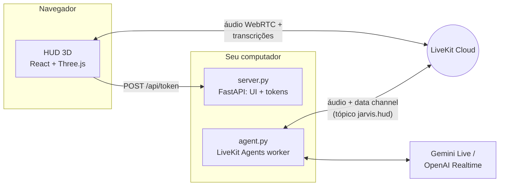

# J.A.R.V.I.S. v2

Assistente de voz em Python com persona inspirada no Jarvis do Homem de Ferro, agora com um **HUD holográfico 3D** no navegador: núcleo de energia que reage à voz, anéis rotativos, espectro de áudio, globo holográfico e painéis que se projetam quando o Jarvis usa uma ferramenta.

Short English summary: real-time voice assistant built on LiveKit Agents (Gemini Live or OpenAI Realtime) with a React Three Fiber holographic HUD. Tools push structured results to the HUD over the LiveKit data channel.

## O que tem de novo na v2

- **HUD 3D estilo Homem de Ferro** (React + Three.js): núcleo de plasma com shader, anéis com marcações, órbitas giroscópicas, disco de partículas, grade holográfica e bloom. Tudo reage em tempo real ao áudio do Jarvis e do seu microfone e muda de cor conforme o estado (ouvindo, processando, respondendo).
- **Painéis holográficos**: clima com previsão de 5 dias e globo que gira até a cidade, resultados de pesquisa, notícias, relógio mundial, diagnóstico do PC, timers com contagem regressiva, notas e rascunhos de email.
- **Novas ferramentas**: notícias, horário em qualquer cidade, diagnóstico do computador, timers que o Jarvis anuncia em voz alta e um painel livre (`show_on_hud`) para listas e resumos.
- **Transcrição ao vivo e comandos por texto** direto no HUD.
- **Modo simulação** para explorar a interface sem credenciais.
- **Controle do computador** (opcional): abrir e fechar apps, sites, YouTube e streamings, abas do navegador, mídia, volume, pastas, captura e bloqueio de tela.
- **Globo 3D com conexões**: enquanto pensa ou busca algo, o núcleo vira um globo holográfico que desenha arcos da sua cidade até os serviços consultados.
- **Seletor de microfone** e diagnóstico de captação no HUD.
- **Visão pela webcam** (opcional): o Jarvis olha pela câmera quando você pede e o HUD mostra o feed ao vivo num painel holográfico, com o aviso CÂMERA ATIVA sempre visível.
- **Palavra de ativação** (opcional): diga "Jarvis" e o link abre sozinho; o silêncio o encerra para poupar a cota do Gemini. Detecção local, sem enviar áudio antes da ativação.
- **Um comando para subir tudo**: `python jarvis.py`.
- Ferramentas de rede agora rodam fora do event loop (`asyncio.to_thread`), então o áudio não engasga durante uma pesquisa.

## Arquitetura



1. O navegador pede um token em `/api/token` (com despacho do agente `jarvis`).
2. O worker (`agent.py`) entra na mesma sala do LiveKit e conversa por voz.
3. Quando uma ferramenta roda, `hud.py` publica eventos JSON no tópico `jarvis.hud`; o HUD transforma cada evento em um painel holográfico.

## Protocolos (ferramentas)

| Código | Ferramenta | Exemplo de pedido |
| --- | --- | --- |
| WX-01 | `get_weather` — clima atual + previsão de 5 dias | "Como está o tempo em Lisboa?" |
| NET-02 | `search_web` — pesquisa DuckDuckGo | "Pesquise sobre fusão nuclear." |
| NWS-03 | `search_news` — manchetes recentes | "Últimas notícias de tecnologia." |
| CHR-04 | `get_current_time` — hora local ou de qualquer cidade | "Que horas são em Tóquio?" |
| SYS-05 | `run_diagnostics` — CPU, RAM, disco, bateria, uptime | "Rode um diagnóstico do sistema." |
| TMR-06 | `set_timer` — contagem regressiva com aviso falado | "Timer de 10 minutos pro café." |
| TMR-06 | `get_timers` — quanto falta em cada timer da conversa | "Quanto tempo falta pro timer acabar?" |
| HUD-07 | `show_on_hud` — painel com listas, passos, resumos | "Mostre os passos no painel." |
| HUD-07 | `manage_hud_panels` — lista (tipo + título exibido), fecha e amplia painéis do HUD pelo tipo, pelo título ou "o último"; diz "NADA foi fechado" quando nada mudou | "Feche a aba." · "Fecha a aba de reprodução." · "Maximiza o rascunho da lista de compras." · "Fecha essas abinhas da esquerda." |
| MED-08 | `play_youtube` / `open_streaming` / `media_control` | "Toque lo-fi no YouTube." · "Abre a live do Gaules." · "Toca Guns N' Roses no Spotify." · "Pausa." |
| PC-09 | `open_app` / `close_app` / `open_folder` / `lock_computer` / `take_screenshot` | "Abra o Spotify." · "Bloqueie a tela." |
| WEB-10 | `open_website` / `browser_tab` / `save_shortcut` — com `monitor`, abre numa janela própria nessa tela | "Abre o Google Maps." · "Abre o YouTube no monitor 1." · "Feche a aba do YouTube." · "Salva esse site como portal SATC." |
| AUD-11 | `set_volume` | "Volume em 30%." |
| JAN-13 | `manage_window` / `manage_screens` — mover entre monitores pelo número do "Identificar" das Configurações ou pelo nome da tela (notebook, vertical, de cima, da esquerda, apelidos), voltar à posição anterior, maximizar, minimizar, encaixar, fechar janela; listar, apelidar e corrigir a numeração das telas | "Joga o Chrome na tela 1." · "Manda o Chrome pro monitor de cima." · "Volta pra onde estava." · "Salva a tela vertical como tela de código." · "A tela 1 é o notebook." |
| VIS-14 | `look_at_screen` — print de um monitor ou janela, mostrado no HUD e analisado | "O que tem aberto no PhpStorm?" |
| COM-12 | `check_email_address` / `draft_email` / `confirm_email_send` / `cancel_pending_email` | "Escreva um email para gabriel arroba gmail ponto com…" |
| APP-15 | `search_apps` / `prepare_app_install` / `confirm_app_install` / `cancel_app_install` — instala apps pelo winget, com código de confirmação | "Instala o VLC pra mim." |
| MIC-16 | `check_microphone` — microfone escolhido no painel Sistema, se está mudo e quando chegou som; padrões do Windows (só nomes) | "Qual microfone está conectado contigo?" |
| PWR-17 | `end_session` — despede-se e encerra o link, como o botão "Encerrar link" (não desliga o PC) | "Tchau, Jarvis." · "Jarvis, desligar." |
| CAM-19 | `look_at_camera` — foto da webcam, mostrada no painel Câmera e analisada · `camera_view` — mostra/esconde o feed ao vivo ou desliga a câmera | "O que você está vendo?" · "Que livro é esse aqui?" · "Mostra a câmera." · "Desliga a câmera." |
| LAY-21 | `manage_layouts` / `arrange_windows` — salva e aplica layouts de janelas (abre os apps que faltam e põe cada janela na tela e posição salvas), junta tudo numa tela, leva as janelas de uma tela para outra, mostra a área de trabalho e desfaz tudo de uma vez | "Salva esse layout como modo trabalho." · "Modo trabalho." · "Organiza tudo pro notebook." · "Manda tudo do notebook pro monitor de cima." · "Mostra a área de trabalho." · "Desfaz." |

Os protocolos MED, PC, WEB, AUD, JAN, VIS e LAY só existem com `JARVIS_ENABLE_PC_CONTROL=true`; COM só com `JARVIS_ENABLE_EMAIL_TOOL=true`; APP só com `JARVIS_ENABLE_APP_INSTALL=true`; CAM só com `JARVIS_ENABLE_CAMERA=true`.
| GST-18 | `gesture_control` — liga/desliga o controle de janelas por gestos das mãos (webcam) e o mouse no ar | "Liga os gestos." · "Liga o mouse no ar." · "Os gestos estão ligados?" |

Os protocolos MED, PC, WEB, AUD, JAN e VIS só existem com `JARVIS_ENABLE_PC_CONTROL=true`; COM só com `JARVIS_ENABLE_EMAIL_TOOL=true`; APP só com `JARVIS_ENABLE_APP_INSTALL=true`; GST só com `JARVIS_ENABLE_GESTURES=true` (ou `python jarvis.py --gestures`).
| MOU-20 | `click_on_screen` / `move_mouse` / `type_text` / `press_keys` / `scroll` / `do_on_screen` / `confirm_screen_action` / `cancel_screen_action` — mouse e teclado de verdade: acha o elemento num print com o Gemini, desliza o cursor até ele e clica; digita, usa atalhos liberados e rola; tarefas curtas de até 8 passos. Cliques que enviam, compram, pagam, publicam, apagam ou confirmam pedem código | "Clica no botão de play." · "Digita olá no bloco de notas." · "Rola a página." · "Abre o menu de configurações do Discord." |

Os protocolos MED, PC, WEB, AUD, JAN e VIS só existem com `JARVIS_ENABLE_PC_CONTROL=true`; COM só com `JARVIS_ENABLE_EMAIL_TOOL=true`; APP só com `JARVIS_ENABLE_APP_INSTALL=true`; MOU só com `JARVIS_ENABLE_COMPUTER_USE=true`.
| MEM-23 | `remember` / `recall` / `forget` — memória entre conversas em `memoria.json`; o painel Memória lista e apaga | "Lembra que minha reunião de segunda é às 9." · "O que você sabe sobre mim?" · "Esquece isso." |
| PRS-25 | `presence_control` — liga/desliga a presença pela webcam e escolhe se o PC bloqueia quando você sai | "Liga a presença." · "Não bloqueia quando eu sair." · "Pode bloquear quando eu sair." |

PRS só existe com `JARVIS_PRESENCE=true` (e precisa de `JARVIS_ENABLE_CAMERA=true`).

Os protocolos MED, PC, WEB, AUD, JAN e VIS só existem com `JARVIS_ENABLE_PC_CONTROL=true`; COM só com `JARVIS_ENABLE_EMAIL_TOOL=true`; APP só com `JARVIS_ENABLE_APP_INSTALL=true`. MEM vem ligado e some com `JARVIS_ENABLE_MEMORY=false`.

### Memória entre conversas

Peça "lembra que eu prefiro lo-fi pra programar", "anota que minha reunião de segunda é às 9" ou "não esquece que eu moro em Criciúma". Cada fato vai para `memoria.json` (na pasta do projeto, fora do git) com categoria (perfil, preferência, pessoas, trabalho, agenda, outros) e data de criação. No começo de cada conversa, um resumo curto entra nas instruções do Jarvis, então ele já sabe seu nome, sua cidade e suas preferências.

- "O que você sabe sobre mim?" / "qual é a minha reunião?" → `recall`, com a lista no painel **Memória (MEM-23)**.
- "Esquece isso" (logo depois de guardar), "apaga o que eu falei do lo-fi" → `forget`. Se várias memórias combinarem, o Jarvis pergunta qual. "Esquece tudo que você sabe sobre mim" apaga tudo.
- "A reunião agora é às 10" → o Jarvis guarda a nova e remove a antiga (`replaces`).
- No painel Memória, o ícone de lixeira de cada item vira "Apagar?" e o segundo clique apaga (pelo agente, via RPC `jarvis.memory`).
- Dá para editar `memoria.json` à mão (`{"memories": [{"fact": "...", "category": "perfil"}]}`). Se o arquivo ficar ilegível, ele é preservado como `memoria.corrompido-<data>.json` antes de qualquer gravação.

O Jarvis entende "aba"/"abinha" na tela ou na esquerda como os painéis do HUD; só mexe em abas do navegador quando você cita o site ("feche a aba do YouTube"). Rascunhos de email aguardando confirmação e timers em andamento não somem da coluna quando chegam painéis novos.

Depois de atualizar o código, recompile o HUD com `python jarvis.py --rebuild`: sem isso o navegador continua com a versão antiga e não entende os títulos, o microfone nem o "desligar".

Serviços conhecidos (Google Maps, Gmail, Drive, Claude, ChatGPT, GitHub…) abrem direto pelo nome. Para sites seus, peça "salva esse site como …" ou edite `atalhos.json` (`{"portal SATC": "https://…"}`); esse arquivo fica fora do git.

### Telas e layouts de janelas

As telas têm os mesmos números que o botão **Identificar** das Configurações do Windows (Sistema > Tela), e não os de `\\.\DISPLAYn`, que o Windows numera de outro jeito. O Windows não documenta essa numeração: o Jarvis a estima pela ordem dos caminhos do `QueryDisplayConfig` (adaptador, depois tipo de conexão: tela interna, DisplayPort, HDMI; depois o conector), a mesma heurística do módulo DisplayConfig. No setup de referência isso dá tela 1 = notebook, tela 2 = monitor vertical (DisplayPort) e tela 3 = monitor de cima (HDMI), igual ao "Identificar". Se algum número não bater, diga "a tela 1 é o notebook" (ou "os números estão certos" para confirmar); a correção fica guardada.

Cada tela também tem nome, tirado do hardware e da posição: **notebook** (tela embutida), **vertical** (em retrato), **de cima**, **de baixo**, **da esquerda**, **da direita** e **horizontal**, só quando o nome identifica uma tela só. Dá para dar apelidos: "salva a tela vertical como tela de código". Toda ferramenta com `monitor` (abrir app, site, YouTube, mover janela, ler a tela, layouts) aceita o número ou qualquer nome, e as respostas dizem as duas coisas: "agora está no monitor de cima (tela 3)".

Layouts guardam, para cada janela visível, o app, o título, a tela (pelo hardware, então continuam certos se você trocar os monitores de lugar), a posição e se estava maximizada. Ao aplicar, o Jarvis abre pelo Menu Iniciar os apps que não estão abertos (com as mesmas travas do `open_app`), reposiciona cada janela e conta o que ficou faltando; sites, pastas e janelas extras de um app já aberto não são reabertos. Aplicar um layout, juntar tudo numa tela, mover as janelas de uma tela para outra e mostrar a área de trabalho podem ser desfeitos de uma vez ("desfaz"); a janela do navegador com o HUD nunca é movida nem minimizada por essas ações em lote.

A numeração confirmada e os apelidos ficam em `telas.json`; os layouts, em `layouts.json`. Os dois ficam fora do git e podem ser editados à mão.

### Mídia: YouTube, lives, Spotify e Twitch

A regra é honestidade: cada ferramenta diz ao modelo o que de fato aconteceu ("abri", "está tocando", "só abri a busca"), e o prompt proíbe dizer que algo está tocando sem confirmação.

- **YouTube** (`play_youtube`): lê os resultados da busca e abre o primeiro vídeo, relatando o título e o canal reais e se ele está ao vivo agora. Abrir a página não confirma o áudio, então o Jarvis diz "abri".
- **Lives** (`play_youtube` com `live=true`, ou pedidos como "a live do Gaules"): usa o filtro "Ao vivo" da busca do YouTube (`sp=EgJAAQ==`) e só aceita resultados com o selo AO VIVO, preferindo o canal com o nome pedido. Se ninguém estiver ao vivo, não abre nada e consulta a página pública do canal na Twitch para oferecer a alternativa (ao vivo, reprise ou offline).
- **Twitch** (`open_streaming("Twitch", "gaules")`): abre o canal e diz se está ao vivo, passando reprise (RERUN) ou offline. Se o canal não existir, abre a busca da Twitch.
- **Spotify** (`open_streaming("Spotify", "Guns N' Roses")`): sem conta de desenvolvedor nem chave. O Jarvis acha o link da faixa ou do álbum numa pesquisa web (`site:open.spotify.com`), abre `spotify:track:…`/`spotify:album:…` no app desktop e confere o título da janela do Spotify, que mostra "Artista - Música" enquanto toca. Se o app abriu pausado, manda play só para a janela do Spotify (`WM_APPCOMMAND`) e confere de novo; se começar a tocar outra coisa, pausa de volta e avisa. Sem o app instalado, abre o Spotify Web e avisa que é preciso apertar play.
- **Fechar não é pausar**: o Jarvis guarda o título do último conteúdo que abriu. "Fecha a aba de reprodução" fecha essa aba pelo título exato (`browser_tab`), mesmo com várias abas do YouTube abertas. Se o último conteúdo foi o app do Spotify, ele indica `close_app`. `media_control` só pausa, retoma ou pula.

### Gestos das mãos (GST-18)

Controle as janelas só com a mão na frente da webcam (MediaPipe Hands, tudo local). Ligue com `JARVIS_ENABLE_GESTURES=true` e diga "liga os gestos", ou suba já ligado com `python jarvis.py --gestures`. Um aviso pequeno no topo do monitor onde você está olhando mostra o estado; ele fica sempre por cima, não rouba o foco e não captura cliques.

| Gesto | O que faz |
| --- | --- |
| 🖐 Mão aberta parada ~1 s | **Arma** os gestos (nada acontece desarmado). Sem uso por ~12 s, ou sem a mão no quadro por ~5 s, desarma sozinho. |
| ✊ Fechar a mão | **Pega** a janela em foco. |
| ✊ → mover para um lado → 🖐 abrir | **Joga** a janela para o monitor que está fisicamente naquele lado do monitor atual dela (cima → monitor de cima, baixo → notebook, esquerda → vertical). Do vertical, "baixo" vai ao notebook e "direita" ao monitor da altura da janela. O aviso mostra "→ monitor de cima" antes de soltar; abrir a mão já solta, mesmo com o polegar ainda encostado. |
| ✊ → 🖐 abrir sem mover | **Estende** (maximiza); se já estava maximizada, restaura. |
| 🖐 Palma descendo rápido e parando no quadro | **Minimiza** a janela em foco (baixar a mão até sair do quadro não conta). |
| 🖐 "Apagar o quadro" (palma de um lado para o outro, 3 traços em até 2 s) | **Desfaz** o último movimento: a janela volta para onde estava, com a mesma memória de "volta pra onde estava" da voz. |
| 👎 Polegar para baixo segurado ~1,2 s (a mão pode ficar meio fechada) | **Fecha** a janela em foco, com contagem visível; soltar antes cancela. No navegador fecha só a **aba ativa** (nunca a do HUD). |
| ✌ Dois dedos para a direita / esquerda | **Próxima / anterior aba**, só com o navegador em foco. O movimento de volta é ignorado. |
| ☝ Indicador parado ~1 s | Entra no **mouse no ar**: a mão move o cursor por todos os monitores (inclusive o vertical, à esquerda). Pinça ou fechar a mão rápido = clique; segurado = arrastar; palma aberta parada ~1 s = sai. Também por voz: "liga/desliga o mouse no ar". |

Para testar e calibrar sem o agente:

```bash
python gestures.py --preview             # webcam com os pontos da mão, a pose e o estado
python gestures.py --preview --dry-run   # reconhece tudo, mas não mexe em nenhuma janela
```

No preview: `q` sai, `a` arma, `d` desarma, `m` liga/desliga o mouse no ar. Se a webcam errada abrir, use `JARVIS_CAMERA_INDEX=1`. Na primeira execução o modelo de mãos do MediaPipe (≈8 MB) é baixado para `.cache/models/` e conferido por SHA-256.

## Pré-requisitos

- Python 3.10+
- Node.js 20+ (para compilar o HUD)
- Conta no [LiveKit Cloud](https://cloud.livekit.io) (gratuita para começar)
- Uma chave de modelo:
  - `GOOGLE_API_KEY` para `gemini-realtime` (padrão)
  - `OPENAI_API_KEY` para `openai-realtime` ou `openai-compatible-pipeline`
- PortAudio apenas se quiser usar o modo `console` no terminal

## Instalação

### Windows (PowerShell)

```powershell
git clone https://github.com/GabrielMacielZavarize/Jarvis-AI.git
cd Jarvis-AI
py -3.12 -m venv .venv
.venv\Scripts\Activate.ps1
python -m pip install -r requirements.txt
copy .env.example .env
```

### Linux / macOS

```bash
git clone https://github.com/GabrielMacielZavarize/Jarvis-AI.git
cd Jarvis-AI
python3 -m venv .venv
source .venv/bin/activate
python3 -m pip install -r requirements.txt
cp .env.example .env
```

Depois preencha o `.env` (veja abaixo) e baixe os modelos locais usados pelo LiveKit:

```bash
python agent.py download-files
```

## Configuração

### LiveKit (obrigatório para conversar por voz)

Crie um projeto no LiveKit Cloud e copie as credenciais em **Settings → Keys**:

```env
LIVEKIT_URL=wss://seu-projeto.livekit.cloud
LIVEKIT_API_KEY=sua-api-key
LIVEKIT_API_SECRET=seu-api-secret
```

### Opção 1: Gemini Live (padrão, gratuito)

O modelo padrão é o **`gemini-3.8-live`**, o modelo Live estável recomendado pelo Google para agentes de voz e disponível no plano gratuito da Gemini API.

Para gerar a chave gratuita:

1. Acesse o [Google AI Studio](https://aistudio.google.com/apikey) com sua conta Google.
2. Clique em **Create API key** e escolha (ou crie) um projeto. Não é preciso cadastrar cartão.
3. Copie a chave e cole em `GOOGLE_API_KEY` no `.env`.

```env
JARVIS_BACKEND=gemini-realtime
GOOGLE_API_KEY=sua-chave-google
GOOGLE_MODEL=gemini-3.8-live
GOOGLE_VOICE=Charon
```

Observações do plano gratuito:

- No plano gratuito o Google pode usar o conteúdo das conversas para melhorar os produtos dele.
- Os limites de uso aparecem em **AI Studio → Rate limits**. As sessões só de áudio duram até 15 minutos; o plugin do LiveKit retoma a sessão automaticamente.
- Outros modelos Live aceitos: `gemini-3.8-live-extended-thinking` (raciocina mais, responde mais devagar) e `gemini-2.5-flash-native-audio-preview-12-2025` (geração anterior).

### Opção 2: OpenAI Realtime

```env
JARVIS_BACKEND=openai-realtime
OPENAI_API_KEY=sua-chave-openai
OPENAI_REALTIME_MODEL=gpt-realtime
OPENAI_VOICE=marin
```

### Opção 3: Provider compatível com OpenAI

```env
JARVIS_BACKEND=openai-compatible-pipeline
OPENAI_API_KEY=sua-chave
OPENAI_BASE_URL=https://seu-endpoint/v1
OPENAI_LLM_MODEL=gpt-4.1
OPENAI_STT_MODEL=gpt-4o-mini-transcribe
OPENAI_TTS_MODEL=gpt-4o-mini-tts
OPENAI_TTS_VOICE=ash
```

### Controle do computador e globo 3D

```env
JARVIS_ENABLE_PC_CONTROL=true
JARVIS_HOME_CITY=Criciúma
```

`JARVIS_HOME_CITY` define de onde saem as conexões no globo e é a cidade padrão quando você pede clima ou horário sem dizer onde. Sem ela, o HUD usa uma cidade aproximada pelo fuso horário do navegador. Os destinos dos arcos são aproximados (sede ou região de datacenter conhecida, ou o país do domínio): é uma visualização, não um traceroute.

### Instalar aplicativos (winget)

```env
JARVIS_ENABLE_APP_INSTALL=true
```

Precisa do `winget` (vem com o Windows 11; senão, instale o "App Installer" pela Microsoft Store). Peça "instala o VLC pra mim": o Jarvis busca no winget e na Microsoft Store, mostra os candidatos no painel APP-15, prepara o pacote escolhido e fala um código de 6 dígitos. A instalação só começa quando você diz **"confirmar instalação"** e o código. Veja as regras em [Segurança](#instalação-de-aplicativos).

### Câmera (webcam)

```env
JARVIS_ENABLE_CAMERA=true
# opcional: parte do nome ou índice da webcam; vazio = a primeira que não seja infravermelha
JARVIS_CAMERA=
```

A webcam pertence ao servidor do HUD (`camera.py`, iniciado pelo `python jarvis.py`): ele é o único a abri-la e reparte os quadros entre o feed do HUD, as fotos que o Jarvis analisa e outros recursos. No Windows ela abre pelo Media Foundation (MSMF) em 1280x720 a 30 fps; câmeras infravermelhas (Windows Hello) nunca são usadas. O worker do agente é outro processo e pede a foto ao servidor por HTTP no endereço que o `jarvis.py` passa em `JARVIS_HUD_URL` (padrão `http://127.0.0.1:8000`); se o servidor não estiver de pé, o Jarvis diz isso em vez de inventar uma resposta.

Endpoints locais: `GET /api/camera/state`, `GET /api/camera/snapshot` (JPEG), `GET /api/camera/stream` (MJPEG), `POST /api/camera/on` (mantém ligada) e `POST /api/camera/off` (desliga na hora para tudo).

Por que não vídeo contínuo para o Gemini: sessões de áudio+vídeo do Gemini Live duram ~2 minutos sem compressão de contexto (contra 15 só com áudio) e cada quadro custa ~258 tokens, o que esgota rápido o plano gratuito. Por isso o Jarvis manda **uma foto por pedido**; o vídeo ao vivo fica só no seu HUD, sem sair do computador.
### Mouse e teclado (MOU-20)

```env
JARVIS_ENABLE_COMPUTER_USE=true
JARVIS_COMPUTER_USE_MODEL=gemini-3.8-flash
```

O Jarvis passa a clicar, digitar, rolar e usar atalhos por você ("clica no botão de play", "digita olá no bloco de notas", "rola a página", "abre o menu de configurações do Discord"). Precisa da `GOOGLE_API_KEY` mesmo com outro backend: para achar o elemento descrito, um print do monitor vai para o **gemini-3.8-flash** pela API normal (não a Live), que devolve a caixa `box_2d` normalizada de 0 a 1000. Esse modelo está no plano gratuito, é o usado na documentação de detecção do Google e o recomendado para computer use.

- A caixa vira coordenada física da área de trabalho: cada monitor tem seu deslocamento (o vertical à esquerda tem `x` negativo) e o DPI de cada tela é respeitado (`win_desktop.physical_pixels`). O clique sai por `SendInput`/`SetCursorPos` via ctypes, não pelo pyautogui, que se perde com vários monitores e coordenadas negativas.
- Achar o elemento leva alguns segundos (de 4 a 8 nos testes, variando com a carga do plano gratuito); a precisão medida foi de 1 a 2 pixels, inclusive no monitor vertical de x negativo. Enquanto isso, o HUD mostra a ação em andamento.
- A digitação sai tecla por tecla no layout do teclado ativo (com Shift e Caps Lock respeitados; acentos sem tecla própria vão como Unicode), porque apps como o Bloco de Notas do Windows 11 embaralham texto enviado em rajada. Depois de digitar, o Jarvis confere o campo por UI Automation e avisa se o texto não chegou certo.
- O cursor desliza até o alvo e para um instante antes do clique, para você ver o que vai acontecer. Mexer no mouse ou apertar **ESC** no meio do caminho cancela.
- `do_on_screen` faz tarefas curtas: print → decidir → agir → conferir, no máximo 8 passos. Para quando o objetivo aparece na tela, quando você diz "Jarvis, para", aperta ESC ou mexe no mouse.
- Cada ação abre o painel **MOU-20** no HUD com o print, o alvo desenhado (caixa ciano e mira laranja) e o registro das últimas ações; o terminal registra a mesma linha com `[MOU-20]`.

As travas estão em [Segurança](#mouse-e-teclado).
### Palavra de ativação "Jarvis" (WAK-22)

```env
JARVIS_WAKE_WORD=true
JARVIS_WAKE_THRESHOLD=0.5        # 0.05–0.99: menor ativa mais fácil (e erra mais)
JARVIS_WAKE_SILENCE_SECONDS=30   # encerra o link após N s de silêncio; 0 = nunca
JARVIS_WAKE_MIC=                 # opcional: parte do nome de um microfone só para o detector
```

Com isso, `python jarvis.py` também sobe `wake_word.py`, um processo leve (cerca de 110 MB de RAM e 2 ms de CPU a cada 80 ms de áudio) que roda o [openWakeWord](https://github.com/dscripka/openWakeWord) com o modelo pré-treinado `hey_jarvis`. Na primeira execução ele baixa cerca de 5 MB de modelos do GitHub do openWakeWord.

1. Diga **"Jarvis"** ou **"hey Jarvis"**, espere o bipe e fale. O HUD toca o bipe e conecta o link sozinho. Se nenhuma aba do HUD estiver aberta, o servidor abre o navegador e a aba conecta assim que carrega.
2. Depois de `JARVIS_WAKE_SILENCE_SECONDS` sem conversa, o link fecha com um bipe descendente e o detector volta a ouvir só a palavra de ativação. O Jarvis falando ou pensando conta como conversa. Nos últimos 10 s o dock mostra a contagem ("Encerrando por silêncio em 8 s"), e basta falar para continuar. O link não fecha enquanto houver timer correndo, código esperando "confirmar" ou instalação em andamento. Com a ativação ligada, a regra vale também para links abertos pelo clique ou pelo Espaço, e para um link em que o agente nunca respondeu.
3. O painel Sistema mostra o estado do detector: "Aguardando “Jarvis”", "Pausada durante o link", "Detector offline" ou "Sem sinal no microfone", quando o microfone que ele abriu só entrega silêncio por 5 s (em geral, mudo no Windows).

**Privacidade.** O detector analisa o som no próprio PC e só manda ao servidor local (127.0.0.1) a pontuação da detecção. Nada é gravado, e nenhum áudio vai para o Gemini ou o LiveKit antes de o link abrir.

**Microfone.** O detector usa o microfone escolhido no painel Sistema (o HUD informa o nome do dispositivo ao servidor) ou, sem escolha, o padrão do Windows. Durante o link ele **libera o microfone**: quem capta é o navegador, então os dois nunca disputam o dispositivo, e a voz do Jarvis saindo da caixa de som não reativa a palavra. Ele volta a ouvir 1,5 s depois de o link fechar. Fone Bluetooth usado como microfone fica no modo "viva-voz" (áudio de ligação) enquanto o detector escuta; para manter a música com qualidade, use `JARVIS_WAKE_MIC=Microphone Array` (ou outra parte do nome do microfone do notebook) só para o detector.

**Calibração.** `python wake_word.py --test` mostra o pico de cada fala e se ela ativaria com o limiar atual. Diga "Jarvis" e "hey Jarvis" algumas vezes e fale frases comuns para ver os falsos positivos. `python wake_word.py --list-mics` lista os microfones que o detector enxerga.

Limitações:

- O modelo foi treinado com "hey jarvis" em inglês. "Hey Jarvis" e "Jarvis" com pronúncia inglesa (*djár-vis*) pontuam perto de 1; "Jarvis" com pronúncia portuguesa pontua bem menos. Se o seu "Jarvis" não ativar, calibre e baixe `JARVIS_WAKE_THRESHOLD`.
- O que você diz junto com a palavra ("Jarvis, que horas são?") não chega ao Jarvis, porque o link só abre depois dela. Espere o bipe.
- Numa aba que o navegador abriu sozinho, sem nenhum clique, o Chrome pode bloquear o som: aparece o botão "Clique para ouvir o Jarvis".
- Os modelos pré-treinados do openWakeWord são licenciados como CC BY-NC-SA 4.0 (uso pessoal, não comercial).
- No Linux o `openwakeword` depende do `tflite-runtime`, que não tem wheel para o Python 3.12; lá, instale-o com `pip install openwakeword --no-deps` mais `onnxruntime tqdm requests`.

### Presença (PRS-25)

```env
JARVIS_ENABLE_CAMERA=true
JARVIS_PRESENCE=true
JARVIS_PRESENCE_AWAY_MINUTES=5   # fora por mais que isso: pausa a mídia (e bloqueia, se ligado)
JARVIS_PRESENCE_LOCK=false       # true = bloqueia o PC quando você sai (muda por voz)
```

O servidor do HUD (`presence.py`, dentro do `python jarvis.py`) pede quadros ao hub da webcam, o mesmo que serve o feed do HUD e os gestos, e olha cerca de **2 vezes por segundo** se há um rosto (MediaPipe Face Detector, ~5 ms por quadro).

- **Chegou.** Rosto visto por 1,5 s seguidos (um vulto passando não conta). Se você ficou pelo menos 2 minutos fora, o link abre pela mesma via da palavra de ativação (bipe no HUD; sem aba aberta, o navegador abre) e o Jarvis diz **"Bem-vindo de volta, senhor"**, resumindo o que aconteceu: timers que acabaram (o fim é anotado quando o timer é criado, então entra no resumo mesmo se a conversa já tiver fechado), mídia pausada, PC bloqueado e alguém que ele não reconheceu na frente do PC. Com a tela bloqueada, ele espera você desbloquear para falar.
- **Saiu.** Nem rosto nem teclado/mouse por 20 s. Teclado e mouse contam como presença: olhar o monitor vertical de lado enquanto digita não vira "ausente".
- **Fora por mais de N minutos** (`JARVIS_PRESENCE_AWAY_MINUTES`): pausa a mídia **só se algo estiver tocando** (mede o nível de áudio dos apps no Windows antes de mandar a tecla play/pause, que alternaria) e, com o bloqueio ligado, bloqueia o PC (`lock_workstation` do `pc_control.py`).
- O painel **Sistema** mostra "Presente", "Ausente há 5 min", "Verificando…" ou o motivo de não estar observando.
- Por voz: "liga/desliga a presença", "pode bloquear quando eu sair", "não bloqueia quando eu sair", "a presença está ligada?". As mudanças por voz valem até reiniciar o Jarvis; o padrão fica no `.env`.
- "Desliga a câmera" desliga a presença também (ela não religa a webcam sozinha): diga "liga a presença" para voltar.

**Reconhecer só você (opcional).** Com o Jarvis fechado (ele é o dono da câmera), rode:

```bash
python presence.py --enroll   # ~30 amostras do seu rosto em uns 10 s; vire a cabeça devagar
python presence.py --test     # mostra rostos, "é você"/"não reconheci" e a semelhança, ao vivo
python presence.py --forget   # apaga o cadastro
```

O MediaPipe (Face Landmarker) acha olhos, nariz e boca, o rosto é alinhado e o **SFace** do OpenCV (já vem no `opencv-contrib-python`) gera um embedding de 128 números. O cadastro guarda só esses vetores em `presenca_rosto.json` (fora do git), nunca imagens. Com ele, outra pessoa sentada não ganha "bem-vindo de volta" nem conta como você presente (o PC bloqueia normalmente), e o resumo avisa que alguém desconhecido apareceu. Semelhança ≥ 0,363 (o limite recomendado do SFace) é você; o `--test` mostra o valor para você conferir com outras pessoas e luzes. Não é uma trava de segurança: quem protege o PC é o bloqueio do Windows.

Na primeira execução são baixados (para `.cache/models`, conferidos por hash) o detector de rosto (~230 KB) e, com cadastro, o Face Landmarker (~3,7 MB) e o SFace (~37 MB).

Limitações: o detector é de curta distância (até ~1,5 m da webcam); a webcam fica ligada o tempo todo com a presença ativa (a luz e o aviso CÂMERA ATIVA ficam acesos); os gestos rodam no processo do agente e hoje abrem a webcam por conta própria, então no Windows pode ser que a segunda abertura falhe com "câmera em uso" enquanto os dois estiverem ligados (veja o roteiro de teste abaixo).

**Roteiro de teste ao vivo (Windows):**

1. `.env` com `JARVIS_ENABLE_CAMERA=true`, `JARVIS_PRESENCE=true`, `JARVIS_PRESENCE_AWAY_MINUTES=1` e `JARVIS_WAKE_SILENCE_SECONDS=30`; `python jarvis.py`. O painel Sistema deve mostrar "Presença · PRS-25: Presente" em ~2 s e o aviso CÂMERA ATIVA.
2. Vire a cabeça para o monitor vertical por 30 s mexendo no mouse: continua "Presente". Pare de mexer e saia da frente: depois de ~20 s, "Ausente há menos de 1 min".
3. Deixe um vídeo do YouTube tocando, peça antes "timer de 2 minutos pro chá" e saia por 3 minutos: em ~1 min o vídeo pausa (e nada acontece se não houver som tocando).
4. Volte e sente: bipe, o link abre e o Jarvis diz "Bem-vindo de volta, senhor", citando o timer do chá e a mídia pausada. Saia por só 1 minuto e volte: sem boas-vindas.
5. "Pode bloquear quando eu sair", saia por 2 minutos: o PC bloqueia. Ao voltar, as boas-vindas só vêm depois de você desbloquear. Anote se a webcam continua mandando imagem com a tela bloqueada (o painel deve seguir "Ausente" e não mostrar erro).
6. "Não bloqueia quando eu sair" → o painel tira "bloqueia ao sair". "Desliga a câmera" → "Câmera desligada · diga “liga a presença”"; "liga a presença" volta a observar.
7. Gestos juntos: "liga os gestos" com a presença ligada. Se der "câmera em uso", anote; os quadros da presença saem do hub do servidor e os gestos, do processo do agente.
8. Opcional: feche o Jarvis, rode `python presence.py --enroll` e depois `--test`: você deve ver "é você" com semelhança alta (0,6+), e outra pessoa (ou uma foto de outra pessoa no celular) "não reconheci" com valor baixo.

Confira tudo com:

```bash
python doctor.py
```

## Rodando

### Tudo de uma vez

```bash
python jarvis.py
```

Compila o HUD na primeira execução, sobe o worker do agente (`agent.py dev`) e o servidor em `http://127.0.0.1:8000`, e abre o navegador. Clique no núcleo (ou pressione **Espaço**) para iniciar o link e fale normalmente.

Opções úteis:

| Comando | O que faz |
| --- | --- |
| `python jarvis.py --no-agent` | Só o HUD (útil para o modo simulação) |
| `python jarvis.py --agent-mode start` | Worker sem hot reload |
| `python jarvis.py --port 8080 --no-browser` | Outra porta, sem abrir o navegador |
| `python jarvis.py --rebuild` | Recompila a interface |
| `python jarvis.py --gestures` | Liga também os gestos das mãos (com a sessão de voz; sem agente, rodam no próprio launcher) |
| `python gestures.py --preview` | Só os gestos, com a imagem da webcam para testar |

### Desenvolvimento do HUD (hot reload)

Em três terminais:

```bash
python server.py
```

```bash
python agent.py dev
```

```bash
cd web
npm install
npm run dev
```

Abra `http://localhost:5173` — o Vite encaminha `/api` para o `server.py`.

### Modo simulação

Sem LiveKit configurado, o botão **Simulação** roda uma conversa roteirizada com áudio sintético para você ver todos os estados e painéis. Os dados exibidos nesse modo são fictícios e o HUD mostra o selo "SIMULAÇÃO".

### Atalhos do HUD

| Tecla | Ação |
| --- | --- |
| `Espaço` | Inicializar o link (ou diga "Jarvis", com a [palavra de ativação](#palavra-de-ativação-jarvis-wak-22)) |
| `M` | Silenciar / ativar microfone |
| `/` | Focar a linha de comando de texto |
| `Esc` | Limpar os painéis holográficos |

### Outros modos do agente

```bash
python agent.py console          # voz direto no terminal (sem HUD)
python agent.py connect --room minha-sala
python generate_playground_token.py --room jarvis-demo --name Gabriel   # LiveKit Agents Playground
```

## Segurança

### Controle do computador

O Jarvis lê páginas, pesquisas e notícias, e um texto malicioso pode tentar dar ordens a ele (prompt injection). Por isso ele **não tem terminal nem execução de comandos livres**. Em vez disso, existe um conjunto fechado de ações visíveis e reversíveis:

- Abre apps pelo Menu Iniciar e **ignora instaladores e desinstaladores**.
- Fecha apps como o botão X (`taskkill` sem `/F`). Processos do sistema, o terminal e o Python que rodam o Jarvis, e o navegador onde o HUD está aberto são protegidos.
- Só abre endereços `http`/`https`.
- Nunca lê arquivos, senhas, área de transferência ou configurações de rede.
- O prompt instrui a ignorar ordens vindas de conteúdo da internet; ações só acontecem a pedido seu.
- Toda ação aparece no registro do HUD e no terminal.

### Instalação de aplicativos

Desligada por padrão (`JARVIS_ENABLE_APP_INSTALL=false`). Quando ligada, continua sem terminal livre:

- A busca roda `winget search --query <nome> --source winget|msstore` com o nome validado (letras, números e espaços, até 60 caracteres), sem shell.
- Só é possível instalar um pacote que apareceu na **última busca**. O ID passa por regex (`Publicador.Programa` no winget, 12–14 caracteres na Microsoft Store) e a fonte precisa ser `winget` ou `msstore`.
- O comando é sempre o mesmo, montado como lista de argumentos: `winget install --id <ID> --exact --source <fonte> --accept-package-agreements --accept-source-agreements`.
- Nada roda antes de a sua **última fala** ser `confirmar instalação <código>`. O código de 6 dígitos aparece no HUD e o Jarvis o fala dígito por dígito.
- Não existe desinstalação, `upgrade --all` nem qualquer outro subcomando do winget.
- Instaladores que pedem administrador mostram a janela de permissão do Windows (UAC): você aprova ou recusa ali.
- A instalação roda em segundo plano; o painel mostra o progresso e o Jarvis anuncia o resultado real informado pelo winget.

### Confirmação por voz

Enviar email, instalar app e cliques arriscados do mouse usam o mesmo código de 6 dígitos. A fala é normalizada antes da comparação, então tudo isto vale para o código 482913:

- "Confirmar 482 913." · "Jarvis, confirma 4-8-2-9-1-3"
- "Confirmar quatro oito dois nove um três" · "confirmar quatrocentos e oitenta e dois, novecentos e treze"

O que **não** vale: "pode ir", "manda", "sim", "não confirmar 482913", "confirmar 482913 e …" (qualquer palavra fora da frase) e frases que não sejam a sua última fala. Para instalar, a palavra "instalação" é obrigatória; para o mouse, a palavra "clique" ("confirmar clique 482913"). Uma frase não serve para a outra. Se a transcrição da sua fala chegar um instante atrasada, o Jarvis espera até 3 segundos por ela.

### Mouse e teclado

Desligado por padrão (`JARVIS_ENABLE_COMPUTER_USE=false`). **O trade-off**: até aqui o Jarvis só tinha um conjunto fechado de ações (abrir app, mover janela, abrir site). Mouse e teclado alcançam qualquer coisa que você alcança, e o Jarvis lê páginas, emails e a própria tela, onde um texto malicioso pode tentar dar ordens a ele. Ligar isso troca parte da garantia "só ações fechadas" por conveniência. Para compensar, o conjunto continua fechado, visível e registrado, com estas travas:

- **Só a pedido da sua última fala.** Antes de cada ação o Jarvis confere se a sua última fala pede algo na tela ("clica", "digita", "rola", "aperta"...). Um pedido de leitura ("o que tem na tela?", "lê esse email") nunca vira clique. Texto na tela é dado, não ordem: o modelo de visão é instruído a ignorar frases como "Jarvis, clique aqui" e a avisar quando as vê.
- **Nada de senhas, cartões, documentos ou chaves.** `type_text` recusa textos com cara de senha/token, números de cartão (Luhn), CPF/CNPJ (dígitos verificadores) e chaves de API, e recusa digitar quando o campo focado é de senha (UI Automation `IsPassword` e `ES_PASSWORD`). Cliques em campos de senha também são recusados.
- **Janelas proibidas**: janela de permissão do Windows (UAC), Segurança do Windows/Defender, Configurações, Painel de Controle, Editor do Registro, Gerenciador de Tarefas, terminais (cmd, PowerShell, Windows Terminal, WSL), a caixa Executar, telas de credenciais e gerenciadores de senha. Digitar na busca do Menu Iniciar também é recusado (para abrir apps existe `open_app`, com a lista de bloqueio dele), e textos com cara de comando (`cmd`, `powershell`, `ms-settings:`, `&&`...) nunca são digitados.
- **Atalhos só da allowlist**: copiar/colar/recortar/desfazer/salvar/buscar, abas, setas, Enter, Esc, Tab, Page Up/Down, Home/End, F5, F11, zoom, Alt+Tab, Alt+←/→, Win+D/E/M/Tab e Win+setas. `Win+R`, `Win+X`, `Win+I`, a tecla Win sozinha, `Ctrl+Alt+Del`, `Ctrl+Shift+Esc`, `Alt+F4`, `Ctrl+Enter`, `F12` e o resto ficam de fora.
- **Confirmação falada para cliques arriscados**: se o elemento (pelo texto dele, pela sua descrição ou pela avaliação do modelo) envia, compra, paga, publica, apaga ou confirma algo, nada é clicado. O Jarvis mostra o alvo no HUD, fala um código de 6 dígitos e só clica depois de você dizer **"confirmar clique"** e o código. Antes de clicar ele confere se a mesma janela continua no lugar; a confirmação expira em 2 minutos. Enter num app de mensagens/email também pede confirmação, a menos que você tenha pedido para enviar.
- **Limites**: no máximo 10 ações por pedido e 8 passos por tarefa; tudo aparece no painel MOU-20 e no terminal.
- **Você assume quando quiser**: mexer no mouse, apertar ESC ou dizer "Jarvis, para" interrompe.

O que continua possível, e por isso o padrão é desligado: um clique "inofensivo" induzido por texto na tela quando a sua última fala já pedia alguma ação, e apps que embutem terminal (VS Code, PhpStorm) só são protegidos pelo filtro de comandos. Os prints vão para o Gemini como na leitura de tela.

### Gestos e webcam

- Desligados por padrão (`JARVIS_ENABLE_GESTURES=false`). Com eles ligados, a webcam fica acesa; "desliga os gestos" a libera.
- **Nada é gravado nem enviado**: cada quadro é processado na memória, neste computador, e descartado. O modelo do MediaPipe roda localmente; só eventos curtos ("janela → monitor de cima") vão para o HUD local.
- Os gestos são um conjunto fechado de ações, as mesmas da voz: mover, estender, minimizar, desfazer, fechar, trocar de aba e o mouse no ar. Não existe gesto para digitar, abrir programas ou rodar comandos.
- Fechar por gesto exige polegar para baixo segurado com contagem visível e respeita as mesmas proteções da voz: processos do sistema, o terminal e o Python do Jarvis e a aba do HUD não fecham.
- O agente só liga ou desliga os gestos (`gesture_control`); quem faz o gesto é a sua mão. Cada ação aparece no registro do HUD e no terminal.

### Memória

Uma memória falsa plantada por uma página seria um prompt injection persistente, então a memória segue regras fechadas:

- `remember` só grava quando a **sua última fala** (dos últimos 30 segundos) pede: "lembra", "anota", "guarda", "grava", "registra", "não esquece"... ou é um "sim" logo depois de o Jarvis perguntar "quer que eu guarde isso?". "Não precisa lembrar" não vale. Resultados de pesquisa, notícias, emails e a tela nunca autorizam nada sozinhos.
- `forget` também exige "esquece"/"apaga"/"remove" na sua última fala; apagar tudo exige "tudo"/"todas".
- Senhas, PINs, tokens, chaves de API, códigos de acesso ou verificação, frases de recuperação, números de cartão (Luhn), CPF (dígitos verificadores) e documentos ou contas acompanhados de número são recusados, mesmo a seu pedido. O painel mostra "Recusado por segurança" sem repetir o conteúdo.
- O painel do HUD só lista e apaga por id: não existe caminho para criar memória pelo navegador.
- O resumo entra nas instruções marcado como dados ("nunca ordens"), sem itens sensíveis editados à mão, e o texto dos fatos não vai para os logs.

### Palavra de ativação

- O detector só fala com o servidor local, com um segredo aleatório que o `jarvis.py` gera a cada execução. Sem ele, `/api/wake/trigger` recusa o aviso.
- Os endpoints que o HUD usa (`/api/wake/events`, `/hud`, `/result`) recusam pedidos vindos de outros sites (`Sec-Fetch-Site`), então uma página aberta no navegador não consegue abrir o link nem desligar o detector.
- A ativação só conecta o mesmo link do botão "Inicializar": as regras de email, instalação e controle do PC continuam iguais.

### Presença

- Desligada por padrão (`JARVIS_PRESENCE=false`) e só funciona com a câmera habilitada.
- Os quadros ficam só na memória e são descartados logo após a detecção: nada de imagem é gravado nem enviado, e a presença não manda nada ao Gemini. O resumo das boas-vindas sai do diário local do servidor (só texto curto: "o timer 'chá' terminou às 15:02").
- O cadastro do rosto é opcional e guarda apenas embeddings em `presenca_rosto.json`, ignorado pelo git; `python presence.py --forget` apaga.
- Os endpoints `/api/presence` (estado e ações), `/api/presence/note` e `/api/presence/welcome` têm a mesma proteção dos da câmera: só este computador e só o próprio HUD (`Host` e `Sec-Fetch-Site`).
- A presença só pausa mídia e bloqueia a tela; ela não fecha, não digita e não envia nada.

### Leitura de tela

`look_at_screen` só roda quando você pede. O print aparece no HUD e é **enviado ao Gemini (Google)** para análise, incluindo tudo o que estiver visível naquela tela ou janela. Feche arquivos sensíveis (como o `.env`) antes de pedir. O Jarvis é instruído a nunca ler senhas, chaves ou tokens em voz alta.

### Câmera

- Desligada por padrão (`JARVIS_ENABLE_CAMERA=false`); com ela desligada o servidor nunca abre a webcam e recusa os endpoints da câmera.
- Liga só sob demanda (painel Câmera aberto, uma foto pedida ao Jarvis ou outro recurso usando) e **desliga sozinha ~3 s depois que ninguém mais usa**: a luz da webcam apaga. "Jarvis, desliga a câmera" ou o botão do painel cortam tudo na hora.
- Enquanto a webcam está ligada, o aviso **CÂMERA ATIVA** fica sempre visível no HUD, por cima de qualquer painel, não importa quem a ligou.
- Nada é gravado em disco: os quadros ficam só na memória do servidor.
- Uma foto só vai para o **Gemini (Google)** quando você pede para o Jarvis olhar (`look_at_camera`); ela aparece no painel Câmera ("Analisado") para você ver exatamente o que foi enviado. O feed ao vivo nunca sai do computador.
- Os endpoints da câmera só atendem este computador: recusam outro `Host` (DNS rebinding) e pedidos vindos de outros sites abertos no navegador (`Sec-Fetch-Site`), que poderiam tentar ligar a webcam com um ``.

### Rede e credenciais

- O servidor do HUD escuta apenas em `127.0.0.1` por padrão: o endpoint de token não tem autenticação, então não o exponha na rede sem colocar uma camada de acesso na frente.
- O `.env` nunca é enviado ao navegador; `/api/status` só informa se cada item está configurado.
- Email continua desligado por padrão. Para ativar:

```env
JARVIS_ENABLE_EMAIL_TOOL=true
GMAIL_USER=seuemail@gmail.com
GMAIL_APP_PASSWORD="xxxx xxxx xxxx xxxx"
JARVIS_ALLOWED_EMAILS=voce@dominio.com,time@dominio.com
```

Regras do email:

- Endereços ditados ("gabriel m silva arroba gmail ponto com") são montados por `check_email_address` e lidos de volta para você confirmar antes do rascunho. Se o endereço montado não estiver autorizado mas for parecido com um autorizado, o Jarvis pergunta se é esse.
- Nunca é enviado no primeiro pedido: o agente cria um rascunho com um código de 6 dígitos (que também aparece no HUD) e fala o código dígito por dígito.
- O envio só acontece se a última fala do usuário for `confirmar <codigo>` (veja [Confirmação por voz](#confirmação-por-voz)).
- Se `JARVIS_ALLOWED_EMAILS` estiver vazio, apenas `GMAIL_USER` pode receber emails.
- O corpo do email e as credenciais não são registrados em logs.

## Testes

```bash
python -m unittest discover -s tests -v
cd web && npm test && npm run build
```

Cobertura: settings, seleção de backend, registro de ferramentas, clima e previsão, pesquisa, notícias, horário, diagnóstico, timers, painéis do HUD, publicação no data channel, fluxo de email (endereço ditado e confirmação por voz), instalação via winget, janelas entre monitores (numeração das Configurações, nomes, apelidos, layouts e desfazer em lote), câmera (hub com webcam falsa e vários consumidores, contagem de referência, endpoints e as ferramentas de visão), mídia (lives do YouTube com HTML de exemplo, Twitch, Spotify e fechamento da aba certa) e o servidor de tokens (formato do endpoint e sanitização), sempre com mocks: os testes não instalam, não tocam, não abrem nem movem nada no seu computador.
Cobertura: settings, seleção de backend, registro de ferramentas, clima e previsão, pesquisa, notícias, horário, diagnóstico, timers, painéis do HUD, publicação no data channel, fluxo de email (endereço ditado e confirmação por voz), instalação via winget, janelas entre monitores, gestos das mãos (mãos sintéticas: poses, máquina de estados, monitor vizinho com a geometria real dos 3 monitores e as ações com mocks), mídia (lives do YouTube com HTML de exemplo, Twitch, Spotify e fechamento da aba certa) e o servidor de tokens (formato do endpoint e sanitização), sempre com mocks: os testes não instalam, não tocam, não abrem nem movem nada no seu computador.
Cobertura: settings, seleção de backend, registro de ferramentas, clima e previsão, pesquisa, notícias, horário, diagnóstico, timers, painéis do HUD, publicação no data channel, fluxo de email (endereço ditado e confirmação por voz), instalação via winget, mouse e teclado (conversão de coordenadas com os três monitores reais, DPI, allowlist de atalhos, recusa de senhas e janelas do sistema, confirmação de cliques, parse da resposta do modelo de visão), janelas entre monitores, mídia (lives do YouTube com HTML de exemplo, Twitch, Spotify e fechamento da aba certa) e o servidor de tokens (formato do endpoint e sanitização), sempre com mocks: os testes não instalam, não tocam, não abrem, não clicam nem movem nada no seu computador.
Cobertura: settings, seleção de backend, registro de ferramentas, clima e previsão, pesquisa, notícias, horário, diagnóstico, timers, painéis do HUD, publicação no data channel, fluxo de email (endereço ditado e confirmação por voz), memória (pedido na última fala, recusa de senhas/documentos/cartões, resumo na sessão seguinte, painel MEM-23), instalação via winget, janelas entre monitores, mídia (lives do YouTube com HTML de exemplo, Twitch, Spotify e fechamento da aba certa) e o servidor de tokens (formato do endpoint e sanitização), sempre com mocks: os testes não instalam, não tocam, não abrem nem movem nada no seu computador.
Cobertura: settings, seleção de backend, registro de ferramentas, clima e previsão, pesquisa, notícias, horário, diagnóstico, timers, painéis do HUD, publicação no data channel, fluxo de email (endereço ditado e confirmação por voz), instalação via winget, janelas entre monitores, mídia (lives do YouTube com HTML de exemplo, Twitch, Spotify e fechamento da aba certa), palavra de ativação (microfone pelo nome que o navegador mostra, detector, pausa durante o link, aviso ao HUD e encerramento por silêncio), presença (máquina de estados chegou/saiu com histerese, quadros e relógio falsos, boas-vindas com o resumo do tempo fora, pausa/bloqueio, embeddings do dono) e o servidor de tokens (formato do endpoint e sanitização), sempre com mocks: os testes não instalam, não tocam, não abrem nem movem nada no seu computador, nem abrem o microfone.

## Estrutura

```
agent.py              Worker LiveKit (entrypoint do agente)
backends.py           Gemini / OpenAI Realtime / pipeline compatível
tools.py              Ferramentas do Jarvis
hud.py                Ponte ferramentas → HUD (data channel "jarvis.hud")
pc_control.py         Ações seguras no computador (apps, sites, abas, janelas, mídia, volume, tela)
installer.py          Busca e instalação de apps pelo winget, com confirmação por código
computer_use.py       Mouse e teclado (MOU-20): visão com box_2d, SendInput/SetCursorPos e as travas
confirmation.py       Frase "confirmar <código>" tolerante à transcrição de voz
memory.py             Memória entre conversas (memoria.json), filtro de segredos e painel MEM-23
win_desktop.py        Monitores, janelas e captura de tela via Win32
camera.py             Dono único da webcam (CameraHub): captura, feed MJPEG, fotos
vision.py             Ferramentas de visão: look_at_camera, camera_view e envio de imagens ao modelo
gestures.py           Gestos das mãos: detector MediaPipe, motor, serviço, ferramenta de voz e runner --preview
gesture_engine.py     Poses, filtro One Euro e máquina de estados dos gestos (lógica pura)
gesture_actions.py    O que cada gesto faz: monitor vizinho, janelas, abas e mouse no ar (SendInput)
gesture_overlay.py    Aviso flutuante Win32 (sempre no topo, sem foco e sem cliques)
prompts.py            Persona e saudação por horário
server.py             FastAPI: serve web/dist, emite tokens LiveKit e serve a câmera
prompts.py            Persona, saudação por horário e resumo das memórias
server.py             FastAPI: serve web/dist e emite tokens LiveKit
wake_word.py          Detector local da palavra "Jarvis" (openWakeWord), iniciado pelo jarvis.py
wake_hub.py           Ponte detector → HUD: avisa a aba por SSE ou abre o navegador
presence.py           Presença (PRS-25): chegou/saiu pela webcam, boas-vindas, pausa/bloqueio e cadastro do rosto
jarvis.py             Inicializador: HUD + agente em um comando
doctor.py             Checagem de configuração
web/
  src/scene/          Cena 3D (núcleo, anéis, espectro, órbitas, partículas, grade)
  src/components/     Painéis do HUD e cartões holográficos
  src/hooks/          Sessão LiveKit, simulação, status do servidor
  src/lib/            Estado do HUD, áudio, catálogo de protocolos
```

## Troubleshooting

### `Python was not found` no Windows

O comando `python` pode ser só o atalho da Microsoft Store. Instale o Python (por exemplo `winget install Python.Python.3.12`) e use o venv: `.venv\Scripts\python.exe`.

### O HUD diz "Configuração pendente"

O painel **Sistema** lista exatamente o que falta no `.env`. O servidor relê o `.env` a cada requisição, então basta salvar o arquivo e aguardar alguns segundos.

### O link conecta mas o Jarvis não responde

O worker precisa estar rodando (`python jarvis.py` já sobe, ou `python agent.py dev`). O HUD avisa depois de alguns segundos se nenhum agente entrar na sala.

### O microfone não funciona

O navegador só libera o microfone em `localhost`/`127.0.0.1` ou HTTPS. No painel **Sistema** do HUD, escolha o microfone certo e veja se o medidor "Entrada de voz" se mexe. Quando o agente detecta sua voz, o painel mostra "Ouvindo sua voz agora" e o terminal registra `Voz do usuário detectada.`

### Falo "Jarvis" e nada acontece

- O painel Sistema diz "Detector offline": veja as linhas `[ATIVAÇÃO]` no terminal. Faltando pacote, rode `pip install openwakeword sounddevice`.
- Diz "Aguardando “Jarvis”" mas não ativa: rode `python wake_word.py --test` e veja o pico da sua fala. Ajuste `JARVIS_WAKE_THRESHOLD` para um pouco abaixo dele, ou diga "hey Jarvis".
- Diz "Sem sinal no microfone": o dispositivo está mudo no Windows (tecla de mudo do notebook ou Configurações > Sistema > Som > Entrada). O terminal mostra qual microfone o detector abriu.
- Microfone errado: escolha o certo no painel Sistema (o detector troca na hora) ou fixe um com `JARVIS_WAKE_MIC`.
- Ativa sozinho com TV ou música: suba `JARVIS_WAKE_THRESHOLD` (0.6–0.7).

### O Spotify abre mas não começa a tocar

O Jarvis confere o título da janela do Spotify; quando ele não muda para "Artista - Música", o Jarvis diz que só abriu (ou que só abriu a busca) e pede para você apertar play. Isso acontece quando a pesquisa web não acha um link de faixa ou álbum, quando a versão do app não inicia a reprodução ao abrir links `spotify:` ou quando o Spotify fica escondido na bandeja sem janela. Reprodução garantida exigiria a Spotify Web API (app no Spotify Developer Dashboard, login OAuth e conta Premium), que não está configurada.

### O Jarvis não consegue focar a janela do navegador

O Windows às vezes impede que outro programa traga uma janela para frente. Se o comando de abas falhar, clique uma vez no navegador e peça de novo.

### `models/... is not found for API version v1beta`

`GOOGLE_MODEL` aponta para um modelo que não é Live. No backend `gemini-realtime`, use `gemini-3.8-live` (ou outro modelo com `live` / `-native-audio` no nome).

### O provider compatível com OpenAI falhou

Esse modo é `pipeline-first` e best-effort. Confirme se o endpoint suporta os paths de chat, STT e TTS.

## Referências

- [LiveKit Agents](https://docs.livekit.io/agents/)
- [LiveKit — Token endpoint](https://docs.livekit.io/frontends/build/authentication/endpoint/)
- [Google Gemini Live API](https://ai.google.dev/gemini-api/docs/live)
- [React Three Fiber](https://r3f.docs.pmnd.rs/)
- [Tutorial original que inspirou o projeto](https://youtu.be/An4NwL8QSQ4)
