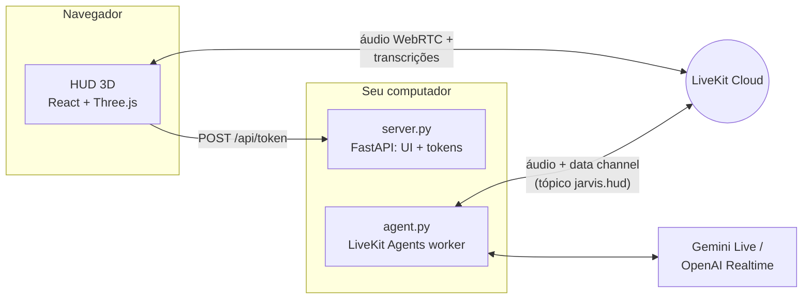

# J.A.R.V.I.S. v2

Assistente de voz em Python com persona inspirada no Jarvis do Homem de Ferro, agora com um **HUD holográfico 3D** no navegador: núcleo de energia que reage à voz, anéis rotativos, espectro de áudio, globo holográfico e painéis que se projetam quando o Jarvis usa uma ferramenta.

Short English summary: real-time voice assistant built on LiveKit Agents (Gemini Live or OpenAI Realtime) with a React Three Fiber holographic HUD. Tools push structured results to the HUD over the LiveKit data channel.

## O que tem de novo na v2

- **HUD 3D estilo Homem de Ferro** (React + Three.js): núcleo de plasma com shader, anéis com marcações, órbitas giroscópicas, disco de partículas, grade holográfica e bloom. Tudo reage em tempo real ao áudio do Jarvis e do seu microfone e muda de cor conforme o estado (ouvindo, processando, respondendo).
- **Painéis holográficos**: clima com previsão de 5 dias e globo que gira até a cidade, resultados de pesquisa, notícias, relógio mundial, diagnóstico do PC, timers com contagem regressiva, notas e rascunhos de email.
- **Novas ferramentas**: notícias, horário em qualquer cidade, diagnóstico do computador, timers que o Jarvis anuncia em voz alta e um painel livre (`show_on_hud`) para listas e resumos.
- **Transcrição ao vivo e comandos por texto** direto no HUD.
- **Modo simulação** para explorar a interface sem credenciais.
- **Controle do computador** (opcional): abrir e fechar apps, sites, YouTube e streamings, abas do navegador, mídia, volume, pastas, captura e bloqueio de tela.
- **Globo 3D com conexões**: enquanto pensa ou busca algo, o núcleo vira um globo holográfico que desenha arcos da sua cidade até os serviços consultados.
- **Seletor de microfone** e diagnóstico de captação no HUD.
- **Um comando para subir tudo**: `python jarvis.py`.
- Ferramentas de rede agora rodam fora do event loop (`asyncio.to_thread`), então o áudio não engasga durante uma pesquisa.

## Arquitetura



1. O navegador pede um token em `/api/token` (com despacho do agente `jarvis`).
2. O worker (`agent.py`) entra na mesma sala do LiveKit e conversa por voz.
3. Quando uma ferramenta roda, `hud.py` publica eventos JSON no tópico `jarvis.hud`; o HUD transforma cada evento em um painel holográfico.

## Protocolos (ferramentas)

| Código | Ferramenta | Exemplo de pedido |
| --- | --- | --- |
| WX-01 | `get_weather` — clima atual + previsão de 5 dias | "Como está o tempo em Lisboa?" |
| NET-02 | `search_web` — pesquisa DuckDuckGo | "Pesquise sobre fusão nuclear." |
| NWS-03 | `search_news` — manchetes recentes | "Últimas notícias de tecnologia." |
| CHR-04 | `get_current_time` — hora local ou de qualquer cidade | "Que horas são em Tóquio?" |
| SYS-05 | `run_diagnostics` — CPU, RAM, disco, bateria, uptime | "Rode um diagnóstico do sistema." |
| TMR-06 | `set_timer` — contagem regressiva com aviso falado | "Timer de 10 minutos pro café." |
| TMR-06 | `get_timers` — quanto falta em cada timer da conversa | "Quanto tempo falta pro timer acabar?" |
| HUD-07 | `show_on_hud` — painel com listas, passos, resumos | "Mostre os passos no painel." |
| HUD-07 | `manage_hud_panels` — lista (tipo + título exibido), fecha e amplia painéis do HUD pelo tipo, pelo título ou "o último"; diz "NADA foi fechado" quando nada mudou | "Feche a aba." · "Fecha a aba de reprodução." · "Maximiza o rascunho da lista de compras." · "Fecha essas abinhas da esquerda." |
| MED-08 | `play_youtube` / `open_streaming` / `media_control` | "Toque lo-fi no YouTube." · "Abre a live do Gaules." · "Toca Guns N' Roses no Spotify." · "Pausa." |
| PC-09 | `open_app` / `close_app` / `open_folder` / `lock_computer` / `take_screenshot` | "Abra o Spotify." · "Bloqueie a tela." |
| WEB-10 | `open_website` / `browser_tab` / `save_shortcut` — com `monitor`, abre numa janela própria nessa tela | "Abre o Google Maps." · "Abre o YouTube no monitor 1." · "Feche a aba do YouTube." · "Salva esse site como portal SATC." |
| AUD-11 | `set_volume` | "Volume em 30%." |
| JAN-13 | `manage_window` — mover entre monitores, voltar à posição anterior, maximizar, minimizar, encaixar, fechar janela | "Joga as Configurações na tela 3." · "Volta pra onde estava." |
| VIS-14 | `look_at_screen` — print de um monitor ou janela, mostrado no HUD e analisado | "O que tem aberto no PhpStorm?" |
| COM-12 | `check_email_address` / `draft_email` / `confirm_email_send` / `cancel_pending_email` | "Escreva um email para gabriel arroba gmail ponto com…" |
| APP-15 | `search_apps` / `prepare_app_install` / `confirm_app_install` / `cancel_app_install` — instala apps pelo winget, com código de confirmação | "Instala o VLC pra mim." |
| MIC-16 | `check_microphone` — microfone escolhido no painel Sistema, se está mudo e quando chegou som; padrões do Windows (só nomes) | "Qual microfone está conectado contigo?" |
| PWR-17 | `end_session` — despede-se e encerra o link, como o botão "Encerrar link" (não desliga o PC) | "Tchau, Jarvis." · "Jarvis, desligar." |
| GST-18 | `gesture_control` — liga/desliga o controle de janelas por gestos das mãos (webcam) e o mouse no ar | "Liga os gestos." · "Liga o mouse no ar." · "Os gestos estão ligados?" |

Os protocolos MED, PC, WEB, AUD, JAN e VIS só existem com `JARVIS_ENABLE_PC_CONTROL=true`; COM só com `JARVIS_ENABLE_EMAIL_TOOL=true`; APP só com `JARVIS_ENABLE_APP_INSTALL=true`; GST só com `JARVIS_ENABLE_GESTURES=true` (ou `python jarvis.py --gestures`).

O Jarvis entende "aba"/"abinha" na tela ou na esquerda como os painéis do HUD; só mexe em abas do navegador quando você cita o site ("feche a aba do YouTube"). Rascunhos de email aguardando confirmação e timers em andamento não somem da coluna quando chegam painéis novos.

Depois de atualizar o código, recompile o HUD com `python jarvis.py --rebuild`: sem isso o navegador continua com a versão antiga e não entende os títulos, o microfone nem o "desligar".

Serviços conhecidos (Google Maps, Gmail, Drive, Claude, ChatGPT, GitHub…) abrem direto pelo nome. Para sites seus, peça "salva esse site como …" ou edite `atalhos.json` (`{"portal SATC": "https://…"}`); esse arquivo fica fora do git.

### Mídia: YouTube, lives, Spotify e Twitch

A regra é honestidade: cada ferramenta diz ao modelo o que de fato aconteceu ("abri", "está tocando", "só abri a busca"), e o prompt proíbe dizer que algo está tocando sem confirmação.

- **YouTube** (`play_youtube`): lê os resultados da busca e abre o primeiro vídeo, relatando o título e o canal reais e se ele está ao vivo agora. Abrir a página não confirma o áudio, então o Jarvis diz "abri".
- **Lives** (`play_youtube` com `live=true`, ou pedidos como "a live do Gaules"): usa o filtro "Ao vivo" da busca do YouTube (`sp=EgJAAQ==`) e só aceita resultados com o selo AO VIVO, preferindo o canal com o nome pedido. Se ninguém estiver ao vivo, não abre nada e consulta a página pública do canal na Twitch para oferecer a alternativa (ao vivo, reprise ou offline).
- **Twitch** (`open_streaming("Twitch", "gaules")`): abre o canal e diz se está ao vivo, passando reprise (RERUN) ou offline. Se o canal não existir, abre a busca da Twitch.
- **Spotify** (`open_streaming("Spotify", "Guns N' Roses")`): sem conta de desenvolvedor nem chave. O Jarvis acha o link da faixa ou do álbum numa pesquisa web (`site:open.spotify.com`), abre `spotify:track:…`/`spotify:album:…` no app desktop e confere o título da janela do Spotify, que mostra "Artista - Música" enquanto toca. Se o app abriu pausado, manda play só para a janela do Spotify (`WM_APPCOMMAND`) e confere de novo; se começar a tocar outra coisa, pausa de volta e avisa. Sem o app instalado, abre o Spotify Web e avisa que é preciso apertar play.
- **Fechar não é pausar**: o Jarvis guarda o título do último conteúdo que abriu. "Fecha a aba de reprodução" fecha essa aba pelo título exato (`browser_tab`), mesmo com várias abas do YouTube abertas. Se o último conteúdo foi o app do Spotify, ele indica `close_app`. `media_control` só pausa, retoma ou pula.

### Gestos das mãos (GST-18)

Controle as janelas só com a mão na frente da webcam (MediaPipe Hands, tudo local). Ligue com `JARVIS_ENABLE_GESTURES=true` e diga "liga os gestos", ou suba já ligado com `python jarvis.py --gestures`. Um aviso pequeno no topo do monitor onde você está olhando mostra o estado; ele fica sempre por cima, não rouba o foco e não captura cliques.

| Gesto | O que faz |
| --- | --- |
| 🖐 Mão aberta parada ~1 s | **Arma** os gestos (nada acontece desarmado). Sem uso por ~12 s, ou sem a mão no quadro por ~5 s, desarma sozinho. |
| ✊ Fechar a mão | **Pega** a janela em foco. |
| ✊ → mover para um lado → 🖐 abrir | **Joga** a janela para o monitor que está fisicamente naquele lado do monitor atual dela (cima → monitor de cima, baixo → notebook, esquerda → vertical). O aviso mostra "→ monitor de cima" antes de soltar. |
| ✊ → 🖐 abrir sem mover | **Estende** (maximiza); se já estava maximizada, restaura. |
| 🖐 Palma descendo rápido e parando no quadro | **Minimiza** a janela em foco (baixar a mão até sair do quadro não conta). |
| 🖐 "Apagar o quadro" (lado a lado, 3 traços) | **Desfaz** o último movimento: a janela volta para onde estava, com a mesma memória de "volta pra onde estava" da voz. |
| 👎 Polegar para baixo segurado ~1,2 s | **Fecha** a janela em foco, com contagem visível; soltar antes cancela. No navegador fecha só a **aba ativa** (nunca a do HUD). |
| ✌ Dois dedos para a direita / esquerda | **Próxima / anterior aba**, só com o navegador em foco. O movimento de volta é ignorado. |
| ☝ Indicador parado ~1 s | Entra no **mouse no ar**: a mão move o cursor por todos os monitores (inclusive o vertical, à esquerda). Pinça rápida = clique; pinça segurada = arrastar; palma aberta parada ~1 s = sai. Também por voz: "liga/desliga o mouse no ar". |

Para testar e calibrar sem o agente:

```bash
python gestures.py --preview             # webcam com os pontos da mão, a pose e o estado
python gestures.py --preview --dry-run   # reconhece tudo, mas não mexe em nenhuma janela
```

No preview: `q` sai, `a` arma, `d` desarma, `m` liga/desliga o mouse no ar. Se a webcam errada abrir, use `JARVIS_CAMERA_INDEX=1`. Na primeira execução o modelo de mãos do MediaPipe (≈8 MB) é baixado para `.cache/models/` e conferido por SHA-256.

## Pré-requisitos

- Python 3.10+
- Node.js 20+ (para compilar o HUD)
- Conta no [LiveKit Cloud](https://cloud.livekit.io) (gratuita para começar)
- Uma chave de modelo:
  - `GOOGLE_API_KEY` para `gemini-realtime` (padrão)
  - `OPENAI_API_KEY` para `openai-realtime` ou `openai-compatible-pipeline`
- PortAudio apenas se quiser usar o modo `console` no terminal

## Instalação

### Windows (PowerShell)

```powershell
git clone https://github.com/GabrielMacielZavarize/Jarvis-AI.git
cd Jarvis-AI
py -3.12 -m venv .venv
.venv\Scripts\Activate.ps1
python -m pip install -r requirements.txt
copy .env.example .env
```

### Linux / macOS

```bash
git clone https://github.com/GabrielMacielZavarize/Jarvis-AI.git
cd Jarvis-AI
python3 -m venv .venv
source .venv/bin/activate
python3 -m pip install -r requirements.txt
cp .env.example .env
```

Depois preencha o `.env` (veja abaixo) e baixe os modelos locais usados pelo LiveKit:

```bash
python agent.py download-files
```

## Configuração

### LiveKit (obrigatório para conversar por voz)

Crie um projeto no LiveKit Cloud e copie as credenciais em **Settings → Keys**:

```env
LIVEKIT_URL=wss://seu-projeto.livekit.cloud
LIVEKIT_API_KEY=sua-api-key
LIVEKIT_API_SECRET=seu-api-secret
```

### Opção 1: Gemini Live (padrão, gratuito)

O modelo padrão é o **`gemini-3.8-live`**, o modelo Live estável recomendado pelo Google para agentes de voz e disponível no plano gratuito da Gemini API.

Para gerar a chave gratuita:

1. Acesse o [Google AI Studio](https://aistudio.google.com/apikey) com sua conta Google.
2. Clique em **Create API key** e escolha (ou crie) um projeto. Não é preciso cadastrar cartão.
3. Copie a chave e cole em `GOOGLE_API_KEY` no `.env`.

```env
JARVIS_BACKEND=gemini-realtime
GOOGLE_API_KEY=sua-chave-google
GOOGLE_MODEL=gemini-3.8-live
GOOGLE_VOICE=Charon
```

Observações do plano gratuito:

- No plano gratuito o Google pode usar o conteúdo das conversas para melhorar os produtos dele.
- Os limites de uso aparecem em **AI Studio → Rate limits**. As sessões só de áudio duram até 15 minutos; o plugin do LiveKit retoma a sessão automaticamente.
- Outros modelos Live aceitos: `gemini-3.8-live-extended-thinking` (raciocina mais, responde mais devagar) e `gemini-2.5-flash-native-audio-preview-12-2025` (geração anterior).

### Opção 2: OpenAI Realtime

```env
JARVIS_BACKEND=openai-realtime
OPENAI_API_KEY=sua-chave-openai
OPENAI_REALTIME_MODEL=gpt-realtime
OPENAI_VOICE=marin
```

### Opção 3: Provider compatível com OpenAI

```env
JARVIS_BACKEND=openai-compatible-pipeline
OPENAI_API_KEY=sua-chave
OPENAI_BASE_URL=https://seu-endpoint/v1
OPENAI_LLM_MODEL=gpt-4.1
OPENAI_STT_MODEL=gpt-4o-mini-transcribe
OPENAI_TTS_MODEL=gpt-4o-mini-tts
OPENAI_TTS_VOICE=ash
```

### Controle do computador e globo 3D

```env
JARVIS_ENABLE_PC_CONTROL=true
JARVIS_HOME_CITY=Criciúma
```

`JARVIS_HOME_CITY` define de onde saem as conexões no globo e é a cidade padrão quando você pede clima ou horário sem dizer onde. Sem ela, o HUD usa uma cidade aproximada pelo fuso horário do navegador. Os destinos dos arcos são aproximados (sede ou região de datacenter conhecida, ou o país do domínio): é uma visualização, não um traceroute.

### Instalar aplicativos (winget)

```env
JARVIS_ENABLE_APP_INSTALL=true
```

Precisa do `winget` (vem com o Windows 11; senão, instale o "App Installer" pela Microsoft Store). Peça "instala o VLC pra mim": o Jarvis busca no winget e na Microsoft Store, mostra os candidatos no painel APP-15, prepara o pacote escolhido e fala um código de 6 dígitos. A instalação só começa quando você diz **"confirmar instalação"** e o código. Veja as regras em [Segurança](#instalação-de-aplicativos).

Confira tudo com:

```bash
python doctor.py
```

## Rodando

### Tudo de uma vez

```bash
python jarvis.py
```

Compila o HUD na primeira execução, sobe o worker do agente (`agent.py dev`) e o servidor em `http://127.0.0.1:8000`, e abre o navegador. Clique no núcleo (ou pressione **Espaço**) para iniciar o link e fale normalmente.

Opções úteis:

| Comando | O que faz |
| --- | --- |
| `python jarvis.py --no-agent` | Só o HUD (útil para o modo simulação) |
| `python jarvis.py --agent-mode start` | Worker sem hot reload |
| `python jarvis.py --port 8080 --no-browser` | Outra porta, sem abrir o navegador |
| `python jarvis.py --rebuild` | Recompila a interface |
| `python jarvis.py --gestures` | Liga também os gestos das mãos (com a sessão de voz; sem agente, rodam no próprio launcher) |
| `python gestures.py --preview` | Só os gestos, com a imagem da webcam para testar |

### Desenvolvimento do HUD (hot reload)

Em três terminais:

```bash
python server.py
```

```bash
python agent.py dev
```

```bash
cd web
npm install
npm run dev
```

Abra `http://localhost:5173` — o Vite encaminha `/api` para o `server.py`.

### Modo simulação

Sem LiveKit configurado, o botão **Simulação** roda uma conversa roteirizada com áudio sintético para você ver todos os estados e painéis. Os dados exibidos nesse modo são fictícios e o HUD mostra o selo "SIMULAÇÃO".

### Atalhos do HUD

| Tecla | Ação |
| --- | --- |
| `Espaço` | Inicializar o link |
| `M` | Silenciar / ativar microfone |
| `/` | Focar a linha de comando de texto |
| `Esc` | Limpar os painéis holográficos |

### Outros modos do agente

```bash
python agent.py console          # voz direto no terminal (sem HUD)
python agent.py connect --room minha-sala
python generate_playground_token.py --room jarvis-demo --name Gabriel   # LiveKit Agents Playground
```

## Segurança

### Controle do computador

O Jarvis lê páginas, pesquisas e notícias, e um texto malicioso pode tentar dar ordens a ele (prompt injection). Por isso ele **não tem terminal nem execução de comandos livres**. Em vez disso, existe um conjunto fechado de ações visíveis e reversíveis:

- Abre apps pelo Menu Iniciar e **ignora instaladores e desinstaladores**.
- Fecha apps como o botão X (`taskkill` sem `/F`). Processos do sistema, o terminal e o Python que rodam o Jarvis, e o navegador onde o HUD está aberto são protegidos.
- Só abre endereços `http`/`https`.
- Nunca lê arquivos, senhas, área de transferência ou configurações de rede.
- O prompt instrui a ignorar ordens vindas de conteúdo da internet; ações só acontecem a pedido seu.
- Toda ação aparece no registro do HUD e no terminal.

### Instalação de aplicativos

Desligada por padrão (`JARVIS_ENABLE_APP_INSTALL=false`). Quando ligada, continua sem terminal livre:

- A busca roda `winget search --query <nome> --source winget|msstore` com o nome validado (letras, números e espaços, até 60 caracteres), sem shell.
- Só é possível instalar um pacote que apareceu na **última busca**. O ID passa por regex (`Publicador.Programa` no winget, 12–14 caracteres na Microsoft Store) e a fonte precisa ser `winget` ou `msstore`.
- O comando é sempre o mesmo, montado como lista de argumentos: `winget install --id <ID> --exact --source <fonte> --accept-package-agreements --accept-source-agreements`.
- Nada roda antes de a sua **última fala** ser `confirmar instalação <código>`. O código de 6 dígitos aparece no HUD e o Jarvis o fala dígito por dígito.
- Não existe desinstalação, `upgrade --all` nem qualquer outro subcomando do winget.
- Instaladores que pedem administrador mostram a janela de permissão do Windows (UAC): você aprova ou recusa ali.
- A instalação roda em segundo plano; o painel mostra o progresso e o Jarvis anuncia o resultado real informado pelo winget.

### Confirmação por voz

Enviar email e instalar app usam o mesmo código de 6 dígitos. A fala é normalizada antes da comparação, então tudo isto vale para o código 482913:

- "Confirmar 482 913." · "Jarvis, confirma 4-8-2-9-1-3"
- "Confirmar quatro oito dois nove um três" · "confirmar quatrocentos e oitenta e dois, novecentos e treze"

O que **não** vale: "pode ir", "manda", "sim", "não confirmar 482913", "confirmar 482913 e …" (qualquer palavra fora da frase) e frases que não sejam a sua última fala. Para instalar, a palavra "instalação" é obrigatória; ela não envia email e vice-versa. Se a transcrição da sua fala chegar um instante atrasada, o Jarvis espera até 3 segundos por ela.

### Gestos e webcam

- Desligados por padrão (`JARVIS_ENABLE_GESTURES=false`). Com eles ligados, a webcam fica acesa; "desliga os gestos" a libera.
- **Nada é gravado nem enviado**: cada quadro é processado na memória, neste computador, e descartado. O modelo do MediaPipe roda localmente; só eventos curtos ("janela → monitor de cima") vão para o HUD local.
- Os gestos são um conjunto fechado de ações, as mesmas da voz: mover, estender, minimizar, desfazer, fechar, trocar de aba e o mouse no ar. Não existe gesto para digitar, abrir programas ou rodar comandos.
- Fechar por gesto exige polegar para baixo segurado com contagem visível e respeita as mesmas proteções da voz: processos do sistema, o terminal e o Python do Jarvis e a aba do HUD não fecham.
- O agente só liga ou desliga os gestos (`gesture_control`); quem faz o gesto é a sua mão. Cada ação aparece no registro do HUD e no terminal.

### Leitura de tela

`look_at_screen` só roda quando você pede. O print aparece no HUD e é **enviado ao Gemini (Google)** para análise, incluindo tudo o que estiver visível naquela tela ou janela. Feche arquivos sensíveis (como o `.env`) antes de pedir. O Jarvis é instruído a nunca ler senhas, chaves ou tokens em voz alta.

### Rede e credenciais

- O servidor do HUD escuta apenas em `127.0.0.1` por padrão: o endpoint de token não tem autenticação, então não o exponha na rede sem colocar uma camada de acesso na frente.
- O `.env` nunca é enviado ao navegador; `/api/status` só informa se cada item está configurado.
- Email continua desligado por padrão. Para ativar:

```env
JARVIS_ENABLE_EMAIL_TOOL=true
GMAIL_USER=seuemail@gmail.com
GMAIL_APP_PASSWORD="xxxx xxxx xxxx xxxx"
JARVIS_ALLOWED_EMAILS=voce@dominio.com,time@dominio.com
```

Regras do email:

- Endereços ditados ("gabriel m silva arroba gmail ponto com") são montados por `check_email_address` e lidos de volta para você confirmar antes do rascunho. Se o endereço montado não estiver autorizado mas for parecido com um autorizado, o Jarvis pergunta se é esse.
- Nunca é enviado no primeiro pedido: o agente cria um rascunho com um código de 6 dígitos (que também aparece no HUD) e fala o código dígito por dígito.
- O envio só acontece se a última fala do usuário for `confirmar <codigo>` (veja [Confirmação por voz](#confirmação-por-voz)).
- Se `JARVIS_ALLOWED_EMAILS` estiver vazio, apenas `GMAIL_USER` pode receber emails.
- O corpo do email e as credenciais não são registrados em logs.

## Testes

```bash
python -m unittest discover -s tests -v
cd web && npm test && npm run build
```

Cobertura: settings, seleção de backend, registro de ferramentas, clima e previsão, pesquisa, notícias, horário, diagnóstico, timers, painéis do HUD, publicação no data channel, fluxo de email (endereço ditado e confirmação por voz), instalação via winget, janelas entre monitores, gestos das mãos (mãos sintéticas: poses, máquina de estados, monitor vizinho com a geometria real dos 3 monitores e as ações com mocks), mídia (lives do YouTube com HTML de exemplo, Twitch, Spotify e fechamento da aba certa) e o servidor de tokens (formato do endpoint e sanitização), sempre com mocks: os testes não instalam, não tocam, não abrem nem movem nada no seu computador.

## Estrutura

```
agent.py              Worker LiveKit (entrypoint do agente)
backends.py           Gemini / OpenAI Realtime / pipeline compatível
tools.py              Ferramentas do Jarvis
hud.py                Ponte ferramentas → HUD (data channel "jarvis.hud")
pc_control.py         Ações seguras no computador (apps, sites, abas, janelas, mídia, volume, tela)
installer.py          Busca e instalação de apps pelo winget, com confirmação por código
confirmation.py       Frase "confirmar <código>" tolerante à transcrição de voz
win_desktop.py        Monitores, janelas e captura de tela via Win32
gestures.py           Gestos das mãos: detector MediaPipe, motor, serviço, ferramenta de voz e runner --preview
gesture_engine.py     Poses, filtro One Euro e máquina de estados dos gestos (lógica pura)
gesture_actions.py    O que cada gesto faz: monitor vizinho, janelas, abas e mouse no ar (SendInput)
gesture_overlay.py    Aviso flutuante Win32 (sempre no topo, sem foco e sem cliques)
prompts.py            Persona e saudação por horário
server.py             FastAPI: serve web/dist e emite tokens LiveKit
jarvis.py             Inicializador: HUD + agente em um comando
doctor.py             Checagem de configuração
web/
  src/scene/          Cena 3D (núcleo, anéis, espectro, órbitas, partículas, grade)
  src/components/     Painéis do HUD e cartões holográficos
  src/hooks/          Sessão LiveKit, simulação, status do servidor
  src/lib/            Estado do HUD, áudio, catálogo de protocolos
```

## Troubleshooting

### `Python was not found` no Windows

O comando `python` pode ser só o atalho da Microsoft Store. Instale o Python (por exemplo `winget install Python.Python.3.12`) e use o venv: `.venv\Scripts\python.exe`.

### O HUD diz "Configuração pendente"

O painel **Sistema** lista exatamente o que falta no `.env`. O servidor relê o `.env` a cada requisição, então basta salvar o arquivo e aguardar alguns segundos.

### O link conecta mas o Jarvis não responde

O worker precisa estar rodando (`python jarvis.py` já sobe, ou `python agent.py dev`). O HUD avisa depois de alguns segundos se nenhum agente entrar na sala.

### O microfone não funciona

O navegador só libera o microfone em `localhost`/`127.0.0.1` ou HTTPS. No painel **Sistema** do HUD, escolha o microfone certo e veja se o medidor "Entrada de voz" se mexe. Quando o agente detecta sua voz, o painel mostra "Ouvindo sua voz agora" e o terminal registra `Voz do usuário detectada.`

### O Spotify abre mas não começa a tocar

O Jarvis confere o título da janela do Spotify; quando ele não muda para "Artista - Música", o Jarvis diz que só abriu (ou que só abriu a busca) e pede para você apertar play. Isso acontece quando a pesquisa web não acha um link de faixa ou álbum, quando a versão do app não inicia a reprodução ao abrir links `spotify:` ou quando o Spotify fica escondido na bandeja sem janela. Reprodução garantida exigiria a Spotify Web API (app no Spotify Developer Dashboard, login OAuth e conta Premium), que não está configurada.

### O Jarvis não consegue focar a janela do navegador

O Windows às vezes impede que outro programa traga uma janela para frente. Se o comando de abas falhar, clique uma vez no navegador e peça de novo.

### `models/... is not found for API version v1beta`

`GOOGLE_MODEL` aponta para um modelo que não é Live. No backend `gemini-realtime`, use `gemini-3.8-live` (ou outro modelo com `live` / `-native-audio` no nome).

### O provider compatível com OpenAI falhou

Esse modo é `pipeline-first` e best-effort. Confirme se o endpoint suporta os paths de chat, STT e TTS.

## Referências

- [LiveKit Agents](https://docs.livekit.io/agents/)
- [LiveKit — Token endpoint](https://docs.livekit.io/frontends/build/authentication/endpoint/)
- [Google Gemini Live API](https://ai.google.dev/gemini-api/docs/live)
- [React Three Fiber](https://r3f.docs.pmnd.rs/)
- [Tutorial original que inspirou o projeto](https://youtu.be/An4NwL8QSQ4)
