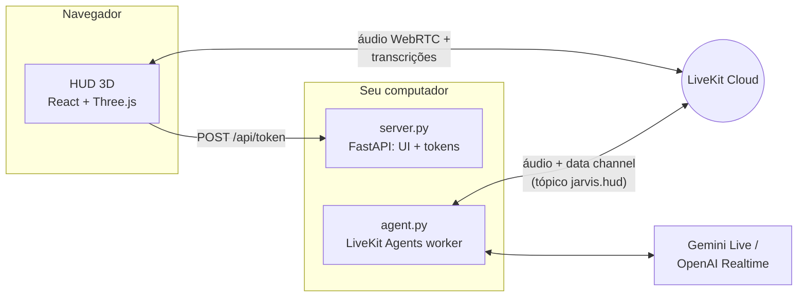

# J.A.R.V.I.S. v2

Assistente de voz em Python com persona inspirada no Jarvis do Homem de Ferro, agora com um **HUD holográfico 3D** no navegador: núcleo de energia que reage à voz, anéis rotativos, espectro de áudio, globo holográfico e painéis que se projetam quando o Jarvis usa uma ferramenta.

Short English summary: real-time voice assistant built on LiveKit Agents (Gemini Live or OpenAI Realtime) with a React Three Fiber holographic HUD. Tools push structured results to the HUD over the LiveKit data channel.

## O que tem de novo na v2

- **HUD 3D estilo Homem de Ferro** (React + Three.js): núcleo de plasma com shader, anéis com marcações, órbitas giroscópicas, disco de partículas, grade holográfica e bloom. Tudo reage em tempo real ao áudio do Jarvis e do seu microfone e muda de cor conforme o estado (ouvindo, processando, respondendo).
- **Painéis holográficos**: clima com previsão de 5 dias e globo que gira até a cidade, resultados de pesquisa, notícias, relógio mundial, diagnóstico do PC, timers com contagem regressiva, notas e rascunhos de email.
- **Novas ferramentas**: notícias, horário em qualquer cidade, diagnóstico do computador, timers que o Jarvis anuncia em voz alta e um painel livre (`show_on_hud`) para listas e resumos.
- **Transcrição ao vivo e comandos por texto** direto no HUD.
- **Modo simulação** para explorar a interface sem credenciais.
- **Um comando para subir tudo**: `python jarvis.py`.
- Ferramentas de rede agora rodam fora do event loop (`asyncio.to_thread`), então o áudio não engasga durante uma pesquisa.

## Arquitetura



1. O navegador pede um token em `/api/token` (com despacho do agente `jarvis`).
2. O worker (`agent.py`) entra na mesma sala do LiveKit e conversa por voz.
3. Quando uma ferramenta roda, `hud.py` publica eventos JSON no tópico `jarvis.hud`; o HUD transforma cada evento em um painel holográfico.

## Protocolos (ferramentas)

| Código | Ferramenta | Exemplo de pedido |
| --- | --- | --- |
| WX-01 | `get_weather` — clima atual + previsão de 5 dias | "Como está o tempo em Lisboa?" |
| NET-02 | `search_web` — pesquisa DuckDuckGo | "Pesquise sobre fusão nuclear." |
| NWS-03 | `search_news` — manchetes recentes | "Últimas notícias de tecnologia." |
| CHR-04 | `get_current_time` — hora local ou de qualquer cidade | "Que horas são em Tóquio?" |
| SYS-05 | `run_diagnostics` — CPU, RAM, disco, bateria, uptime | "Rode um diagnóstico do sistema." |
| TMR-06 | `set_timer` — contagem regressiva com aviso falado | "Timer de 10 minutos pro café." |
| HUD-07 | `show_on_hud` — painel com listas, passos, resumos | "Mostre os passos no painel." |
| COM-08 | `draft_email` / `confirm_email_send` / `cancel_pending_email` | "Escreva um email para…" |

## Pré-requisitos

- Python 3.10+
- Node.js 20+ (para compilar o HUD)
- Conta no [LiveKit Cloud](https://cloud.livekit.io) (gratuita para começar)
- Uma chave de modelo:
  - `GOOGLE_API_KEY` para `gemini-realtime` (padrão)
  - `OPENAI_API_KEY` para `openai-realtime` ou `openai-compatible-pipeline`
- PortAudio apenas se quiser usar o modo `console` no terminal

## Instalação

### Windows (PowerShell)

```powershell
git clone https://github.com/GabrielMacielZavarize/Jarvis-AI.git
cd Jarvis-AI
py -3.12 -m venv .venv
.venv\Scripts\Activate.ps1
python -m pip install -r requirements.txt
copy .env.example .env
```

### Linux / macOS

```bash
git clone https://github.com/GabrielMacielZavarize/Jarvis-AI.git
cd Jarvis-AI
python3 -m venv .venv
source .venv/bin/activate
python3 -m pip install -r requirements.txt
cp .env.example .env
```

Depois preencha o `.env` (veja abaixo) e baixe os modelos locais usados pelo LiveKit:

```bash
python agent.py download-files
```

## Configuração

### LiveKit (obrigatório para conversar por voz)

Crie um projeto no LiveKit Cloud e copie as credenciais em **Settings → Keys**:

```env
LIVEKIT_URL=wss://seu-projeto.livekit.cloud
LIVEKIT_API_KEY=sua-api-key
LIVEKIT_API_SECRET=seu-api-secret
```

### Opção 1: Gemini Live (padrão)

```env
JARVIS_BACKEND=gemini-realtime
GOOGLE_API_KEY=sua-chave-google
GOOGLE_MODEL=gemini-2.5-flash-native-audio-preview-12-2025
GOOGLE_VOICE=Charon
```

### Opção 2: OpenAI Realtime

```env
JARVIS_BACKEND=openai-realtime
OPENAI_API_KEY=sua-chave-openai
OPENAI_REALTIME_MODEL=gpt-realtime
OPENAI_VOICE=marin
```

### Opção 3: Provider compatível com OpenAI

```env
JARVIS_BACKEND=openai-compatible-pipeline
OPENAI_API_KEY=sua-chave
OPENAI_BASE_URL=https://seu-endpoint/v1
OPENAI_LLM_MODEL=gpt-4.1
OPENAI_STT_MODEL=gpt-4o-mini-transcribe
OPENAI_TTS_MODEL=gpt-4o-mini-tts
OPENAI_TTS_VOICE=ash
```

Confira tudo com:

```bash
python doctor.py
```

## Rodando

### Tudo de uma vez

```bash
python jarvis.py
```

Compila o HUD na primeira execução, sobe o worker do agente (`agent.py dev`) e o servidor em `http://127.0.0.1:8000`, e abre o navegador. Clique no núcleo (ou pressione **Espaço**) para iniciar o link e fale normalmente.

Opções úteis:

| Comando | O que faz |
| --- | --- |
| `python jarvis.py --no-agent` | Só o HUD (útil para o modo simulação) |
| `python jarvis.py --agent-mode start` | Worker sem hot reload |
| `python jarvis.py --port 8080 --no-browser` | Outra porta, sem abrir o navegador |
| `python jarvis.py --rebuild` | Recompila a interface |

### Desenvolvimento do HUD (hot reload)

Em três terminais:

```bash
python server.py
```

```bash
python agent.py dev
```

```bash
cd web
npm install
npm run dev
```

Abra `http://localhost:5173` — o Vite encaminha `/api` para o `server.py`.

### Modo simulação

Sem LiveKit configurado, o botão **Simulação** roda uma conversa roteirizada com áudio sintético para você ver todos os estados e painéis. Os dados exibidos nesse modo são fictícios e o HUD mostra o selo "SIMULAÇÃO".

### Atalhos do HUD

| Tecla | Ação |
| --- | --- |
| `Espaço` | Inicializar o link |
| `M` | Silenciar / ativar microfone |
| `/` | Focar a linha de comando de texto |
| `Esc` | Limpar os painéis holográficos |

### Outros modos do agente

```bash
python agent.py console          # voz direto no terminal (sem HUD)
python agent.py connect --room minha-sala
python generate_playground_token.py --room jarvis-demo --name Gabriel   # LiveKit Agents Playground
```

## Segurança

- O servidor do HUD escuta apenas em `127.0.0.1` por padrão: o endpoint de token não tem autenticação, então não o exponha na rede sem colocar uma camada de acesso na frente.
- O `.env` nunca é enviado ao navegador; `/api/status` só informa se cada item está configurado.
- Email continua desligado por padrão. Para ativar:

```env
JARVIS_ENABLE_EMAIL_TOOL=true
GMAIL_USER=seuemail@gmail.com
GMAIL_APP_PASSWORD="xxxx xxxx xxxx xxxx"
JARVIS_ALLOWED_EMAILS=voce@dominio.com,time@dominio.com
```

Regras do email:

- Nunca é enviado no primeiro pedido: o agente cria um rascunho com um código de 6 dígitos (que também aparece no HUD).
- O envio só acontece se o último comando do usuário for exatamente `confirmar <codigo>`.
- Se `JARVIS_ALLOWED_EMAILS` estiver vazio, apenas `GMAIL_USER` pode receber emails.
- O corpo do email e as credenciais não são registrados em logs.

## Testes

```bash
python -m unittest discover -s tests -v
cd web && npm run build
```

Cobertura: settings, seleção de backend, registro de ferramentas, clima e previsão, pesquisa, notícias, horário, diagnóstico, timers, painéis do HUD, publicação no data channel, fluxo de email e o servidor de tokens (formato do endpoint e sanitização).

## Estrutura

```
agent.py              Worker LiveKit (entrypoint do agente)
backends.py           Gemini / OpenAI Realtime / pipeline compatível
tools.py              Ferramentas do Jarvis
hud.py                Ponte ferramentas → HUD (data channel "jarvis.hud")
prompts.py            Persona e saudação por horário
server.py             FastAPI: serve web/dist e emite tokens LiveKit
jarvis.py             Inicializador: HUD + agente em um comando
doctor.py             Checagem de configuração
web/
  src/scene/          Cena 3D (núcleo, anéis, espectro, órbitas, partículas, grade)
  src/components/     Painéis do HUD e cartões holográficos
  src/hooks/          Sessão LiveKit, simulação, status do servidor
  src/lib/            Estado do HUD, áudio, catálogo de protocolos
```

## Troubleshooting

### `Python was not found` no Windows

O comando `python` pode ser só o atalho da Microsoft Store. Instale o Python (por exemplo `winget install Python.Python.3.12`) e use o venv: `.venv\Scripts\python.exe`.

### O HUD diz "Configuração pendente"

O painel **Sistema** lista exatamente o que falta no `.env`. O servidor relê o `.env` a cada requisição, então basta salvar o arquivo e aguardar alguns segundos.

### O link conecta mas o Jarvis não responde

O worker precisa estar rodando (`python jarvis.py` já sobe, ou `python agent.py dev`). O HUD avisa depois de alguns segundos se nenhum agente entrar na sala.

### O microfone não funciona

O navegador só libera o microfone em `localhost`/`127.0.0.1` ou HTTPS. Verifique também a permissão de microfone do site.

### `models/... is not found for API version v1beta`

`GOOGLE_MODEL` aponta para um modelo que não é Live. No backend `gemini-realtime`, use um modelo com `-live-` ou `-native-audio-` no nome.

### O provider compatível com OpenAI falhou

Esse modo é `pipeline-first` e best-effort. Confirme se o endpoint suporta os paths de chat, STT e TTS.

## Referências

- [LiveKit Agents](https://docs.livekit.io/agents/)
- [LiveKit — Token endpoint](https://docs.livekit.io/frontends/build/authentication/endpoint/)
- [Google Gemini Live API](https://ai.google.dev/gemini-api/docs/live)
- [React Three Fiber](https://r3f.docs.pmnd.rs/)
- [Tutorial original que inspirou o projeto](https://youtu.be/An4NwL8QSQ4)
