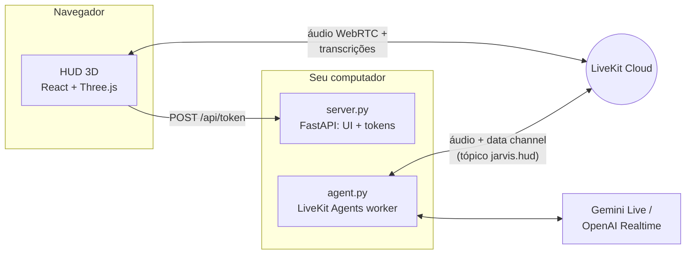

# Arquitetura

1. O navegador pede um token em `/api/token`, já com o despacho do agente `jarvis`.
2. O worker (`agent.py`) entra na mesma sala do LiveKit e conversa por voz.
3. Quando uma ferramenta roda, o `hud.py` publica eventos JSON no tópico `jarvis.hud`, e o HUD transforma cada evento num painel.

O servidor (`server.py`) fica de pé o tempo todo, mesmo sem link aberto. É ele que cuida da webcam, da palavra de ativação, dos avisos proativos, da presença, dos avisos da agenda, das rotinas agendadas e por contexto e do celular. Quando precisa falar com você, ele acorda o HUD, que abre o link.

As ferramentas que vão à rede rodam fora do event loop (`asyncio.to_thread`), então o áudio não engasga durante uma pesquisa.

## Arquivos

| Arquivo | O que tem |
| --- | --- |
| `jarvis.py` | Inicializador: HUD e agente num comando só |
| `agent.py` | Worker do LiveKit (entrypoint do agente) |
| `backends.py` | Gemini, OpenAI Realtime e pipeline compatível, compressão de contexto e troca de modelo na conversa |
| `model_pool.py` | Fila de modelos do Gemini: reservas, rodízio e pausa por cota ou sobrecarga (`modelos.json`) |
| `settings.py` | Leitura e validação do `.env` |
| `prompts.py` | Regras comuns a todas as personas, saudação por horário e resumo das memórias |
| `personas.py` | Personas do HUD no agente (J.A.R.V.I.S., Mark III, F.R.I.D.A.Y., Stealth): jeito, voz, saudação, `persona.json` e a troca ao vivo |
| `tools.py` | Ferramentas do Jarvis |
| `weather.py` | Clima do Open-Meteo: rótulos dos códigos e o resumo do modo ambiente |
| `hud.py` | Ponte entre as ferramentas e o HUD (data channel `jarvis.hud`) e o tempo de resposta |
| `server.py` | FastAPI: serve o `web/dist`, emite tokens do LiveKit e serve a câmera |
| `doctor.py` | Checagem da configuração |
| `pc_control.py` | Ações seguras no computador: apps, sites, abas, janelas, mídia, volume e tela |
| `win_desktop.py` | Monitores, janelas e captura de tela via Win32 |
| `installer.py` | Busca e instalação de apps pelo winget, com confirmação por código |
| `computer_use.py` | Mouse e teclado (MOU-20): visão com `box_2d`, `SendInput`, `SetCursorPos` e as travas |
| `screen_assist.py` | Assistente de tela (TEL-31): lê seleção, janela ou cursor por UI Automation e explica com o Gemini |
| `screen_watch.py` | Vigia de janela (OLH-35): lê o texto da janela vigiada no servidor do HUD e avisa erros novos pelos avisos proativos |
| `dictation.py` | Modo ditado (DIT-29): transcrições da fala, comandos falados e teclado do MOU-20 |
| `confirmation.py` | A frase "confirmar <código>", tolerante à transcrição de voz |
| `memory.py` | Memória entre conversas (`memoria.json`), busca pelo sentido, filtro de segredos e painel |
| `diary.py` | Diário das conversas (DIA-36): resumo no fim do link pelo Gemini, `diario.json`, busca por data e pelo sentido e painel |
| `voices.py` | Voz do Jarvis (VOZ-30): vozes do Gemini Live, `voz.json` (uma voz por persona) e a ferramenta `change_voice` |
| `routines.py` | Rotinas (`rotinas.json`): passos, execução com falhas parciais, ferramentas e agendador |
| `context_triggers.py` | Rotinas por contexto: gatilhos, sondas (processos, foco, áudio, Wi-Fi, presença) e o vigia no servidor |
| `calendar_tools.py` | Google Agenda (AGD-27): login OAuth, datas em português, ferramentas e avisos de reunião |
| `proactive.py` | Avisos proativos (PRO-28): `lembretes.json`, monitores, prioridade, silêncio e ferramentas |
| `camera.py` | Dono único da webcam (`CameraHub`): captura, feed MJPEG e fotos |
| `vision.py` | Ferramentas de visão: `look_at_camera`, `camera_view` e envio de imagens ao modelo |
| `presence.py` | Presença (PRS-25): chegou e saiu pela webcam, boas-vindas, pausa, bloqueio e cadastro do rosto |
| `gestures.py` | Gestos das mãos: detector MediaPipe, motor, serviço, ferramenta de voz e o `--preview` |
| `gesture_engine.py` | Poses, filtro One Euro, qualidade dos quadros, histerese, traces e máquina de estados (lógica pura) |
| `gesture_calibration.py` | Calibração guiada (`--calibrate`), que grava o `gestos_calibracao.json` |
| `gesture_actions.py` | O que cada gesto faz: monitor vizinho, janelas, abas, mouse no ar, mídia e atalhos |
| `gesture_mapping.py` | Gestos personalizáveis (`gestos.json`), padrões, bloqueio de ações perigosas e o catálogo do painel Gestos do HUD |
| `gesture_overlay.py` | Aviso flutuante Win32 (sempre no topo, sem foco e sem cliques) e a janela em camadas usada pelo painel |
| `gesture_map.py` | Painel de gestos: geometria do mapa das telas, arrastar e soltar e o desenho (lógica pura) |
| `gesture_panel.py` | Painel de gestos no Windows: janela no canto, lista de janelas e miniaturas (PrintWindow) |
| `wake_word.py` | Detector local da palavra "Jarvis" (openWakeWord), iniciado pelo `jarvis.py` |
| `wake_hub.py` | Ponte entre o detector e o HUD: avisa a aba por SSE ou abre o navegador |
| `mcp_client.py` | Integrações MCP (MCP-32): `mcp.json`, filtro do `permitir`, confirmação das que escrevem (e da casa: porta, portão, alarme) e o diagnóstico |
| `health.py` | Painel de saúde (SAU-40): `saude.db`, resumo, sugestões, rotas `/api/health` e o envio dos eventos |
| `lan_access.py` | Celular na rede (LAN-26): pareamento, tokens por aparelho, bloqueio das rotas e certificados |
| `generate_playground_token.py` | Token para o LiveKit Agents Playground |

E o HUD, em `web/src`:

| Pasta | O que tem |
| --- | --- |
| `scene/` | Cena 3D: núcleo, anéis, espectro, órbitas, partículas, grade, globo e feixe do projetor |
| `components/` | Painéis do HUD, cartões, notificações, legenda, modo ambiente e ajustes |
| `hooks/` | Sessão do LiveKit, simulação, status do servidor, palavra de ativação, arrastar painéis e ociosidade |
| `lib/` | Estado do HUD, áudio, catálogo de protocolos, sons da interface (`sounds.ts`), personas (`themes.ts`), modo visual sem piscar (`visualMode.ts`), painel Gestos (`gestures.ts`), preferências (`prefs.ts`), qualidade da cena, gráficos e som do reator |
| `styles/` | `hud.css` e `cards.css` com o visual base e `personas.css` com o que cada persona muda |

## Arquivos locais

Ficam na pasta do projeto, fora do git: `.env`, `memoria.json`, `memoria_vetores.json`, `diario.json`, `rotinas.json`, `lembretes.json`, `layouts.json`, `telas.json`, `atalhos.json`, `gestos.json`, `gestos_calibracao.json`, `voz.json`, `persona.json`, `modelos.json`, `presenca_rosto.json`, `aparelhos.json`, `mcp.json`, `saude.db`, `google_credentials.json`, `google_token.json` e a pasta `.jarvis-tls/`.

## Referências

- [LiveKit Agents](https://docs.livekit.io/agents/)
- [LiveKit: endpoint de token](https://docs.livekit.io/frontends/build/authentication/endpoint/)
- [Google Gemini Live API](https://ai.google.dev/gemini-api/docs/live)
- [React Three Fiber](https://r3f.docs.pmnd.rs/)
- [Tutorial que deu origem ao projeto](https://youtu.be/An4NwL8QSQ4)
